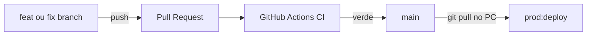

# Quiver Tap — Deploy e segregacao Dev/Prod

## Ambientes

| | Desenvolvimento | Producao |
|---|-----------------|----------|
| API | `:3002` | `:3001` |
| Frontend | Vite `:5202` | Build estatico via API `:3001` |
| Banco | `cervejaria_dev` (:5434) | `cervejaria` (:5432) |
| Usuario PG | `cervejaria_dev` | `cervejaria_prod` |
| Uploads | `backend/uploads-dev` | `backend/uploads-prod` (fora de `prod-artifacts`; ver `Set-ProdUploadsEnv`) |
| Env | `backend/.env.development` | `backend/.env.production` |
| Build UI (local/CI) | `frontend/dist` | — |
| Build UI (publicado) | — | `deploy/prod-artifacts/frontend` |
| Build API (local/CI) | `backend/dist` | — |
| Build API (publicado) | — | `deploy/prod-artifacts/backend/dist` |
| URL local | http://localhost:5202 | https://tap.quivercloud.com.br |
| URL internet (dev) | https://tapdev.quivercloud.com.br | — |

### Dev pela internet

O ambiente de desenvolvimento também pode ser acessado em **https://tapdev.quivercloud.com.br** (Cloudflare Tunnel → Vite `:5202`).

**Importante:** o serviço Windows `Cloudflared` neste PC roda com `tunnel run --token` (config **remota** no painel Zero Trust). O arquivo `%USERPROFILE%\.cloudflared\config.yml` **nao** e aplicado automaticamente pelo servico — ingress novo exige cadastro no painel (ou migrar o conector para config local).

1. **Painel Cloudflare** → Zero Trust → Networks → Connectors → Tunnels → **quiver** → Configure → **Public Hostname** → Add:
   - Hostname: `tapdev.quivercloud.com.br`
   - Service: `http://localhost:5202`
2. **DNS** (se ainda nao existir): `cloudflared tunnel route dns quiver tapdev.quivercloud.com.br`
3. **SSL:** `tapdev.quivercloud.com.br` e coberto pelo certificado `*.quivercloud.com.br`.
4. Em `backend/.env.development`:
   ```env
   CORS_ORIGIN="http://localhost:5202,https://tapdev.quivercloud.com.br"
   APP_URL="https://tapdev.quivercloud.com.br"
   ```
5. Reinicie o dev: `npm run dev:stop` → `npm run dev:start`.

O Vite faz proxy de `/api`, `/uploads` e WebSocket para a API dev (`:3002`). **Nao** aponte o tunel dev para `:3001` (prod).

**Sintomas se faltar ingress remoto:** DNS resolve, HTTP 502, HTTPS falha handshake.

### Isolamento de artefatos

- `npm run ci:frontend` / `vite build` escrevem em **`frontend/dist`** — nao alteram prod.
- Somente **`npm run prod:deploy`** publica em **`deploy/prod-artifacts/`** (manifest em `manifest.json`).
- A API prod usa `FRONTEND_DIST` apontando para `prod-artifacts/frontend`.
- O entry da API e `prod-artifacts/backend/dist/index.js`; `node_modules` e um junction para `backend/node_modules` (resolucao ESM do Node).
- Verificar alinhamento: `npm run prod:verify`.

## Politica no mesmo PC

- **Producao** roda 24/7 via daemon oculto + tarefas `QuiverTap-AtLogon` / `QuiverTap-AtStartup`.
- **Desenvolvimento** so via supervisor Cursor ou `npm run dev:start`.
- Evite rodar dev e prod sob carga pesada ao mesmo tempo (RAM).

### Tela piscando?

**Causa comum:** supervisor dev reiniciando Vite a cada 30s (frontend `:5202` instavel).

```powershell
npm run dev:stop
```

Se nao estiver codando, mantenha dev parado. Para corrigir autostart prod:

```powershell
npm.cmd run prod:fix-flickering
```

(Use `npm.cmd`, nao `npm`, se o PowerShell bloquear scripts.)

Isso remove a tarefa antiga `QuiverTap-Watchdog` e usa um unico processo oculto para monitorar prod.

## Deploy de producao (caminho principal)

```powershell
npm run prod:deploy
```

O script pede confirmacao digitando `DEPLOY`, depois executa:

1. Backup do banco `cervejaria`
2. Build frontend em staging (`build:prod`) e backend (`backend/dist`)
3. Publicacao atomica em `deploy/prod-artifacts/` + `manifest.json`
4. Migrations em producao (`db:migrate:prod`)
5. Restart da API (`:3001`) — tunnel Cloudflare permanece ativo
6. Smoke test (`/api/ready`, `/`) + `prod:status`

### Flags uteis

```powershell
npm run prod:deploy -- -DryRun              # so mostra o plano
npm run prod:deploy -- -Confirmed           # pula prompt (apos OK no chat com agente)
npm run prod:deploy -- -FrontendOnly        # so UI
npm run prod:deploy -- -BackendOnly         # so API
npm run prod:deploy -- -SkipMigrate         # sem migration Prisma
npm run prod:deploy -- -SkipBackup          # emergencia (evitar)
```

### Outros comandos prod

| Comando | Uso |
|---------|-----|
| `npm run prod:status` | Health check |
| `npm run prod:verify` | Manifest vs bundle servido |
| `npm run prod:restart` | Reinicia API sem rebuild |
| `npm run prod:backup` | Backup manual |
| `npm run prod:ensure` | Watchdog — nao aplica codigo novo |

## Checklist manual (avancado)

Se precisar rodar passos isolados (nao recomendado — use `prod:deploy`):

1. `npm run prod:backup`
2. `npm run prod:deploy -- -Confirmed` (publica artefatos + restart)

Builds locais (`ci:frontend`, `npm run build`) **nao** publicam prod.

## Rollback

- API nao sobe: reverter codigo/env e `npm run prod:deploy` ou `npm run prod:restart`
- Banco: restaurar `deploy/backups/backup-prod-*.sql` via `psql`

## Postgres — dois containers

| | Producao | Desenvolvimento |
|---|----------|-----------------|
| Container | `cervejaria-db` | `cervejaria-db-dev` |
| Porta | `5432` | `5434` |
| Volume | `postgres_data` | `postgres_dev_data` |

Comandos:

```powershell
npm run db:up          # sobe prod + dev
npm run db:up:prod     # sobe so prod
npm run db:up:dev      # sobe so dev
npm run db:down        # para so dev (prod intocavel)
npm run db:down:all    # para tudo (emergencia)
npm run db:cleanup-dev-from-prod  # remove vestigios de dev do container prod
```

Variaveis externas exigidas para criar ou recriar os containers:

- `POSTGRES_PROD_PASSWORD` para `postgres` (producao);
- `POSTGRES_DEV_PASSWORD` para `postgres-dev` (desenvolvimento);
- `npm run db:up` exige ambas.

## Setup inicial (usuarios Postgres segregados)

```powershell
npm run db:create-env-users
```

Cria `cervejaria_prod` e `cervejaria_dev` com acesso apenas ao seu banco.

## Cloudflare Tunnel

Producao serve frontend + API em **`:3001`**. Ingress deve apontar para:

```yaml
service: http://localhost:3001
```

## Skills Cursor (agente)

- Git + PR: `.cursor/skills/quiver-tap-git-workflow/SKILL.md`
- Deploy: `.cursor/skills/quiver-tap-deploy/SKILL.md`
- Dev vs prod: `.cursor/skills/quiver-tap-environments/SKILL.md`

Peça no chat: **"deploy em prod"** — o agente guia com confirmacao antes de executar.

## Painel Ops (local, separado da app)

Servico **independente** em **http://127.0.0.1:3099** — continua no ar mesmo se a app prod (`:3001`) cair.

| Comando | Uso |
|---------|-----|
| `npm run ops:start` | Sobe o painel |
| `npm run ops:open` | Abre no navegador |

**Primeira vez:** copie `ops-panel/.env.example` → `ops-panel/.env` e defina `OPS_PANEL_TOKEN`.

O painel mostra status prod/dev, links GitHub, logs e botoes (dev start/stop, restart API, deploy).

- **Nao expor** via Cloudflare — apenas localhost
- Sobe automaticamente junto com o watchdog (`QuiverTap-AtLogon`)
- Acoes destrutivas exigem token + confirmacao `DEPLOY`

## Fluxo Git + GitHub

Repo: `https://github.com/filipedsn/cervejaria.git` — branch **`main`** = linha de producao.



### Passo a passo

| # | Acao |
|---|------|
| 1 | `git checkout main` → `git pull origin main` |
| 2 | `git checkout -b feat/nome-curto` |
| 3 | Desenvolver e testar em http://localhost:5202 |
| 4 | `git commit` + `git push -u origin feat/nome-curto` |
| 5 | Abrir PR **→ main** no GitHub |
| 6 | Esperar CI verde (`frontend`, `backend-validate`) |
| 7 | **Squash and merge** |
| 8 | No PC: `git pull origin main` → `npm.cmd run prod:deploy` |

### Branches

- `feat/` — funcionalidade
- `fix/` — correcao
- `chore/` — CI, scripts, docs

### CI

GitHub Actions em [`.github/workflows/ci.yml`](../.github/workflows/ci.yml):

| Job | Bloqueia merge? |
|-----|-----------------|
| `frontend` | Sim — `build:deploy` |
| `backend-validate` | Sim — `prisma validate` |
| `backend-build` | Nao (tsc ainda com erros pre-existentes) |

Rodar localmente antes do PR:

```powershell
npm run ci:frontend
npm run ci:validate
```

### GitHub (recomendado apos primeiro push do workflow)

**Settings → Branches → main**: exigir status checks `frontend` e `backend-validate` (sem reviewer obrigatorio — solo dev).
