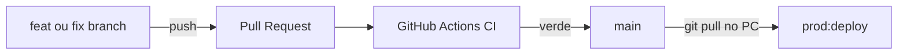

# Quiver Tap — Deploy e segregacao Dev/Prod

## Ambientes

| | Desenvolvimento | Producao |
|---|-----------------|----------|
| API | `:3002` | `:3001` |
| Frontend | Vite `:5202` | Build estatico via API `:3001` |
| Banco | `cervejaria_dev` | `cervejaria` |
| Usuario PG | `cervejaria_dev` | `cervejaria_prod` |
| Uploads | `backend/uploads-dev` | `backend/uploads-prod` |
| Env | `backend/.env.development` | `backend/.env.production` |

## Politica no mesmo PC

- **Producao** roda 24/7 via daemon oculto + tarefas `QuiverTap-AtLogon` / `QuiverTap-AtStartup`.
- **Desenvolvimento** so via supervisor Cursor ou `npm run dev:start`.
- Evite rodar dev e prod sob carga pesada ao mesmo tempo (RAM).

### Tela piscando?

**Causa comum:** supervisor dev reiniciando Vite a cada 30s (frontend `:5202` instavel).

```powershell
npm run dev:stop
```

Se nao estiver codando, mantenha dev parado. Para corrigir autostart prod:

```powershell
npm.cmd run prod:fix-flickering
```

(Use `npm.cmd`, nao `npm`, se o PowerShell bloquear scripts.)

Isso remove a tarefa antiga `QuiverTap-Watchdog` e usa um unico processo oculto para monitorar prod.

## Deploy de producao (caminho principal)

```powershell
npm run prod:deploy
```

O script pede confirmacao digitando `DEPLOY`, depois executa:

1. Backup do banco `cervejaria`
2. Build frontend (`build:deploy`) e backend (`tsc`)
3. Migrations em producao (`db:migrate:prod`)
4. Restart da API (`:3001`) — tunnel Cloudflare permanece ativo
5. Smoke test (`/api/ready`, `/`) + `prod:status`

### Flags uteis

```powershell
npm run prod:deploy -- -DryRun              # so mostra o plano
npm run prod:deploy -- -Confirmed           # pula prompt (apos OK no chat com agente)
npm run prod:deploy -- -FrontendOnly        # so UI
npm run prod:deploy -- -BackendOnly         # so API
npm run prod:deploy -- -SkipMigrate         # sem migration Prisma
npm run prod:deploy -- -SkipBackup          # emergencia (evitar)
```

### Outros comandos prod

| Comando | Uso |
|---------|-----|
| `npm run prod:status` | Health check |
| `npm run prod:restart` | Reinicia API sem rebuild |
| `npm run prod:backup` | Backup manual |
| `npm run prod:ensure` | Watchdog — nao aplica codigo novo |

## Checklist manual (avancado)

Se precisar rodar passos isolados:

1. `npm run prod:backup`
2. `npm run build:deploy --prefix frontend`
3. `npm run build --prefix backend`
4. `npm run db:migrate:prod`
5. `npm run prod:restart`
6. Smoke: `GET http://127.0.0.1:3001/api/ready` e login em https://tap.quivercloud.com.br

## Rollback

- API nao sobe: reverter codigo/env e `npm run prod:deploy` ou `npm run prod:restart`
- Banco: restaurar `deploy/backups/backup-prod-*.sql` via `psql`

## Setup inicial (usuarios Postgres segregados)

```powershell
npm run db:create-env-users
```

Cria `cervejaria_prod` e `cervejaria_dev` com acesso apenas ao seu banco.

## Cloudflare Tunnel

Producao serve frontend + API em **`:3001`**. Ingress deve apontar para:

```yaml
service: http://localhost:3001
```

## Skills Cursor (agente)

- Git + PR: `.cursor/skills/quiver-tap-git-workflow/SKILL.md`
- Deploy: `.cursor/skills/quiver-tap-deploy/SKILL.md`
- Dev vs prod: `.cursor/skills/quiver-tap-environments/SKILL.md`

Peça no chat: **"deploy em prod"** — o agente guia com confirmacao antes de executar.

## Painel Ops (local, separado da app)

Servico **independente** em **http://127.0.0.1:3099** — continua no ar mesmo se a app prod (`:3001`) cair.

| Comando | Uso |
|---------|-----|
| `npm run ops:start` | Sobe o painel |
| `npm run ops:open` | Abre no navegador |

**Primeira vez:** copie `ops-panel/.env.example` → `ops-panel/.env` e defina `OPS_PANEL_TOKEN`.

O painel mostra status prod/dev, links GitHub, logs e botoes (dev start/stop, restart API, deploy).

- **Nao expor** via Cloudflare — apenas localhost
- Sobe automaticamente junto com o watchdog (`QuiverTap-AtLogon`)
- Acoes destrutivas exigem token + confirmacao `DEPLOY`

## Fluxo Git + GitHub

Repo: `https://github.com/filipedsn/cervejaria.git` — branch **`main`** = linha de producao.



### Passo a passo

| # | Acao |
|---|------|
| 1 | `git checkout main` → `git pull origin main` |
| 2 | `git checkout -b feat/nome-curto` |
| 3 | Desenvolver e testar em http://localhost:5202 |
| 4 | `git commit` + `git push -u origin feat/nome-curto` |
| 5 | Abrir PR **→ main** no GitHub |
| 6 | Esperar CI verde (`frontend`, `backend-validate`) |
| 7 | **Squash and merge** |
| 8 | No PC: `git pull origin main` → `npm.cmd run prod:deploy` |

### Branches

- `feat/` — funcionalidade
- `fix/` — correcao
- `chore/` — CI, scripts, docs

### CI

GitHub Actions em [`.github/workflows/ci.yml`](../.github/workflows/ci.yml):

| Job | Bloqueia merge? |
|-----|-----------------|
| `frontend` | Sim — `build:deploy` |
| `backend-validate` | Sim — `prisma validate` |
| `backend-build` | Nao (tsc ainda com erros pre-existentes) |

Rodar localmente antes do PR:

```powershell
npm run ci:frontend
npm run ci:validate
```

### GitHub (recomendado apos primeiro push do workflow)

**Settings → Branches → main**: exigir status checks `frontend` e `backend-validate` (sem reviewer obrigatorio — solo dev).
