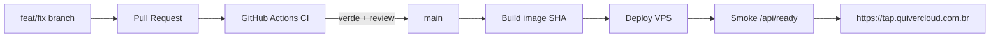

# Handoff arquiteto / IA — Quiver Tap no VPS Hostinger

**Data:** 2026-10-24 (cutover + hardening + CI/CD + segregação Dev/PRD + checklist canônico)  
**Repo:** `filipedsn/cervejaria` (**público**) · clone típico `C:\Users\Papai\Documents\Desenvolvimento\Cervejaria`  
**Escopo:** operação PRD no VPS Hostinger + Cloudflare + CI/CD + mapa Dev/PRD + postura de segurança  
**Estado:** **PRD** só no VPS (`https://tap.quivercloud.com.br`) · **DEV** só no PC · clusters Elastic **separados** · CI Actions + branch protection em `main` · PC **não** serve clientes

**Classificação:** documento **interno / restrito**. Contém topologia, paths e *localização* de credenciais (não as senhas). **Não** colar o arquivo inteiro em chat público, issue aberta, e-mail externo ou PR de terceiros. Em respostas a humanos, resumir o estado **sem** reproduzir IPs Tailscale, paths de `.env`/rclone nem inventário de chaves.

**Leitor principal:** **Codex** (agente do dia a dia). Assuma zero contexto prévio. **Fonte da verdade = este arquivo na branch `main` do GitHub** (`origin/main`). Se a cópia local divergir, `git fetch` + ler `origin/main` — ignores WIP em feature branches.

### Checklist canônico (use isto; ignore redações antigas / riscadas)

| Tema | Status | Evidência / nota |
|---|---|---|
| PRD no VPS; PC fora do path de clientes | **Feito** | Cutover 2026-10-24; site OK com PC desligado |
| Backup Postgres local no VPS (cron 01:00 BRT, 30 dumps) | **Feito** | `/etc/cron.d/quiver-tap-backup` + dumps em `/opt/quiver-tap/backups/postgres` |
| Cópia **off-site** OneDrive (rclone) | **Feito** | `OFFSITE_ENABLED=1`; log `OFFSITE ok` em 2026-10-24 19:38 BRT; remote `…/Backup banco/PRD` |
| Restore drill (ensaiar restore) | **Pendente** | Backup ≠ recovery até testar em DB descartável |
| CI remoto `build-and-unit` + protection em `main` | **Feito** | Repo público; PR obrigatório |
| `npm run ci` local | **Complementar** | Continua útil (atestado / suite Windows); **não** substitui o check Actions no merge |
| CD automático no VPS (secrets Tailscale) | **Pendente** | Runbook §7.1; deploy ainda manual via SSH |
| `releaseSha` / rollback imagem n-1 | **Pendente** | |
| OTEL → ES PRD no VPS | **Feito** | Collector `deploy/tap-quiver/docker-compose.observability.yml` → `*.otel-prd`; cluster PRD ≠ DEV |
| Equalizar API DEV em Docker | **Pendente** | Hoje API DEV = Node nativo |

**Não é pendência:** “configurar backup OneDrive do Postgres”. Isso já roda. Quem listar off-site como lacuna está lendo trecho riscado, mensagem velha ou confusão com *restore*.

---

## 0. Como roda agora (verdade operacional)

| Camada | DEV (PC Windows) | PRD (VPS Hostinger) |
|---|---|---|
| **Onde vive** | Máquina do Filipe | VPS `2093568` · `200.141.28.26` / Tailscale `100.120.170.89` |
| **Aplicação** | Node **nativo** (scripts locais) — ver §0.1 sobre equalizar em Docker | Docker `cervejaria-api` (`network_mode: host`) |
| **Banco Postgres** | Docker local (`cervejaria-db` / `cervejaria-db-dev` em `docker-compose.yml`) | Docker `cervejaria-db` · só `127.0.0.1:5432` |
| **Elasticsearch / Kibana** | **Cluster local** (Docker no PC) | **Cluster aparte no VPS** · `127.0.0.1` + Tailscale |
| **Ingress público** | Nenhum (não é origem de clientes) | Cloudflare **proxy** → nginx `:443` → app `:3001` |
| **URL canônica** | localhost / portas de dev | `https://tap.quivercloud.com.br` |
| **Uploads** | pastas locais do repo | Volume `vps_uploads_data` |
| **SSH admin** | — | **Somente Tailscale** · porta 22 **fechada** na internet |

**Prova de cutover:** com o PC desligado, `https://tap.quivercloud.com.br` continuou respondendo.  
**Regra de ouro:** PC desligado **não pode** afetar PRD; mexer em DEV **não pode** escrever no Elastic/Postgres/app do VPS.

---

## 0.1 Ambientes Dev vs PRD — segregação física (mastigado para o Codex)

### Por que isso existe

Antes o notebook era SPOF de produção (app + tunnel). Agora há **dois mundos físicos**:

| Mundo | Máquina | Papel |
|---|---|---|
| **DEV** | PC Windows do Filipe | Codar, testar, OTEL de desenvolvimento, banco/ES de brinquedo |
| **PRD** | VPS Hostinger | Único lugar que atende cliente em `tap.quivercloud.com.br` |

Não é “o mesmo stack com `NODE_ENV` diferente”. São **hosts diferentes**, **discos diferentes**, **clusters Elastic diferentes**, **credenciais diferentes**. Se o Codex misturar, estraga telemetria, dados ou o site no ar.

### Mapa lado a lado (cole na retina)

| Peça | DEV (local) | PRD (VPS) | Misturar? |
|---|---|---|---|
| **App Quiver Tap** | Processo Node no PC (hoje) | Container `cervejaria-api` | **NUNCA** apontar o binário local para URL/DB/ES de PRD “só pra testar” |
| **Postgres** | Compose raiz `docker-compose.yml` → `cervejaria-db` (`:5432`) e/ou `cervejaria-db-dev` (`:5434`, DB `cervejaria_dev`) | Container `cervejaria-db` no VPS, só loopback | **NUNCA** `pg_dump`/`restore` DEV→PRD sem pedido explícito + backup |
| **Elasticsearch** | Cluster Docker **no PC** (rede típica `elasticsearch-kibana_elastic`, `:9200` local) | Cluster Docker **no VPS** em `/docker/elasticsearch-kibana/` · `127.0.0.1:9200` · Tailscale `100.120.170.89:9200` | **NUNCA** — dois clusters; índices `*.otel-dev` ≠ `*.otel-prd` |
| **Kibana** | Local (PC) | VPS `:5601` via Tailscale | Idem |
| **OTEL / EDOT Collector** | `docker-compose.observability.yml` → `quiver-edot-collector` · OTLP `127.0.0.1:4317/4318` · **só DEV** (`filter/dev-only`) | `deploy/tap-quiver/docker-compose.observability.yml` → `quiver-edot-collector-prd` · OTLP loopback · `filter/prd-only` → `*.otel-prd` | App DEV → ES **local**; app PRD → ES **VPS** |
| **Backups DB** | Não são a retenção oficial | Cron VPS 01:00 BRT + rclone OneDrive `…/Backup banco/PRD` | Offsite PRD ≠ cópia do notebook |
| **DNS / Cloudflare** | Não publica o Tap | `tap` → IP do VPS | Não recolocar tunnel do Tap no PC |
| **Secrets** | `.env` / env local (fora do git) | `/opt/quiver-tap/deploy/tap-quiver/.env.staging` no VPS | Não copiar secret de PRD para repo nem para log |

### Clusters Elastic — regra explícita (Codex erra aqui se não ler)

```
DEV  →  Elasticsearch no PC     →  data streams / índices de desenvolvimento (ex.: *.otel-dev)
PRD  →  Elasticsearch no VPS    →  telemetria/ops de produção (ex.: *.otel-prd) quando ligado
```

1. **São clusters distintos.** Mesmo que a versão do ES seja a mesma (ex. 8.17), os dados **não** são compartilhados.  
2. App em DEV deve usar `ELASTICSEARCH_URL` (ou equivalente) apontando para **127.0.0.1:9200 do PC**, nunca para `100.120.170.89`.  
3. App em PRD (container no VPS, host network) fala com **127.0.0.1:9200 do VPS**.  
4. Abrir Kibana PRD pelo browser do PC (`http://100.120.170.89:5601` com Tailscale) é **só leitura/ops** — não significa que o app DEV possa indexar lá.  
5. Scripts em `scripts/observability/` e inventários TAP-96: se o alvo não disser “VPS/PRD”, assuma **cluster local DEV**. Mutação em PRD exige confirmação humana explícita.  
6. Histórico: quando DEV e “prod” compartilhavam um único ES no PC, havia pressão de shards/`*.otel-dev` misturado com `*.otel-prd`. **Essa era uma dívida; a segregação física no VPS existe para acabar com isso.** Não recriar o monólito.

### Assimetria de arquitetura (DEV ainda não é igual ao PRD)

| | DEV hoje | PRD hoje | Alvo |
|---|---|---|---|
| App | Node nativo no Windows | Docker Compose (`deploy/tap-quiver/`) | **Equalizar:** DEV também subir a API via Docker (mesmo Dockerfile/compose de espírito), para “o que roda no PC ≈ o que roda no VPS” |
| Postgres | Já Docker | Docker | OK (manter DBs **separados**) |
| Elastic | Já Docker local | Docker no VPS | OK (clusters **separados**) |

**Pendência de produto/engenharia:** containerizar o app de DEV (compose de desenvolvimento reutilizando `deploy/tap-quiver/Dockerfile` ou um `docker-compose.dev.yml`). Até lá, Codex **não** inventa que DEV “já é Docker na API” — só DB/observability são.

### Como o Codex decide “em qual ambiente estou?”

| Sinal | DEV | PRD |
|---|---|---|
| Hostname / SSH | Sessão local no Windows | `ssh` → `100.120.170.89` / `quiver-vps` |
| URL no browser | `http://localhost:…` | `https://tap.quivercloud.com.br` |
| `docker ps` no PC | `cervejaria-db`, `cervejaria-db-dev`, ES local, talvez `quiver-edot-collector` | Não é PRD |
| `docker ps` no VPS | — | `cervejaria-api`, `cervejaria-db`, stack em `/docker/elasticsearch-kibana/` |
| Path de código | `C:\Users\Papai\Documents\Desenvolvimento\Cervejaria` | `/opt/quiver-tap` |
| Env file | locais / `backend` env de development | `.env.staging` no compose do VPS |

Na dúvida: **pergunte ao humano** antes de apontar qualquer URL de Elastic, Postgres ou `APP_URL` para o outro mundo.

### Proibições absolutas (imprimir na testa do Codex)

1. **Não** apontar app DEV para Postgres ou Elastic do VPS.  
2. **Não** apontar app PRD para serviços do PC (PC pode estar desligado; PRD quebra).  
3. **Não** rodar migrate/seed/destructive em PRD “porque passou em DEV”.  
4. **Não** indexar telemetria DEV no cluster PRD (nem o contrário).  
5. **Não** reativar Cloudflare Tunnel do `tap` no PC.  
6. **Não** reabrir `:22` / `:3001` / `:9200` / `:5601` na internet.  
7. **Não** assumir que equalizar DEV em Docker já foi feito — está na lista de evolução.  
8. Deploy PRD: só via processo do §7.1 + confirmação humana (`deploy=true`).

### Prompt curto (Copiar para o Codex)

```
Leia docs/handoff-vps-hostinger-arquiteto.md seções 0, 0.1 e 7.1.
DEV = PC (app Node local hoje; DB/ES Docker local). PRD = só VPS.
Elastic DEV e Elastic PRD são clusters físicos diferentes — nunca cruzar.
Não reabra portas; não use tunnel do tap no PC; deploy=true só com minha confirmação.
Se for equalizar DEV em Docker, proponha PR pequeno (compose dev) sem tocar PRD.
```

---

## 1. Inventário de infraestrutura

| Item | Valor |
|---|---|
| App | Quiver Tap (Fastify + frontend estático no mesmo processo) |
| VPS | Hostinger KVM 4 · `srv2093568.hstgr.cloud` · `200.141.28.26` · VM id `2093568` |
| SO | Ubuntu 26.04 LTS · 4 vCPU · 16 GB · 200 GB |
| Gestão | Hostinger MCP/API + SSH (via Tailscale) + Cloudflare MCP |
| Conta Cloudflare | `filipedsn@gmail.com` · zona `quivercloud.com.br` · plano Free |
| Apex site | `quivercloud.com.br` → A `2.57.91.91` (**outro** host, não o Tap) |
| Tailscale | Free/Personal · PC `filipe` `100.71.18.99` · VPS `srv2093568` `100.120.170.89` |

### 1.1 Projetos Docker no VPS (renomeados)

| Nome no Docker Manager | Path / papel |
|---|---|
| **Banco de Dados** | Postgres `cervejaria-db` · `127.0.0.1:5432` |
| **Tap Quiver** | App `cervejaria-api` · código em `/opt/quiver-tap` · compose `deploy/tap-quiver/` |
| **elasticsearch-kibana** | ES `:9200` + Kibana `:5601` · bind **`127.0.0.1`** + proxy Tailscale Serve |

### 1.2 Firewall Hostinger (`quiver-vps`, id `385624`)

| Porta | Estado |
|---|---|
| 22 SSH | **Fechada** (acesso só Tailscale) |
| 80 HTTP | Aberta (redirect → HTTPS) |
| 443 HTTPS | Aberta (nginx → app) |
| 3001 | **Fechada** na internet |
| 9200 / 5601 | **Fechadas** (localhost + Tailscale) |
| ICMP | Aberta |

---

## 2. Cloudflare — configuração atual

### 2.1 SSL
- Modo: **Full (strict)**
- Always HTTPS: **on**
- Origem Tap: certificado **Cloudflare Origin CA** em `/etc/ssl/cloudflare/tap.{pem,key}` (nginx)

### 2.2 DNS (A/CNAME relevantes)

| Nome | Tipo | Destino | Proxy |
|---|---|---|---|
| `quivercloud.com.br` | A | `2.57.91.91` | laranja |
| `www.quivercloud.com.br` | CNAME | `quivercloud.com.br` | laranja |
| **`tap.quivercloud.com.br`** | **A** | **`200.141.28.26` (VPS)** | **laranja** |
| `hostingermail-a/b/c._domainkey` | CNAME | Hostinger DKIM | **cinza** (e-mail) |

**Removidos nesta sessão (DNS + tunnel):**  
`app`, `daybyday`, `kibana`, `quiver`, `plane`, `tapdev`.

### 2.3 Tunnel Cloudflare `quiver`
- ID: `edfe96ac-3ef6-4a44-a150-765b19777f97`
- **`tap` saiu do ingress** (não usa mais tunnel)
- Ingress restante: apenas **catch-all → 404**
- Serviço Windows `Cloudflared` no PC pode existir, mas **não é necessário para o Tap**
- **Não** usar tunnel para produção do Tap daqui pra frente

### 2.4 Fluxo HTTP atual

```
Cliente → Cloudflare (HTTPS, WAF Free) → VPS :443 (nginx + Origin CA)
       → 127.0.0.1:3001 (cervejaria-api)
```

Ops (ES/Kibana):

```
PC (Tailscale) → 100.120.170.89:9200 / :5601
              → tailscale serve → 127.0.0.1 (Docker)
```

---

## 3. O que foi feito (cronológico resumido)

### 3.1 Staging no VPS
- Auth Hostinger MCP; VPS acessível.
- Banco: dump/restore do PC **sem alterar** Docker/dados locais; 38 tabelas validadas.
- App Docker: `deploy/tap-quiver/` (Dockerfile, compose, `.env.staging`).
- Validação inicial por `http://200.141.28.26:3001` (DNS ainda intacto).

### 3.2 Bugs corrigidos no caminho
1. **`Invalid PDV activation destination`** — `PDV_CANONICAL_ALL` exige DB em `127.0.0.1:5432/cervejaria` → `network_mode: host`.
2. **Login volta ao formulário** — cookie `Secure` em HTTP → `authCookiesShouldBeSecure()` baseado em `APP_URL` https.
3. **Logos faltando** — sync `uploads-prod` → volume `vps_uploads_data`.

### 3.3 Cutover de produção (concluído)
- nginx no VPS (80→443, proxy para `:3001`).
- Origin CA Cloudflare + SSL **Full Strict**.
- DNS `tap` **A → 200.141.28.26** (proxy laranja); removido CNAME do tunnel.
- `APP_URL` / `CORS_ORIGIN` = `https://tap.quivercloud.com.br`.
- Porta `3001` removida do firewall público.
- Watchdog local: tarefas **QuiverTap-AtLogon** e **QuiverTap-AtStartup** excluídas.
- Cloudflared de prod do Tap desnecessário; teste com **PC desligado** OK.

### 3.4 Elasticsearch / Kibana + Tailscale
- Stack vazia criada, depois **bind localhost**.
- Tailscale no PC + VPS; `tailscale serve --tcp` para `:9200` e `:5601` (só tailnet).
- App no VPS alcança ES em `http://127.0.0.1:9200` (host network).
- Script auxiliar local (opcional): `deploy/tap-quiver/tunnel-elastic.ps1` (SSH tunnel) — **preferir Tailscale**.

### 3.5 Hardening de segurança (concluído nesta sessão)
| Ação | Detalhe |
|---|---|
| SSH | Porta 22 **fechada** na internet; admin via Tailscale `100.120.170.89` |
| Segredos | Rotacionados no VPS: `JWT_SECRET`, senha Postgres `cervejaria`, senha `elastic` |
| Tunnel residual | Removidos DNS/ingress de hosts locais não usados |
| Cookies / HTTPS | `APP_URL` https → cookies Secure + HSTS coerentes |

**Onde estão os segredos:** apenas no VPS  
`/opt/quiver-tap/deploy/tap-quiver/.env.staging`  
(e espelho ES em `/docker/elasticsearch-kibana/.env` se aplicável).  
**Não** versionar. Sessões de usuário foram invalidadas na rotação do JWT (re-login necessário).

---

## 4. Postura de segurança — auditoria (2026-10-24, 2ª rodada)

### 4.1 Já ok / corrigido nesta rodada

| Item | Estado |
|---|---|
| Cloudflare SSL Full Strict + Always HTTPS | ok |
| Min TLS Cloudflare | **subido para 1.2** (+ TLS 1.3 on) |
| HSTS na borda Cloudflare | **habilitado** (1 ano, includeSubDomains) |
| Firewall Hostinger | só 80/443/ICMP · 22/3001/5432/9200/5601 fechados na internet |
| API `:3001` | **bind `127.0.0.1`** (só nginx local alcança) |
| `.env.staging` permissões | **600** (antes 666 — corrigido) |
| SSH senha | **PasswordAuthentication no** · root só com chave |
| SSH público | timeout (fechado no firewall) |
| JWT / APP_URL https | ok após rotação |
| ES/Kibana | localhost + Tailscale Serve |
| Backup diário 01:00 BRT · 30 dumps **locais** | ok |
| Off-site OneDrive via rclone (`OFFSITE_ENABLED=1`) | **ok** (comprovado 2026-10-24: log `OFFSITE ok`) |
| Headers app (Helmet) | HSTS/XFO/nosniff presentes na origem |

### 4.2 Riscos / itens ainda em aberto

| Prioridade | Item | Por quê | Ação sugerida |
|---|---|---|---|
| ~~Alta~~ | ~~Cloudflared no PC~~ | ~~Resolvido 2026-10-24~~ | Serviço **desinstalado**; tunnel down |
| ~~Alta~~ | ~~Chaves SSH~~ | ~~Resolvido / intencional~~ | (1) humana GitHub (2) agente Cursor `~/.ssh/quiver-vps/cursor-agent` · alias `ssh quiver-vps` |
| ~~Média~~ | ~~Backups só no disco do VPS / sem off-site~~ | ~~Resolvido 2026-10-24~~ | rclone → OneDrive `…/Backup banco/PRD` no mesmo cron; **não** relistar como pendência |
| Média | **Restore nunca ensaiado** | Ter dump (local + OneDrive) ≠ saber restaurar | Restore drill em DB **descartável** (única lacuna de backup) |
| ~~Média~~ | ~~ES container `unhealthy`~~ | ~~Resolvido~~ | Healthcheck usava senha antiga no env do container; recreate alinhou `ELASTIC_PASSWORD` → **healthy** / cluster **green** |
| ~~Média~~ | ~~QuiverTap-ProdBackup no PC~~ | ~~Resolvido~~ | Tarefa excluída pelo usuário (2026-10-24) |
| Baixa | Secret store | `.env` em arquivo no disco | Migrar para vault/Hostinger secrets no CD |
| Baixa | WAF rules custom | Plano Free = proteção genérica | Regras se aparecer abuso/bot |
| Baixa | Apex `2.57.91.91` | Fora do Tap | Revisar à parte |
| Info | DKIM cinza | Só e-mail | Manter |

DKIM cinza (`hostingermail-*._domainkey`) é **só e-mail** (envio/autenticidade). Recebimento depende dos MX Hostinger — intactos.

---

## 5. Diagnóstico de maturidade CI/CD

### 5.1 Modelo de qualidade (dois gates — não são rivais)

| Peça | Onde | Papel **atual** |
|---|---|---|
| **CI remoto (obrigatório no merge)** | `.github/workflows/ci.yml` → job `build-and-unit` | Branch protection em `main` exige este check verde. **Supersede** a decisão antiga TAP-116 (“Actions desligado”) |
| **CI local (complementar)** | `npm run ci` | Suite mais larga no Windows (Pester, ops-panel, etc.) + atestado para tooling legado. **Não** substitui o Actions |
| Atestado | `deploy/.local-ci-attestation.json` | Ainda usado pelo `deploy.ps1` Windows **legado** |
| Deploy Windows | `scripts/prod/deploy.ps1` / `deploy.cmd` | **Legado** — **não** publica mais o Tap público (PRD = VPS) |
| Fluxo Git | `CONTRIBUTING.md` | Deve refletir Actions on; se o clone local disser “Actions desligado”, está **desatualizado** — confiar em `origin/main` |

**Para o Codex:** não diga que “o projeto decidiu manter só CI local”. A decisão vigente é **híbrida**: Actions obriga merge; `npm run ci` continua recomendado no dia a dia / legado.

### 5.2 Lacunas de plataforma (restantes)

| Lacuna | Evidência |
|---|---|
| CD no VPS ainda semi-manual | `deploy-vps.yml` faz `docker build` por SHA; deploy SSH via Tailscale **opcional** (faltam secrets `TS_*` / `VPS_SSH_KEY`) |
| Sem push para registry | build no runner (`push: false`); tag `quiver-tap-api:<SHA>` |
| Restore drill | dumps locais + OneDrive **OK**; **restore** ainda não ensaiado |
| OTEL no VPS | ligado: EDOT na API + collector PRD → `*.otel-prd` |

**Não listar aqui:** off-site OneDrive do Postgres (já feito — ver checklist canônico no topo).

### 5.3 Notas (1–5) — atualizadas pós-CI remoto

| Dimensão | Antes | Agora | Comentário |
|---|---|---|---|
| Qualidade / gates locais | 4 | **4** | Intactos (`npm run ci` + atestado) |
| Processo Git / PR | 3 | **4** | PR obrigatório + check `build-and-unit` em `main` |
| CI remoto | veio 1 | **4** | Actions Free; Prisma com `working-directory: backend` + `npx prisma generate` |
| CD / promoção a prod | 2 | **3** | Workflow de build SHA pronto; promote Tailscale ainda sem secrets |
| Infra portable / runtime | 2 | **4** | App+DB Docker no VPS = runtime oficial |
| DR / multi-env | 2 | **4** | Backup cron 01:00 BRT + offsite OneDrive; falta restore drill |

**Síntese:** o SPOF do notebook para **servir** produção foi eliminado. CI remoto e proteção de `main` estão ativos. O SPOF restante é **como** se publica no VPS (deploy ainda depende de secrets Tailscale no Actions ou SSH manual).

### 5.4 Definição de pronto (plataforma ~4)

- [x] `tap.quivercloud.com.br` no VPS com HTTPS; PC não serve prod  
- [x] `:3001` não pública; SSH restrito  
- [x] Todo PR em `main` exige CI verde no GitHub (`build-and-unit`)  
- [ ] Todo deploy de prod vem de imagem tagueada com SHA de `main` (build SHA ok; promote automático pendente)  
- [ ] Smoke automático no VPS antes do promote  
- [x] Backup DB no VPS agendado (30 dumps + rclone OneDrive) · [ ] restore ensaiado  
- [ ] Rollback de app (imagem n-1) documentado e testado  

---

## 6. Como o CI/CD muda (alvo)

### 6.1 Fluxo legado (PC) — desativado para prod pública

```
branch → PR → CI local → merge main
  → no PC: prod:deploy → Node :3001 → Tunnel Cloudflare
```

### 6.2 Fluxo atual / alvo

```
# Já vigente no merge:
branch → PR → CI remoto obrigatório (build-and-unit) → merge main
# Ainda alvo no promote PRD:
  → build imagem Docker (tag = SHA) → (opcional GHCR)
  → deploy VPS: backup DB → migrate → compose up → smoke
  → PC só DEV
```

`npm run ci` local continua **recomendado** antes do push; o **bloqueio** do botão de merge é o Actions.

### 6.3 Preservar vs substituir

| Preservar | Substituir / evoluir |
|---|---|
| Gates + confirmação humana | `prod:deploy` Windows como publisher |
| Suite `npm run ci` | Atestado só local → check GitHub |
| `PDV_CANONICAL_ALL` + DB `127.0.0.1:5432` | Continua (host network) |
| `authCookiesShouldBeSecure` / HTTPS | Já em produção com `https://tap...` |
| Watchdog Windows | Docker restart + healthcheck (+ opcional systemd) |

---

## 7. Roadmap CI/CD

### Fase A — CI remoto — **FEITA**
1. [x] Repo **público** (`filipedsn/cervejaria`) para Actions Free + branch protection.  
2. [x] `ci.yml` em push/PR/`workflow_dispatch` — job **`build-and-unit`** (Node 24, npm ci root/backend/frontend, `prisma generate` no backend, unit, build FE/BE).  
3. [x] Branch protection em `main`: PR obrigatório + status check `build-and-unit`; sem push direto.  
4. [x] Atestado local (`npm run ci`) permanece como complemento no fluxo Windows legado.

### Fase B — CD para o VPS (próximo)
1. [x] Workflow `deploy-vps.yml` — `docker build` tag = SHA (`workflow_dispatch`).  
2. [ ] **Ligar a esteira** — seguir o **§7.1 Runbook Codex** (secrets Tailscale + SSH + ACL `tag:ci` + 1º deploy dry-run).  
3. [ ] Endurecer: backup Postgres antes do recreate · migrate explícito · `releaseSha` no container · (opcional) GHCR.  
4. [ ] Secrets de app só no VPS (nunca tarball com `.env` no git).

### Fase C — Cutover — **FEITA**
1. [x] HTTPS + Cloudflare proxy  
2. [x] `APP_URL`/`CORS` https  
3. [x] DNS `tap` → VPS; tunnel do `tap` removido  
4. [x] Watchdog de prod Windows removido (AtLogon/AtStartup)  
5. [x] Firewall: sem `:3001` / sem `:22` públicos  

### Fase D — Operação
1. [x] Backup Postgres no VPS (cron 01:00 BRT, 30 dumps) + rclone OneDrive PRD.  
2. [ ] Restore ensaiado.  
3. [ ] Alertas (uptime `/api/ready`, disco, restarts).  
4. [ ] Rollback imagem n-1 documentado.  
5. [ ] OTEL/EDOT opcional no VPS (ES já disponível via Tailscale).



### 7.1 Runbook Codex — ligar a esteira de deploy no VPS (mastigado)

> **Audiência:** agente Codex (ou humano) com acesso ao GitHub `filipedsn/cervejaria`, Tailscale admin e SSH no VPS via Tailscale.  
> **Objetivo:** fazer o workflow `.github/workflows/deploy-vps.yml` **executar de verdade** um deploy Docker no VPS, sem reabrir a porta 22 na internet.  
> **Estado hoje:** CI (`build-and-unit`) OK; o job `deploy-via-tailscale` **existe no YAML mas aborta** porque **não há secrets** no repo (lista vazia em 2026-10-24).

#### A. O que já existe (não recriar do zero)

| Artefato | Path / valor | Papel |
|---|---|---|
| Workflow CD | `.github/workflows/deploy-vps.yml` | `workflow_dispatch` · job `docker-build-sha` · job opcional `deploy-via-tailscale` se `inputs.deploy == true` |
| Dockerfile prod | `deploy/tap-quiver/Dockerfile` | imagem da API + frontend estático |
| Compose VPS | `deploy/tap-quiver/docker-compose.yml` | serviço `api` · `network_mode: host` · `env_file: .env.staging` · volume `vps_uploads_data` |
| Código no VPS | `/opt/quiver-tap` (git) | origem do `docker compose build` remoto |
| Env no VPS | `/opt/quiver-tap/deploy/tap-quiver/.env.staging` | **nunca** no git; não copiar para Actions |
| VPS Tailscale IP | `100.120.170.89` | host SSH (não usar o IP público `200.141.28.26` para deploy) |
| Hostname público | `tap.quivercloud.com.br` | smoke externo pós-deploy |

**Como o deploy atual funciona (importante):** o job `build` no runner só **valida** que a imagem compila (`push: false`). O job `deploy` **não** envia essa imagem: ele SSH no VPS, faz `git fetch/checkout origin/main`, `docker compose build api` + `up -d --force-recreate` e `curl` em `http://127.0.0.1:3001/api/ready`. Ou seja: **fonte da verdade do deploy = git `main` no VPS**, não o artefato do runner. Evoluir para GHCR é opcional (passo H).

#### B. Definition of Done (quando parar)

1. Os 4 secrets Actions existem (nomes exatos na tabela C).  
2. ACL Tailscale tem `tag:ci` e grant SSH (22) de `tag:ci` → VPS.  
3. Chave pública do deploy está em `/root/.ssh/authorized_keys` no VPS.  
4. `gh workflow run "Deploy VPS" -f deploy=false` → job `docker-build-sha` **verde**.  
5. Com confirmação humana explícita: `gh workflow run "Deploy VPS" -f deploy=true` → job `deploy-via-tailscale` **verde** e `https://tap.quivercloud.com.br/api/ready` responde OK.  
6. Atualizar este handoff: marcar Fase B item 2 como `[x]` e anotar a data do 1º deploy bem-sucedido.  
7. Abrir PR (branch protection exige) — **nunca** push direto em `main`.

#### C. Secrets GitHub Actions (criar estes 4)

Repo → Settings → Secrets and variables → Actions → New repository secret  
(ou CLI: `gh secret set NOME --repo filipedsn/cervejaria`).

| Secret | Conteúdo | Como obter |
|---|---|---|
| `TS_OAUTH_CLIENT_ID` | Client ID OAuth Tailscale | Passo D |
| `TS_OAUTH_SECRET` | Client secret OAuth Tailscale | Passo D (só aparece uma vez) |
| `VPS_SSH_KEY` | Chave **privada** PEM/OpenSSH completa (com `-----BEGIN…-----`) | Passo E — chave **só** para CI, não reutilizar `cursor-agent` |
| `VPS_TAILSCALE_IP` | `100.120.170.89` | Fixo (VPS na tailnet) |

Verificar nomes (valores nunca listados):  
`gh api repos/filipedsn/cervejaria/actions/secrets -q '.secrets[].name'`  
Esperado: os quatro acima. Lista vazia = esteira ainda morta.

#### D. Tailscale — ACL `tag:ci` + OAuth client

Docs oficiais: [Tailscale GitHub Action](https://tailscale.com/docs/integrations/github/github-action) · [CI sem exposição pública](https://tailscale.com/docs/solutions/connect-github-cicd-workflows-to-private-infrastructure-without-public-exposure).

1. **ACL / policy** (admin console → Access controls). Garantir algo equivalente a:

```json
{
  "tagOwners": {
    "tag:ci": []
  },
  "grants": [
    {
      "src": ["tag:ci"],
      "dst": ["100.120.170.89"],
      "ip": ["22"]
    }
  ]
}
```

Se a policy já usa `tag:` no VPS, preferir `dst` por tag do servidor em vez do IP — o essencial é: **nó efêmero `tag:ci` alcança TCP/22 do VPS**. Não abrir 22 na internet Hostinger.

2. **OAuth client** (Trust credentials → Credential → OAuth):
   - Descrição: `github-actions-cervejaria-deploy`
   - Scopes: **Devices → Core → Write** e **Keys → Auth Keys → Write**
   - Tags do client: **`tag:ci`** (obrigatório — OAuth não herda user)
   - Copiar Client ID + Secret → secrets `TS_OAUTH_*`

3. No workflow, preferir action atual: `tailscale/github-action@v4` com:

```yaml
oauth-client-id: ${{ secrets.TS_OAUTH_CLIENT_ID }}
oauth-secret: ${{ secrets.TS_OAUTH_SECRET }}
tags: tag:ci
```

(Se o YAML ainda estiver em `@v3`, atualizar para `@v4` no mesmo PR da esteira.)

#### E. Chave SSH dedicada ao CI (no VPS)

No PC admin (Tailscale ligado):

```bash
ssh-keygen -t ed25519 -f ./github-actions-vps -C "github-actions@cervejaria-deploy" -N ""
# pública → VPS
ssh root@100.120.170.89 'mkdir -p /root/.ssh && chmod 700 /root/.ssh'
type .\github-actions-vps.pub | ssh root@100.120.170.89 'tee -a /root/.ssh/authorized_keys > /nul'
# privada → secret (PowerShell)
Get-Content .\github-actions-vps -Raw | gh secret set VPS_SSH_KEY --repo filipedsn/cervejaria
gh secret set VPS_TAILSCALE_IP --repo filipedsn/cervejaria --body "100.120.170.89"
```

Guardar a privada cifrada fora do git (mesmo padrão OneDrive das outras chaves). **Não** commitar. Após o secret, apagar a cópia plain do disco de trabalho se possível.

Teste manual antes do Actions:  
`ssh -i ./github-actions-vps root@100.120.170.89 'hostname && docker ps --format "{{.Names}}" | findstr cervejaria'`  
(no bash: `grep cervejaria`).

#### F. Pré-checagens no VPS (uma vez)

SSH como humano/`cursor-agent` e confirmar:

```bash
cd /opt/quiver-tap && git remote -v && git status -sb
test -f deploy/tap-quiver/.env.staging && echo env_ok
docker volume inspect vps_uploads_data >/dev/null && echo vol_ok
curl -fsS -o /dev/null -w "%{http_code}\n" http://127.0.0.1:3001/api/ready
```

Se `/opt/quiver-tap` não for clone git de `filipedsn/cervejaria`, **parar** e alinhar (o workflow assume `git fetch origin main`). Deploy remoto precisa de credencial de leitura no remoto git do VPS (HTTPS com deploy key ou SSH).

#### G. Como disparar (ordem segura)

1. **Só build (sem mexer no VPS):**  
   `gh workflow run "Deploy VPS" --repo filipedsn/cervejaria -f deploy=false`  
   `gh run watch` até `docker-build-sha` verde.

2. **Deploy real** — **só com confirmação humana explícita** (regra de produto §8.3). Antes: backup rápido opcional no VPS  
   `bash /opt/quiver-tap/deploy/tap-quiver/backup-postgres.sh` (se o script existir no cron path documentado).  
   Depois:  
   `gh workflow run "Deploy VPS" --repo filipedsn/cervejaria -f deploy=true`  
   Acompanhar logs do job `deploy-via-tailscale`.

3. Smoke externo:  
   `curl -fsS -o /dev/null -w "%{http_code}\n" https://tap.quivercloud.com.br/api/ready`  
   Esperado: `200`.

4. Rollback emergencial (manual): no VPS, `git log` / checkout SHA anterior + `docker compose build api && docker compose up -d --force-recreate api`. Documentar o SHA bom no comentário do run.

#### H. Melhorias recomendadas no mesmo esforço (Codex pode fazer em PRs)

Ordem sugerida — cada item = PR pequeno:

1. **Backup + migrate no script remoto** antes do `compose up` (migrate = `npm`/`prisma migrate deploy` **dentro** do fluxo já usado no VPS; sem inventar rollback de schema).  
2. Passar `RELEASE_SHA=${{ github.sha }}` (ou build-arg) para o container — fecha pendência §11 item 12.  
3. Atualizar `tailscale/github-action@v4`.  
4. (Opcional) Push para **GHCR** `ghcr.io/filipedsn/quiver-tap-api:<sha>` e no VPS `docker pull` + retag — aí o job `build` deixa de ser só validação.  
5. Gate: só permitir `deploy=true` a partir de `main` / SHA de `main`.

#### I. Proibições (não negociável)

- Reabrir porta **22** no firewall Hostinger para `0.0.0.0/0`.  
- Colocar `.env.staging`, senhas DB/JWT/Elastic ou chave privada no git ou em log do Actions.  
- Deploy automático em todo push sem confirmação humana (por enquanto `workflow_dispatch` apenas).  
- Misturar secrets do app nos secrets do Actions — Actions só precisa de Tailscale + SSH + IP.  
- Usar IP público `200.141.28.26` no SSH do deploy.

#### J. Prompt curto para o Codex (copiar/colar)

```
Leia docs/handoff-vps-hostinger-arquiteto.md §7.1 e execute a Fase B (ligar CD).
Não reabra porta 22. Não faça deploy=true sem eu confirmar.
1) Configure ACL tag:ci + OAuth Tailscale; 2) crie chave SSH só-CI e secrets Actions;
3) rode deploy=false até verde; 4) pare e peça confirmação para deploy=true;
5) após sucesso, abra PR atualizando o handoff (Fase B item 2 [x] + data).
Repo: filipedsn/cervejaria. VPS Tailscale: 100.120.170.89. Workflow: Deploy VPS.
```

---

## 8. Restrições de produto (não negociáveis)

1. `PDV_CANONICAL_ALL=1` + production → `DATABASE_URL` host ∈ `{localhost,127.0.0.1,[::1]}`, porta 5432, DB `cervejaria`.
2. Cookies Secure apenas em HTTPS (`authCookiesShouldBeSecure` / `APP_URL`).
3. Deploy prod exige confirmação humana explícita (skills).
4. Migrations: sem rollback automático de schema — backup antes obrigatório.
5. ES/Kibana **nunca** expor na internet pública; ops via Tailscale.
6. SSH admin **via Tailscale**; não reabrir `:22` “any” sem necessidade.
7. **Segregação Dev/PRD (§0.1):** app/DB/Elastic de DEV no PC; app/DB/Elastic de PRD no VPS. Clusters Elastic **não** são compartilhados. Não cruzar URLs nem credenciais entre mundos.
8. **Não** voltar a servir o Tap público a partir do PC (tunnel/watchdog de prod).

---

## 9. Inventário técnico do VPS (paths)

> Paths abaixo são para **ops autenticado** (SSH Tailscale). Em chat/resumo externo: diga “env e rclone só no VPS” — **não** espelhe a tabela inteira.

| Recurso | Detalhe |
|---|---|
| Código | `/opt/quiver-tap` |
| Compose app | `/opt/quiver-tap/deploy/tap-quiver/` |
| Env app | `/opt/quiver-tap/deploy/tap-quiver/.env.staging` (**600**; fora do git) |
| nginx site | `/etc/nginx/sites-available/tap.quivercloud.com.br` |
| Origin cert | `/etc/ssl/cloudflare/tap.pem` + `tap.key` |
| Backups Postgres | Dumps locais + cron 01:00 BRT + **off-site rclone OneDrive** (feito). Config/credencial **só no VPS** (`backup-postgres.env`, `rclone.conf` mode 600). Log: `…/backups/logs/` |
| DB | container `cervejaria-db` · project Banco de Dados |
| API | container `cervejaria-api` · host network · health `:3001` |
| ES/Kibana | `/docker/elasticsearch-kibana/` · ports `127.0.0.1:9200/5601` |
| URL pública | `https://tap.quivercloud.com.br` |
| Diffs cookie/HSTS | `security-config.ts`, `session.ts`, `cliente-session.ts`, `public.ts`, `app.ts` |

### Acesso ops (para humanos / agentes)

| Destino | Como |
|---|---|
| App | https://tap.quivercloud.com.br |
| SSH (humano) | chave GitHub `filipedsn@…` · Tailscale ligado · `ssh root@100.120.170.89` |
| SSH (Cursor/agente) | chave `~/.ssh/quiver-vps/cursor-agent` · alias `ssh quiver-vps` · Tailscale ligado |
| Elasticsearch | `http://100.120.170.89:9200` (credencial no `.env` do VPS) |
| Kibana | `http://100.120.170.89:5601` |

---

## 10. Acesso admin, chaves SSH e recuperação (explícito)

### 10.1 Modelo (o que cada peça faz)

| Peça | Função | Sem ela… |
|---|---|---|
| **Tailscale** | Rede privada PC ↔ VPS (`100.x`) | Não alcança SSH nem ES/Kibana (porta 22 pública está **fechada**) |
| **Chave SSH privada** | Prova identidade no `sshd` (senha SSH **desligada**) | Tailscale sozinho não basta para shell root |
| **Senha Elastic** | Auth HTTP no ES/Kibana | Agente pode estar na tailnet e ainda assim não ler índices |
| **Cloudflare / Hostinger login** | Site público + break-glass de infra | Independente das chaves do PC |

**Produção do Tap (clientes)** não depende de Tailscale nem de chaves SSH — só de Cloudflare → VPS `:443`.

**Elastic + admin do VPS** dependem de Tailscale + credenciais locais.

### 10.2 Duas chaves autorizadas no VPS (`/root/.ssh/authorized_keys`)

São **intencionais** (não lixo de migração):

| Comentário / papel | Arquivo no PC (privada) | Uso |
|---|---|---|
| `filipedsn@users.noreply.github.com` | `%USERPROFILE%\.ssh\id_ed25519_github` | Acesso humano |
| `cursor-agent-quiver-vps` | `%USERPROFILE%\.ssh\quiver-vps\cursor-agent` | Cursor / agente com admin no VPS |

Alias SSH no PC (`%USERPROFILE%\.ssh\config`):

```
Host quiver-vps
  HostName 100.120.170.89
  User root
  IdentityFile ~/.ssh/quiver-vps/cursor-agent
  IdentitiesOnly yes
```

Fingerprints (conferência; não são segredo):

- GitHub: `SHA256:Vseg4l0rQPhmhrmdvfLRN4ONKJx7uIWGEhWsBZhn+5k`
- Cursor agent: `SHA256:ILPLxZIoq0V5FJSNV9lIq0gLAbQgN3SmfTO5WY5cuC0`

IPs Tailscale de referência (podem mudar — validar no admin Tailscale):

- PC `filipe`: `100.71.18.99`
- VPS `srv2093568`: `100.120.170.89`

### 10.3 Backup cifrado das chaves (PC pode queimar)

| Item | Valor |
|---|---|
| Pasta | `OneDrive\Quiver\Tap Quiver\Backup chaves SSH\` |
| Arquivo | `quiver-ssh-keys-20261024-192018.zip.enc` (AES; método interno `QSSH0001` / PBKDF2) |
| Conteúdo do zip (após decrypt) | `cursor-agent` (+`.pub`), `id_ed25519_github` (+`.pub`), `ssh-config`, `LEIA-ME.txt`, `FINGERPRINTS.txt` |
| Senha do `.enc` | **Não** versionar neste doc · guardar no gerenciador de senhas / cofre · o arquivo `SENHA-LEIA-E-APAGUE-*.txt` na mesma pasta deve ser **apagado** do OneDrive depois de copiar a senha |

**Restaurar num PC novo**

1. Entrar no Tailscale com a mesma conta/tailnet.  
2. Descriptografar o `.enc` → extrair `keys/`.  
3. Colocar privadas em:
   - `%USERPROFILE%\.ssh\quiver-vps\cursor-agent`
   - `%USERPROFILE%\.ssh\id_ed25519_github`
4. Restaurar o bloco `Host quiver-vps` no `~\.ssh\config`.  
5. Testar: `ssh quiver-vps` e/ou `ssh -i …\cursor-agent root@100.120.170.89`.

### 10.4 Plano B (break-glass) — sem backup de chaves

Se o PC queimou **e** o OneDrive/senha do `.enc` também se perdeu:

1. **Hostinger** (login da conta) → VPS `2093568` → **SSH keys** → colar uma **nova** chave pública no root.  
2. Ou **console/VNC** da Hostinger → editar `/root/.ssh/authorized_keys`.  
3. Reinstalar Tailscale no PC novo e autorizar o device na tailnet.  
4. Site `https://tap.quivercloud.com.br` continua no ar nesse intervalo (não depende do PC).

Contas que são break-glass além das chaves: **Hostinger**, **Cloudflare**, **Tailscale**.

### 10.5 O que o agente Cursor precisa no dia a dia

| Necessidade | Requisito |
|---|---|
| Admin no VPS (Docker, nginx, `.env`, backups) | Tailscale **ligado** + chave `cursor-agent` |
| Elasticsearch / Kibana | Tailscale **ligado** + senha `elastic` (no `.env` do VPS; não no git) |
| Ver o Tap como cliente | Só browser → Cloudflare; sem Tailscale |

---

## 11. Pendências explícitas

### 11.0 Ainda abertas (checklist curto — preferir esta lista)

1. [ ] **Restore drill** do Postgres (dump VPS ou OneDrive → DB descartável)  
2. [ ] **CD no VPS** — secrets Tailscale/SSH + 1º `deploy=true` (§7.1)  
3. [ ] **`releaseSha`** no container + rollback imagem n-1 ensaiado  
4. [ ] Smoke automático no promote  
5. [x] OTEL → ES **PRD** (collector + EDOT na API) 
6. [ ] Equalizar **API DEV** em Docker  

**Já fechado (não reabrir como lacuna):** cutover; HTTPS; tunnel/watchdog PC; SSH Tailscale; Cloudflared off; CI Actions + protection; backup local **e** off-site OneDrive; segregação Dev/PRD/Elastic; ES healthy.

### 11.1 Histórico marcado (auditoria)

1. [x] Cutover `tap.quivercloud.com.br`  
2. [x] HTTPS + fechar `:3001` pública  
3. [x] Remover dependência do Tunnel para o Tap  
4. [x] Derrubar watchdog AtLogon/AtStartup  
5. [x] SSH só Tailscale + rotação de segredos  
6. [x] Cloudflared desinstalado no PC  
7. [x] Chaves SSH humanas + agente documentadas + backup cifrado no OneDrive  
8. [x] Workflows CI + `deploy-vps.yml` no repo (build por SHA); deploy Tailscale ainda sem secrets — **runbook Codex em §7.1**  
9. [x] Repo **público**; branch protection em `main` (PR obrigatório + check `build-and-unit`; sem push direto)  
10. [x] Backups Postgres agendados no VPS (01:00 BRT, 30 dumps)  
11. [x] Backup **off-site** OneDrive `…/Backup banco/PRD` via rclone (`OFFSITE_ENABLED=1`, comprovado 2026-10-24)  
12. [ ] `releaseSha` no container (hoje pode ser `unknown`)  
13. [x] Tarefa `QuiverTap-ProdBackup` no PC excluída  
14. [x] OTEL → ES **PRD** no VPS (cluster PRD ≠ cluster DEV local) 
15. [x] ES healthcheck alinhado à senha rotacionada → container **healthy**  
16. [x] Segregação física Dev (PC) × PRD (VPS) documentada — app, Postgres e **dois** clusters Elastic (§0.1)  
17. [ ] Equalizar arquitetura de **DEV**: API também em Docker (hoje só Node nativo; DB/ES local já são Docker)  
18. [ ] Restore ensaiado (único item de backup ainda aberto)
### 11.2 Branch protection (`main`) — como está

| Regra | Valor |
|---|---|
| Require a pull request before merging | **on** |
| Require status checks to pass | **on** → `build-and-unit` |
| Require branches to be up to date | **on** (quando suportado) |
| Restrict who can push | só via PR (sem push direto na `main`) |
| Repo visibility | **public** (necessário no plano Free para protection + Actions) |

Workflows: `.github/workflows/ci.yml`, `.github/workflows/deploy-vps.yml`.

---

## 12. Mensagem executiva (1 parágrafo)

O Quiver Tap **saiu do notebook**: **PRD** só no **VPS** (Cloudflare → nginx → Docker); **DEV** só no **PC**; Elastic **separado** (cluster local ≠ cluster VPS). Backup Postgres **local + off-site OneDrive já configurados e comprovados**; o que falta de DR é **ensaiar o restore**. CI: Actions `build-and-unit` **obriga** merge em `main`; `npm run ci` local é **complementar** (não rivais). Cutover OK com PC desligado. Codex: checklist canônico no topo · Dev/PRD §0.1 · CD §7.1. Outras lacunas: secrets Tailscale do deploy; `releaseSha`/rollback; OTEL PRD; API DEV em Docker. Doc **interno** — não republicar paths/credenciais.
