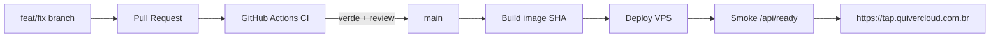

# Handoff arquiteto / IA — Quiver Tap no VPS Hostinger

**Data:** 2026-10-24 (cutover + hardening + CI/CD remoto)  
**Repo:** `C:\Users\Papai\Documents\Desenvolvimento\Cervejaria` (`filipedsn/cervejaria`, **público**)  
**Escopo:** migração da produção para Hostinger VPS + Cloudflare + CI/CD remoto + postura de segurança  
**Estado:** **produção pública no VPS** em `https://tap.quivercloud.com.br` · PC **não** é mais origem · validado com PC desligado · **CI Actions + branch protection em `main`**

---

## 0. Como roda agora (verdade operacional)

| Camada | Antes (PC Windows) | Agora (VPS Hostinger) |
|---|---|---|
| **Aplicação (`:3001`)** | Node nativo + watchdog/tarefas | Docker `cervejaria-api` (`network_mode: host`) |
| **Banco** | Docker `cervejaria-db` no PC | Docker `cervejaria-db` · `127.0.0.1:5432` |
| **Ingress público** | Cloudflare Tunnel → `localhost:3001` | Cloudflare **proxy** → VPS **nginx :443** → app `:3001` |
| **URL canônica** | `https://tap.quivercloud.com.br` (via tunnel) | `https://tap.quivercloud.com.br` (via VPS) |
| **Uploads** | `backend/uploads-prod` | Volume `vps_uploads_data` |
| **ES / Kibana** | Local / tunnel (legado) | Docker no VPS · **só localhost + Tailscale** |
| **SSH admin** | — | **Somente Tailscale** (`100.120.170.89`) · porta 22 **fechada** na internet |

**Prova de cutover:** com o PC desligado, `https://tap.quivercloud.com.br` continuou respondendo.

---

## 1. Inventário de infraestrutura

| Item | Valor |
|---|---|
| App | Quiver Tap (Fastify + frontend estático no mesmo processo) |
| VPS | Hostinger KVM 4 · `srv2093568.hstgr.cloud` · `200.141.28.26` · VM id `2093568` |
| SO | Ubuntu 26.04 LTS · 4 vCPU · 16 GB · 200 GB |
| Gestão | Hostinger MCP/API + SSH (via Tailscale) + Cloudflare MCP |
| Conta Cloudflare | `filipedsn@gmail.com` · zona `quivercloud.com.br` · plano Free |
| Apex site | `quivercloud.com.br` → A `2.57.91.91` (**outro** host, não o Tap) |
| Tailscale | Free/Personal · PC `filipe` `100.71.18.99` · VPS `srv2093568` `100.120.170.89` |

### 1.1 Projetos Docker no VPS (renomeados)

| Nome no Docker Manager | Path / papel |
|---|---|
| **Banco de Dados** | Postgres `cervejaria-db` · `127.0.0.1:5432` |
| **Tap Quiver** | App `cervejaria-api` · código em `/opt/quiver-tap` · compose `deploy/tap-quiver/` |
| **elasticsearch-kibana** | ES `:9200` + Kibana `:5601` · bind **`127.0.0.1`** + proxy Tailscale Serve |

### 1.2 Firewall Hostinger (`quiver-vps`, id `385624`)

| Porta | Estado |
|---|---|
| 22 SSH | **Fechada** (acesso só Tailscale) |
| 80 HTTP | Aberta (redirect → HTTPS) |
| 443 HTTPS | Aberta (nginx → app) |
| 3001 | **Fechada** na internet |
| 9200 / 5601 | **Fechadas** (localhost + Tailscale) |
| ICMP | Aberta |

---

## 2. Cloudflare — configuração atual

### 2.1 SSL
- Modo: **Full (strict)**
- Always HTTPS: **on**
- Origem Tap: certificado **Cloudflare Origin CA** em `/etc/ssl/cloudflare/tap.{pem,key}` (nginx)

### 2.2 DNS (A/CNAME relevantes)

| Nome | Tipo | Destino | Proxy |
|---|---|---|---|
| `quivercloud.com.br` | A | `2.57.91.91` | laranja |
| `www.quivercloud.com.br` | CNAME | `quivercloud.com.br` | laranja |
| **`tap.quivercloud.com.br`** | **A** | **`200.141.28.26` (VPS)** | **laranja** |
| `hostingermail-a/b/c._domainkey` | CNAME | Hostinger DKIM | **cinza** (e-mail) |

**Removidos nesta sessão (DNS + tunnel):**  
`app`, `daybyday`, `kibana`, `quiver`, `plane`, `tapdev`.

### 2.3 Tunnel Cloudflare `quiver`
- ID: `edfe96ac-3ef6-4a44-a150-765b19777f97`
- **`tap` saiu do ingress** (não usa mais tunnel)
- Ingress restante: apenas **catch-all → 404**
- Serviço Windows `Cloudflared` no PC pode existir, mas **não é necessário para o Tap**
- **Não** usar tunnel para produção do Tap daqui pra frente

### 2.4 Fluxo HTTP atual

```
Cliente → Cloudflare (HTTPS, WAF Free) → VPS :443 (nginx + Origin CA)
       → 127.0.0.1:3001 (cervejaria-api)
```

Ops (ES/Kibana):

```
PC (Tailscale) → 100.120.170.89:9200 / :5601
              → tailscale serve → 127.0.0.1 (Docker)
```

---

## 3. O que foi feito (cronológico resumido)

### 3.1 Staging no VPS
- Auth Hostinger MCP; VPS acessível.
- Banco: dump/restore do PC **sem alterar** Docker/dados locais; 38 tabelas validadas.
- App Docker: `deploy/tap-quiver/` (Dockerfile, compose, `.env.staging`).
- Validação inicial por `http://200.141.28.26:3001` (DNS ainda intacto).

### 3.2 Bugs corrigidos no caminho
1. **`Invalid PDV activation destination`** — `PDV_CANONICAL_ALL` exige DB em `127.0.0.1:5432/cervejaria` → `network_mode: host`.
2. **Login volta ao formulário** — cookie `Secure` em HTTP → `authCookiesShouldBeSecure()` baseado em `APP_URL` https.
3. **Logos faltando** — sync `uploads-prod` → volume `vps_uploads_data`.

### 3.3 Cutover de produção (concluído)
- nginx no VPS (80→443, proxy para `:3001`).
- Origin CA Cloudflare + SSL **Full Strict**.
- DNS `tap` **A → 200.141.28.26** (proxy laranja); removido CNAME do tunnel.
- `APP_URL` / `CORS_ORIGIN` = `https://tap.quivercloud.com.br`.
- Porta `3001` removida do firewall público.
- Watchdog local: tarefas **QuiverTap-AtLogon** e **QuiverTap-AtStartup** excluídas.
- Cloudflared de prod do Tap desnecessário; teste com **PC desligado** OK.

### 3.4 Elasticsearch / Kibana + Tailscale
- Stack vazia criada, depois **bind localhost**.
- Tailscale no PC + VPS; `tailscale serve --tcp` para `:9200` e `:5601` (só tailnet).
- App no VPS alcança ES em `http://127.0.0.1:9200` (host network).
- Script auxiliar local (opcional): `deploy/tap-quiver/tunnel-elastic.ps1` (SSH tunnel) — **preferir Tailscale**.

### 3.5 Hardening de segurança (concluído nesta sessão)
| Ação | Detalhe |
|---|---|
| SSH | Porta 22 **fechada** na internet; admin via Tailscale `100.120.170.89` |
| Segredos | Rotacionados no VPS: `JWT_SECRET`, senha Postgres `cervejaria`, senha `elastic` |
| Tunnel residual | Removidos DNS/ingress de hosts locais não usados |
| Cookies / HTTPS | `APP_URL` https → cookies Secure + HSTS coerentes |

**Onde estão os segredos:** apenas no VPS  
`/opt/quiver-tap/deploy/tap-quiver/.env.staging`  
(e espelho ES em `/docker/elasticsearch-kibana/.env` se aplicável).  
**Não** versionar. Sessões de usuário foram invalidadas na rotação do JWT (re-login necessário).

---

## 4. Postura de segurança — auditoria (2026-10-24, 2ª rodada)

### 4.1 Já ok / corrigido nesta rodada

| Item | Estado |
|---|---|
| Cloudflare SSL Full Strict + Always HTTPS | ok |
| Min TLS Cloudflare | **subido para 1.2** (+ TLS 1.3 on) |
| HSTS na borda Cloudflare | **habilitado** (1 ano, includeSubDomains) |
| Firewall Hostinger | só 80/443/ICMP · 22/3001/5432/9200/5601 fechados na internet |
| API `:3001` | **bind `127.0.0.1`** (só nginx local alcança) |
| `.env.staging` permissões | **600** (antes 666 — corrigido) |
| SSH senha | **PasswordAuthentication no** · root só com chave |
| SSH público | timeout (fechado no firewall) |
| JWT / APP_URL https | ok após rotação |
| ES/Kibana | localhost + Tailscale Serve |
| Backup diário 01:00 BRT · 30 dumps | ok |
| Headers app (Helmet) | HSTS/XFO/nosniff presentes na origem |

### 4.2 Riscos / itens ainda em aberto

| Prioridade | Item | Por quê | Ação sugerida |
|---|---|---|---|
| ~~Alta~~ | ~~Cloudflared no PC~~ | ~~Resolvido 2026-10-24~~ | Serviço **desinstalado**; tunnel down |
| ~~Alta~~ | ~~Chaves SSH~~ | ~~Resolvido / intencional~~ | (1) humana GitHub (2) agente Cursor `~/.ssh/quiver-vps/cursor-agent` · alias `ssh quiver-vps` |
| ~~Média~~ | ~~Backups só no disco do VPS~~ | ~~Resolvido~~ | Offsite **OneDrive** `…/Backup banco/PRD` via rclone no cron 01:00 BRT |
| Média | **Restore nunca ensaiado** | Backup sem restore testado ≠ recovery | Rodar restore drill em DB descartável |
| ~~Média~~ | ~~ES container `unhealthy`~~ | ~~Resolvido~~ | Healthcheck usava senha antiga no env do container; recreate alinhou `ELASTIC_PASSWORD` → **healthy** / cluster **green** |
| ~~Média~~ | ~~QuiverTap-ProdBackup no PC~~ | ~~Resolvido~~ | Tarefa excluída pelo usuário (2026-10-24) |
| Baixa | Secret store | `.env` em arquivo no disco | Migrar para vault/Hostinger secrets no CD |
| Baixa | WAF rules custom | Plano Free = proteção genérica | Regras se aparecer abuso/bot |
| Baixa | Apex `2.57.91.91` | Fora do Tap | Revisar à parte |
| Info | DKIM cinza | Só e-mail | Manter |

DKIM cinza (`hostingermail-*._domainkey`) é **só e-mail** (envio/autenticidade). Recebimento depende dos MX Hostinger — intactos.

---

## 5. Diagnóstico de maturidade CI/CD

### 5.1 O que já existe (release local forte)

| Peça | Onde | Papel |
|---|---|---|
| Fluxo Git | `CONTRIBUTING.md` | branch → PR → squash → deploy |
| CI local | `npm run ci` | build FE, Prisma, unit, tsc, ops-panel, Pester |
| Atestado | `deploy/.local-ci-attestation.json` | exigido pelo deploy Windows legado |
| Deploy Windows | `scripts/prod/deploy.ps1` | **legado** — não é mais o publisher de prod pública |
| Gate de origem | preflight deploy | main limpa + atestado |
| Ops Panel | `:3099` | local |

### 5.2 Lacunas de plataforma (restantes)

| Lacuna | Evidência |
|---|---|
| CD no VPS ainda semi-manual | `deploy-vps.yml` faz `docker build` por SHA; deploy SSH via Tailscale **opcional** (faltam secrets `TS_*` / `VPS_SSH_KEY`) |
| Sem push para registry | build local no runner (`push: false`); tag `quiver-tap-api:<SHA>` |
| Restore drill | dumps diários + rclone OneDrive OK; restore ainda não ensaiado |
| OTEL no VPS | desligado no env atual |

**Resolvido nesta sessão:** repo público (Free Actions + branch protection); `ci.yml` em push/PR com job `build-and-unit`; protection em `main` (PR + check obrigatório).

### 5.3 Notas (1–5) — atualizadas pós-CI remoto

| Dimensão | Antes | Agora | Comentário |
|---|---|---|---|
| Qualidade / gates locais | 4 | **4** | Intactos (`npm run ci` + atestado) |
| Processo Git / PR | 3 | **4** | PR obrigatório + check `build-and-unit` em `main` |
| CI remoto | 1 | **4** | Actions Free no repo público; Prisma via `npm exec --prefix backend` |
| CD / promoção a prod | 2 | **3** | Workflow de build SHA pronto; promote Tailscale ainda sem secrets |
| Infra portable / runtime | 2 | **4** | App+DB Docker no VPS = runtime oficial |
| DR / multi-env | 2 | **4** | Backup cron 01:00 BRT + offsite OneDrive; falta restore drill |

**Síntese:** o SPOF do notebook para **servir** produção foi eliminado. CI remoto e proteção de `main` estão ativos. O SPOF restante é **como** se publica no VPS (deploy ainda depende de secrets Tailscale no Actions ou SSH manual).

### 5.4 Definição de pronto (plataforma ~4)

- [x] `tap.quivercloud.com.br` no VPS com HTTPS; PC não serve prod  
- [x] `:3001` não pública; SSH restrito  
- [x] Todo PR em `main` exige CI verde no GitHub (`build-and-unit`)  
- [ ] Todo deploy de prod vem de imagem tagueada com SHA de `main` (build SHA ok; promote automático pendente)  
- [ ] Smoke automático no VPS antes do promote  
- [x] Backup DB no VPS agendado (30 dumps + rclone OneDrive) · [ ] restore ensaiado  
- [ ] Rollback de app (imagem n-1) documentado e testado  

---

## 6. Como o CI/CD muda (alvo)

### 6.1 Fluxo legado (PC) — desativado para prod pública

```
branch → PR → CI local → merge main
  → no PC: prod:deploy → Node :3001 → Tunnel Cloudflare
```

### 6.2 Fluxo alvo

```
branch → PR → CI remoto obrigatório → merge main
  → build imagem Docker (tag = SHA)
  → push registry (ou build pinado no VPS)
  → deploy VPS: backup DB → migrate → compose up → smoke
  → PC só DEV
```

### 6.3 Preservar vs substituir

| Preservar | Substituir / evoluir |
|---|---|
| Gates + confirmação humana | `prod:deploy` Windows como publisher |
| Suite `npm run ci` | Atestado só local → check GitHub |
| `PDV_CANONICAL_ALL` + DB `127.0.0.1:5432` | Continua (host network) |
| `authCookiesShouldBeSecure` / HTTPS | Já em produção com `https://tap...` |
| Watchdog Windows | Docker restart + healthcheck (+ opcional systemd) |

---

## 7. Roadmap CI/CD

### Fase A — CI remoto — **FEITA**
1. [x] Repo **público** (`filipedsn/cervejaria`) para Actions Free + branch protection.  
2. [x] `ci.yml` em push/PR/`workflow_dispatch` — job **`build-and-unit`** (Node 24, npm ci root/backend/frontend, `prisma generate` no backend, unit, build FE/BE).  
3. [x] Branch protection em `main`: PR obrigatório + status check `build-and-unit`; sem push direto.  
4. [x] Atestado local (`npm run ci`) permanece como complemento no fluxo Windows legado.

### Fase B — CD para o VPS (próximo)
1. [x] Workflow `deploy-vps.yml` — `docker build` tag = SHA (`workflow_dispatch`).  
2. [ ] Secrets Actions: `TS_OAUTH_CLIENT_ID`, `TS_OAUTH_SECRET`, `VPS_SSH_KEY`, `VPS_TAILSCALE_IP` (deploy SSH via Tailscale; porta 22 pública fechada).  
3. [ ] Registry (GHCR) ou build pinado no VPS + migrate + smoke `/api/ready`.  
4. [ ] Secrets de app só no VPS (nunca tarball com `.env` no git).

### Fase C — Cutover — **FEITA**
1. [x] HTTPS + Cloudflare proxy  
2. [x] `APP_URL`/`CORS` https  
3. [x] DNS `tap` → VPS; tunnel do `tap` removido  
4. [x] Watchdog de prod Windows removido (AtLogon/AtStartup)  
5. [x] Firewall: sem `:3001` / sem `:22` públicos  

### Fase D — Operação
1. [x] Backup Postgres no VPS (cron 01:00 BRT, 30 dumps) + rclone OneDrive PRD.  
2. [ ] Restore ensaiado.  
3. [ ] Alertas (uptime `/api/ready`, disco, restarts).  
4. [ ] Rollback imagem n-1 documentado.  
5. [ ] OTEL/EDOT opcional no VPS (ES já disponível via Tailscale).



---

## 8. Restrições de produto (não negociáveis)

1. `PDV_CANONICAL_ALL=1` + production → `DATABASE_URL` host ∈ `{localhost,127.0.0.1,[::1]}`, porta 5432, DB `cervejaria`.
2. Cookies Secure apenas em HTTPS (`authCookiesShouldBeSecure` / `APP_URL`).
3. Deploy prod exige confirmação humana explícita (skills).
4. Migrations: sem rollback automático de schema — backup antes obrigatório.
5. ES/Kibana **nunca** expor na internet pública; ops via Tailscale.
6. SSH admin **via Tailscale**; não reabrir `:22` “any” sem necessidade.

---

## 9. Inventário técnico do VPS (paths)

| Recurso | Detalhe |
|---|---|
| Código | `/opt/quiver-tap` |
| Compose app | `/opt/quiver-tap/deploy/tap-quiver/` |
| Env app | `/opt/quiver-tap/deploy/tap-quiver/.env.staging` |
| nginx site | `/etc/nginx/sites-available/tap.quivercloud.com.br` |
| Origin cert | `/etc/ssl/cloudflare/tap.pem` + `tap.key` |
| Backups Postgres | Local: `/opt/quiver-tap/backups/postgres` · cron **01:00 America/Sao_Paulo** · **30 dumps** locais · **offsite OneDrive** via `rclone` (VPS→nuvem, **PC não precisa estar ligado**) · pasta `Quiver/Tap Quiver/Backup banco/PRD` · `OFFSITE_RETENTION_COUNT=30` · config `/opt/quiver-tap/deploy/tap-quiver/backup-postgres.env` · credencial rclone em `/root/.config/rclone/rclone.conf` (600) · log `/opt/quiver-tap/backups/logs/` |
| DB | container `cervejaria-db` · project Banco de Dados |
| API | container `cervejaria-api` · host network · health `:3001` |
| ES/Kibana | `/docker/elasticsearch-kibana/` · ports `127.0.0.1:9200/5601` |
| URL pública | `https://tap.quivercloud.com.br` |
| Diffs cookie/HSTS | `security-config.ts`, `session.ts`, `cliente-session.ts`, `public.ts`, `app.ts` |

### Acesso ops (para humanos / agentes)

| Destino | Como |
|---|---|
| App | https://tap.quivercloud.com.br |
| SSH (humano) | chave GitHub `filipedsn@…` · Tailscale ligado · `ssh root@100.120.170.89` |
| SSH (Cursor/agente) | chave `~/.ssh/quiver-vps/cursor-agent` · alias `ssh quiver-vps` · Tailscale ligado |
| Elasticsearch | `http://100.120.170.89:9200` (credencial no `.env` do VPS) |
| Kibana | `http://100.120.170.89:5601` |

---

## 10. Acesso admin, chaves SSH e recuperação (explícito)

### 10.1 Modelo (o que cada peça faz)

| Peça | Função | Sem ela… |
|---|---|---|
| **Tailscale** | Rede privada PC ↔ VPS (`100.x`) | Não alcança SSH nem ES/Kibana (porta 22 pública está **fechada**) |
| **Chave SSH privada** | Prova identidade no `sshd` (senha SSH **desligada**) | Tailscale sozinho não basta para shell root |
| **Senha Elastic** | Auth HTTP no ES/Kibana | Agente pode estar na tailnet e ainda assim não ler índices |
| **Cloudflare / Hostinger login** | Site público + break-glass de infra | Independente das chaves do PC |

**Produção do Tap (clientes)** não depende de Tailscale nem de chaves SSH — só de Cloudflare → VPS `:443`.

**Elastic + admin do VPS** dependem de Tailscale + credenciais locais.

### 10.2 Duas chaves autorizadas no VPS (`/root/.ssh/authorized_keys`)

São **intencionais** (não lixo de migração):

| Comentário / papel | Arquivo no PC (privada) | Uso |
|---|---|---|
| `filipedsn@users.noreply.github.com` | `%USERPROFILE%\.ssh\id_ed25519_github` | Acesso humano |
| `cursor-agent-quiver-vps` | `%USERPROFILE%\.ssh\quiver-vps\cursor-agent` | Cursor / agente com admin no VPS |

Alias SSH no PC (`%USERPROFILE%\.ssh\config`):

```
Host quiver-vps
  HostName 100.120.170.89
  User root
  IdentityFile ~/.ssh/quiver-vps/cursor-agent
  IdentitiesOnly yes
```

Fingerprints (conferência; não são segredo):

- GitHub: `SHA256:Vseg4l0rQPhmhrmdvfLRN4ONKJx7uIWGEhWsBZhn+5k`
- Cursor agent: `SHA256:ILPLxZIoq0V5FJSNV9lIq0gLAbQgN3SmfTO5WY5cuC0`

IPs Tailscale de referência (podem mudar — validar no admin Tailscale):

- PC `filipe`: `100.71.18.99`
- VPS `srv2093568`: `100.120.170.89`

### 10.3 Backup cifrado das chaves (PC pode queimar)

| Item | Valor |
|---|---|
| Pasta | `OneDrive\Quiver\Tap Quiver\Backup chaves SSH\` |
| Arquivo | `quiver-ssh-keys-20261024-192018.zip.enc` (AES; método interno `QSSH0001` / PBKDF2) |
| Conteúdo do zip (após decrypt) | `cursor-agent` (+`.pub`), `id_ed25519_github` (+`.pub`), `ssh-config`, `LEIA-ME.txt`, `FINGERPRINTS.txt` |
| Senha do `.enc` | **Não** versionar neste doc · guardar no gerenciador de senhas / cofre · o arquivo `SENHA-LEIA-E-APAGUE-*.txt` na mesma pasta deve ser **apagado** do OneDrive depois de copiar a senha |

**Restaurar num PC novo**

1. Entrar no Tailscale com a mesma conta/tailnet.  
2. Descriptografar o `.enc` → extrair `keys/`.  
3. Colocar privadas em:
   - `%USERPROFILE%\.ssh\quiver-vps\cursor-agent`
   - `%USERPROFILE%\.ssh\id_ed25519_github`
4. Restaurar o bloco `Host quiver-vps` no `~\.ssh\config`.  
5. Testar: `ssh quiver-vps` e/ou `ssh -i …\cursor-agent root@100.120.170.89`.

### 10.4 Plano B (break-glass) — sem backup de chaves

Se o PC queimou **e** o OneDrive/senha do `.enc` também se perdeu:

1. **Hostinger** (login da conta) → VPS `2093568` → **SSH keys** → colar uma **nova** chave pública no root.  
2. Ou **console/VNC** da Hostinger → editar `/root/.ssh/authorized_keys`.  
3. Reinstalar Tailscale no PC novo e autorizar o device na tailnet.  
4. Site `https://tap.quivercloud.com.br` continua no ar nesse intervalo (não depende do PC).

Contas que são break-glass além das chaves: **Hostinger**, **Cloudflare**, **Tailscale**.

### 10.5 O que o agente Cursor precisa no dia a dia

| Necessidade | Requisito |
|---|---|
| Admin no VPS (Docker, nginx, `.env`, backups) | Tailscale **ligado** + chave `cursor-agent` |
| Elasticsearch / Kibana | Tailscale **ligado** + senha `elastic` (no `.env` do VPS; não no git) |
| Ver o Tap como cliente | Só browser → Cloudflare; sem Tailscale |

---

## 11. Pendências explícitas

1. [x] Cutover `tap.quivercloud.com.br`  
2. [x] HTTPS + fechar `:3001` pública  
3. [x] Remover dependência do Tunnel para o Tap  
4. [x] Derrubar watchdog AtLogon/AtStartup  
5. [x] SSH só Tailscale + rotação de segredos  
6. [x] Cloudflared desinstalado no PC  
7. [x] Chaves SSH humanas + agente documentadas + backup cifrado no OneDrive  
8. [x] Workflows CI + `deploy-vps.yml` no repo (build por SHA); deploy Tailscale ainda sem secrets no Actions  
9. [x] Repo **público**; branch protection em `main` (PR obrigatório + check `build-and-unit`; sem push direto)  
10. [x] Backups Postgres agendados no VPS (01:00 BRT, 30 dumps) · [ ] restore ensaiado  
11. [x] Backup off-site OneDrive `Quiver/Tap Quiver/Backup banco/PRD` (rclone no VPS)  
12. [ ] `releaseSha` no container (hoje pode ser `unknown`)  
13. [x] Tarefa `QuiverTap-ProdBackup` no PC excluída  
14. [ ] OTEL → ES no VPS (opcional)  
15. [x] ES healthcheck alinhado à senha rotacionada → container **healthy**

### 11.1 Branch protection (`main`) — como está

| Regra | Valor |
|---|---|
| Require a pull request before merging | **on** |
| Require status checks to pass | **on** → `build-and-unit` |
| Require branches to be up to date | **on** (quando suportado) |
| Restrict who can push | só via PR (sem push direto na `main`) |
| Repo visibility | **public** (necessário no plano Free para protection + Actions) |

Workflows: `.github/workflows/ci.yml`, `.github/workflows/deploy-vps.yml`.

---

## 12. Mensagem executiva (1 parágrafo)

O Quiver Tap **saiu do notebook**: produção pública está no **VPS Hostinger** atrás da **Cloudflare** (`https://tap.quivercloud.com.br`, SSL Full Strict), com app e banco em Docker, porta da API fechada na internet, SSH só via **Tailscale** (chave humana + chave do agente Cursor), Elasticsearch/Kibana na tailnet, backup diário do Postgres no VPS (+ rclone OneDrive PRD) e **backup cifrado das chaves SSH no OneDrive** (plano B via painel Hostinger). O repositório está **público**, com **GitHub Actions** (`build-and-unit`) e **branch protection** em `main`. O cutover foi **provado com o PC desligado**. Lacunas principais restantes: **restore drill** do Postgres; CD automático no VPS (secrets Tailscale no Actions); OTEL opcional.
