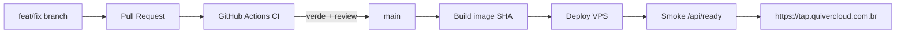

# Handoff arquiteto / IA — Quiver Tap no VPS Hostinger

**Data:** 2026-10-24 (cutover + hardening + CI/CD + segregação Dev/PRD + checklist canônico)  
**Repo:** `filipedsn/cervejaria` (**público**) · clone típico `C:\Users\Papai\Documents\Desenvolvimento\Cervejaria`  
**Escopo:** operação PRD no VPS Hostinger + Cloudflare + CI/CD + mapa Dev/PRD + postura de segurança  
**Estado:** **PRD** só no VPS (`https://tap.quivercloud.com.br`) · **DEV** só no PC · clusters Elastic **separados** · CI Actions + branch protection em `main` · PC **não** serve clientes

**Classificação:** documento **interno / restrito**. Contém topologia, paths e *localização* de credenciais (não as senhas). **Não** colar o arquivo inteiro em chat público, issue aberta, e-mail externo ou PR de terceiros. Em respostas a humanos, resumir o estado **sem** reproduzir IPs Tailscale, paths de `.env`/rclone nem inventário de chaves.

**Leitor principal:** **Codex** (agente do dia a dia). Assuma zero contexto prévio. **Fonte da verdade = este arquivo na branch `main` do GitHub** (`origin/main`). Se a cópia local divergir, `git fetch` + ler `origin/main` — ignores WIP em feature branches.

### Checklist canônico (use isto; ignore redações antigas / riscadas)

| Tema | Status | Evidência / nota |
|---|---|---|
| PRD no VPS; PC fora do path de clientes | **Feito** | Cutover 2026-10-24; site OK com PC desligado |
| Backup Postgres local no VPS (cron 01:00 BRT, 30 dumps) | **Feito** | `/etc/cron.d/quiver-tap-backup` + dumps em `/opt/quiver-tap/backups/postgres` |
| Cópia **off-site** OneDrive (rclone) | **Feito** | `OFFSITE_ENABLED=1`; log `OFFSITE ok` em 2026-10-24 19:38 BRT; remote `…/Backup banco/PRD` |
| Restore drill (ensaiar restore) | **Pendente** | Backup ≠ recovery até testar em DB descartável |
| CI remoto `build-and-unit` + protection em `main` | **Feito** | Repo público; PR obrigatório |
| `npm run ci` local | **Complementar** | Continua útil (atestado / suite Windows); **não** substitui o check Actions no merge |
| CD no VPS com aprovação humana | **Implementado — ativação pendente** | Esteira "Deploy PRD (VPS)" (TAP-126, §7.1); falta policy `tag:ci` + OAuth Tailscale |
| `releaseSha` / rollback imagem n-1 | **Pendente** | |
| OTEL → ES PRD no VPS | **Feito** | Collector `deploy/tap-quiver/docker-compose.observability.yml` → `*.otel-prd`; cluster PRD ≠ DEV |
| Equalizar API DEV em Docker | **Pendente** | Hoje API DEV = Node nativo |

**Não é pendência:** “configurar backup OneDrive do Postgres”. Isso já roda. Quem listar off-site como lacuna está lendo trecho riscado, mensagem velha ou confusão com *restore*.

---

## 0. Como roda agora (verdade operacional)

| Camada | DEV (PC Windows) | PRD (VPS Hostinger) |
|---|---|---|
| **Onde vive** | Máquina do Filipe | VPS `2093568` · `200.141.28.26` / Tailscale `100.120.170.89` |
| **Aplicação** | Node **nativo** (scripts locais) — ver §0.1 sobre equalizar em Docker | Docker `cervejaria-api` (`network_mode: host`) |
| **Banco Postgres** | Docker local (`cervejaria-db` / `cervejaria-db-dev` em `docker-compose.yml`) | Docker `cervejaria-db` · só `127.0.0.1:5432` |
| **Elasticsearch / Kibana** | **Cluster local** (Docker no PC) | **Cluster aparte no VPS** · `127.0.0.1` + Tailscale |
| **Ingress público** | Nenhum (não é origem de clientes) | Cloudflare **proxy** → nginx `:443` → app `:3001` |
| **URL canônica** | localhost / portas de dev | `https://tap.quivercloud.com.br` |
| **Uploads** | pastas locais do repo | Volume `vps_uploads_data` |
| **SSH admin** | — | **Somente Tailscale** · porta 22 **fechada** na internet |

**Prova de cutover:** com o PC desligado, `https://tap.quivercloud.com.br` continuou respondendo.  
**Regra de ouro:** PC desligado **não pode** afetar PRD; mexer em DEV **não pode** escrever no Elastic/Postgres/app do VPS.

---

## 0.1 Ambientes Dev vs PRD — segregação física (mastigado para o Codex)

### Por que isso existe

Antes o notebook era SPOF de produção (app + tunnel). Agora há **dois mundos físicos**:

| Mundo | Máquina | Papel |
|---|---|---|
| **DEV** | PC Windows do Filipe | Codar, testar, OTEL de desenvolvimento, banco/ES de brinquedo |
| **PRD** | VPS Hostinger | Único lugar que atende cliente em `tap.quivercloud.com.br` |

Não é “o mesmo stack com `NODE_ENV` diferente”. São **hosts diferentes**, **discos diferentes**, **clusters Elastic diferentes**, **credenciais diferentes**. Se o Codex misturar, estraga telemetria, dados ou o site no ar.

### Mapa lado a lado (cole na retina)

| Peça | DEV (local) | PRD (VPS) | Misturar? |
|---|---|---|---|
| **App Quiver Tap** | Processo Node no PC (hoje) | Container `cervejaria-api` | **NUNCA** apontar o binário local para URL/DB/ES de PRD “só pra testar” |
| **Postgres** | Compose raiz `docker-compose.yml` → `cervejaria-db` (`:5432`) e/ou `cervejaria-db-dev` (`:5434`, DB `cervejaria_dev`) | Container `cervejaria-db` no VPS, só loopback | **NUNCA** `pg_dump`/`restore` DEV→PRD sem pedido explícito + backup |
| **Elasticsearch** | Cluster Docker **no PC** (rede típica `elasticsearch-kibana_elastic`, `:9200` local) | Cluster Docker **no VPS** em `/docker/elasticsearch-kibana/` · `127.0.0.1:9200` · Tailscale `100.120.170.89:9200` | **NUNCA** — dois clusters; índices `*.otel-dev` ≠ `*.otel-prd` |
| **Kibana** | Local (PC) | VPS `:5601` via Tailscale | Idem |
| **OTEL / EDOT Collector** | `docker-compose.observability.yml` → `quiver-edot-collector` · OTLP `127.0.0.1:4317/4318` · **só DEV** (`filter/dev-only`) | `deploy/tap-quiver/docker-compose.observability.yml` → `quiver-edot-collector-prd` · OTLP loopback · `filter/prd-only` → `*.otel-prd` | App DEV → ES **local**; app PRD → ES **VPS** |
| **Backups DB** | Não são a retenção oficial | Cron VPS 01:00 BRT + rclone OneDrive `…/Backup banco/PRD` | Offsite PRD ≠ cópia do notebook |
| **DNS / Cloudflare** | Não publica o Tap | `tap` → IP do VPS | Não recolocar tunnel do Tap no PC |
| **Secrets** | `.env` / env local (fora do git) | `/opt/quiver-tap/deploy/tap-quiver/.env.staging` no VPS | Não copiar secret de PRD para repo nem para log |

### Clusters Elastic — regra explícita (Codex erra aqui se não ler)

```
DEV  →  Elasticsearch no PC     →  data streams / índices de desenvolvimento (ex.: *.otel-dev)
PRD  →  Elasticsearch no VPS    →  telemetria/ops de produção (ex.: *.otel-prd) quando ligado
```

1. **São clusters distintos.** Mesmo que a versão do ES seja a mesma (ex. 8.17), os dados **não** são compartilhados.  
2. App em DEV deve usar `ELASTICSEARCH_URL` (ou equivalente) apontando para **127.0.0.1:9200 do PC**, nunca para `100.120.170.89`.  
3. App em PRD (container no VPS, host network) fala com **127.0.0.1:9200 do VPS**.  
4. Abrir Kibana PRD pelo browser do PC (`http://100.120.170.89:5601` com Tailscale) é **só leitura/ops** — não significa que o app DEV possa indexar lá.  
5. Scripts em `scripts/observability/` e inventários TAP-96: se o alvo não disser “VPS/PRD”, assuma **cluster local DEV**. Mutação em PRD exige confirmação humana explícita.  
6. Histórico: quando DEV e “prod” compartilhavam um único ES no PC, havia pressão de shards/`*.otel-dev` misturado com `*.otel-prd`. **Essa era uma dívida; a segregação física no VPS existe para acabar com isso.** Não recriar o monólito.

### Assimetria de arquitetura (DEV ainda não é igual ao PRD)

| | DEV hoje | PRD hoje | Alvo |
|---|---|---|---|
| App | Node nativo no Windows | Docker Compose (`deploy/tap-quiver/`) | **Equalizar:** DEV também subir a API via Docker (mesmo Dockerfile/compose de espírito), para “o que roda no PC ≈ o que roda no VPS” |
| Postgres | Já Docker | Docker | OK (manter DBs **separados**) |
| Elastic | Já Docker local | Docker no VPS | OK (clusters **separados**) |

**Pendência de produto/engenharia:** containerizar o app de DEV (compose de desenvolvimento reutilizando `deploy/tap-quiver/Dockerfile` ou um `docker-compose.dev.yml`). Até lá, Codex **não** inventa que DEV “já é Docker na API” — só DB/observability são.

### Como o Codex decide “em qual ambiente estou?”

| Sinal | DEV | PRD |
|---|---|---|
| Hostname / SSH | Sessão local no Windows | `ssh` → `100.120.170.89` / `quiver-vps` |
| URL no browser | `http://localhost:…` | `https://tap.quivercloud.com.br` |
| `docker ps` no PC | `cervejaria-db`, `cervejaria-db-dev`, ES local, talvez `quiver-edot-collector` | Não é PRD |
| `docker ps` no VPS | — | `cervejaria-api`, `cervejaria-db`, stack em `/docker/elasticsearch-kibana/` |
| Path de código | `C:\Users\Papai\Documents\Desenvolvimento\Cervejaria` | `/opt/quiver-tap` |
| Env file | locais / `backend` env de development | `.env.staging` no compose do VPS |

Na dúvida: **pergunte ao humano** antes de apontar qualquer URL de Elastic, Postgres ou `APP_URL` para o outro mundo.

### Proibições absolutas (imprimir na testa do Codex)

1. **Não** apontar app DEV para Postgres ou Elastic do VPS.  
2. **Não** apontar app PRD para serviços do PC (PC pode estar desligado; PRD quebra).  
3. **Não** rodar migrate/seed/destructive em PRD “porque passou em DEV”.  
4. **Não** indexar telemetria DEV no cluster PRD (nem o contrário).  
5. **Não** reativar Cloudflare Tunnel do `tap` no PC.  
6. **Não** reabrir `:22` / `:3001` / `:9200` / `:5601` na internet.  
7. **Não** assumir que equalizar DEV em Docker já foi feito — está na lista de evolução.  
8. Deploy PRD: só via esteira do §7.1 com aprovação humana no environment `production` (ou SSH manual com autorização explícita).

### Prompt curto (Copiar para o Codex)

```
Leia docs/handoff-vps-hostinger-arquiteto.md seções 0, 0.1 e 7.1.
DEV = PC (app Node local hoje; DB/ES Docker local). PRD = só VPS.
Elastic DEV e Elastic PRD são clusters físicos diferentes — nunca cruzar.
Não reabra portas; não use tunnel do tap no PC; deploy PRD só com a minha aprovação na esteira (§7.1).
Se for equalizar DEV em Docker, proponha PR pequeno (compose dev) sem tocar PRD.
```

---

## 1. Inventário de infraestrutura

| Item | Valor |
|---|---|
| App | Quiver Tap (Fastify + frontend estático no mesmo processo) |
| VPS | Hostinger KVM 4 · `srv2093568.hstgr.cloud` · `200.141.28.26` · VM id `2093568` |
| SO | Ubuntu 26.04 LTS · 4 vCPU · 16 GB · 200 GB |
| Gestão | Hostinger MCP/API + SSH (via Tailscale) + Cloudflare MCP |
| Conta Cloudflare | `filipedsn@gmail.com` · zona `quivercloud.com.br` · plano Free |
| Apex site | `quivercloud.com.br` → A `2.57.91.91` (**outro** host, não o Tap) |
| Tailscale | Free/Personal · PC `filipe` `100.71.18.99` · VPS `srv2093568` `100.120.170.89` |

### 1.1 Projetos Docker no VPS (renomeados)

| Nome no Docker Manager | Path / papel |
|---|---|
| **Banco de Dados** | Postgres `cervejaria-db` · `127.0.0.1:5432` |
| **Tap Quiver** | App `cervejaria-api` · código em `/opt/quiver-tap` · compose `deploy/tap-quiver/` |
| **elasticsearch-kibana** | ES `:9200` + Kibana `:5601` · bind **`127.0.0.1`** + proxy Tailscale Serve |

### 1.2 Firewall Hostinger (`quiver-vps`, id `385624`)

| Porta | Estado |
|---|---|
| 22 SSH | **Fechada** (acesso só Tailscale) |
| 80 HTTP | Aberta (redirect → HTTPS) |
| 443 HTTPS | Aberta (nginx → app) |
| 3001 | **Fechada** na internet |
| 9200 / 5601 | **Fechadas** (localhost + Tailscale) |
| ICMP | Aberta |

---

## 2. Cloudflare — configuração atual

### 2.1 SSL
- Modo: **Full (strict)**
- Always HTTPS: **on**
- Origem Tap: certificado **Cloudflare Origin CA** em `/etc/ssl/cloudflare/tap.{pem,key}` (nginx)

### 2.2 DNS (A/CNAME relevantes)

| Nome | Tipo | Destino | Proxy |
|---|---|---|---|
| `quivercloud.com.br` | A | `2.57.91.91` | laranja |
| `www.quivercloud.com.br` | CNAME | `quivercloud.com.br` | laranja |
| **`tap.quivercloud.com.br`** | **A** | **`200.141.28.26` (VPS)** | **laranja** |
| `hostingermail-a/b/c._domainkey` | CNAME | Hostinger DKIM | **cinza** (e-mail) |

**Removidos nesta sessão (DNS + tunnel):**  
`app`, `daybyday`, `kibana`, `quiver`, `plane`, `tapdev`.

### 2.3 Tunnel Cloudflare `quiver`
- ID: `edfe96ac-3ef6-4a44-a150-765b19777f97`
- **`tap` saiu do ingress** (não usa mais tunnel)
- Ingress restante: apenas **catch-all → 404**
- Serviço Windows `Cloudflared` no PC pode existir, mas **não é necessário para o Tap**
- **Não** usar tunnel para produção do Tap daqui pra frente

### 2.4 Fluxo HTTP atual

```
Cliente → Cloudflare (HTTPS, WAF Free) → VPS :443 (nginx + Origin CA)
       → 127.0.0.1:3001 (cervejaria-api)
```

Ops (ES/Kibana):

```
PC (Tailscale) → 100.120.170.89:9200 / :5601
              → tailscale serve → 127.0.0.1 (Docker)
```

---

## 3. O que foi feito (cronológico resumido)

### 3.1 Staging no VPS
- Auth Hostinger MCP; VPS acessível.
- Banco: dump/restore do PC **sem alterar** Docker/dados locais; 38 tabelas validadas.
- App Docker: `deploy/tap-quiver/` (Dockerfile, compose, `.env.staging`).
- Validação inicial por `http://200.141.28.26:3001` (DNS ainda intacto).

### 3.2 Bugs corrigidos no caminho
1. **`Invalid PDV activation destination`** — `PDV_CANONICAL_ALL` exige DB em `127.0.0.1:5432/cervejaria` → `network_mode: host`.
2. **Login volta ao formulário** — cookie `Secure` em HTTP → `authCookiesShouldBeSecure()` baseado em `APP_URL` https.
3. **Logos faltando** — sync `uploads-prod` → volume `vps_uploads_data`.

### 3.3 Cutover de produção (concluído)
- nginx no VPS (80→443, proxy para `:3001`).
- Origin CA Cloudflare + SSL **Full Strict**.
- DNS `tap` **A → 200.141.28.26** (proxy laranja); removido CNAME do tunnel.
- `APP_URL` / `CORS_ORIGIN` = `https://tap.quivercloud.com.br`.
- Porta `3001` removida do firewall público.
- Watchdog local: tarefas **QuiverTap-AtLogon** e **QuiverTap-AtStartup** excluídas.
- Cloudflared de prod do Tap desnecessário; teste com **PC desligado** OK.

### 3.4 Elasticsearch / Kibana + Tailscale
- Stack vazia criada, depois **bind localhost**.
- Tailscale no PC + VPS; `tailscale serve --tcp` para `:9200` e `:5601` (só tailnet).
- App no VPS alcança ES em `http://127.0.0.1:9200` (host network).
- Script auxiliar local (opcional): `deploy/tap-quiver/tunnel-elastic.ps1` (SSH tunnel) — **preferir Tailscale**.

### 3.5 Hardening de segurança (concluído nesta sessão)
| Ação | Detalhe |
|---|---|
| SSH | Porta 22 **fechada** na internet; admin via Tailscale `100.120.170.89` |
| Segredos | Rotacionados no VPS: `JWT_SECRET`, senha Postgres `cervejaria`, senha `elastic` |
| Tunnel residual | Removidos DNS/ingress de hosts locais não usados |
| Cookies / HTTPS | `APP_URL` https → cookies Secure + HSTS coerentes |

**Onde estão os segredos:** apenas no VPS  
`/opt/quiver-tap/deploy/tap-quiver/.env.staging`  
(e espelho ES em `/docker/elasticsearch-kibana/.env` se aplicável).  
**Não** versionar. Sessões de usuário foram invalidadas na rotação do JWT (re-login necessário).

---

## 4. Postura de segurança — auditoria (2026-10-24, 2ª rodada)

### 4.1 Já ok / corrigido nesta rodada

| Item | Estado |
|---|---|
| Cloudflare SSL Full Strict + Always HTTPS | ok |
| Min TLS Cloudflare | **subido para 1.2** (+ TLS 1.3 on) |
| HSTS na borda Cloudflare | **habilitado** (1 ano, includeSubDomains) |
| Firewall Hostinger | só 80/443/ICMP · 22/3001/5432/9200/5601 fechados na internet |
| API `:3001` | **bind `127.0.0.1`** (só nginx local alcança) |
| `.env.staging` permissões | **600** (antes 666 — corrigido) |
| SSH senha | **PasswordAuthentication no** · root só com chave |
| SSH público | timeout (fechado no firewall) |
| JWT / APP_URL https | ok após rotação |
| ES/Kibana | localhost + Tailscale Serve |
| Backup diário 01:00 BRT · 30 dumps **locais** | ok |
| Off-site OneDrive via rclone (`OFFSITE_ENABLED=1`) | **ok** (comprovado 2026-10-24: log `OFFSITE ok`) |
| Headers app (Helmet) | HSTS/XFO/nosniff presentes na origem |

### 4.2 Riscos / itens ainda em aberto

| Prioridade | Item | Por quê | Ação sugerida |
|---|---|---|---|
| ~~Alta~~ | ~~Cloudflared no PC~~ | ~~Resolvido 2026-10-24~~ | Serviço **desinstalado**; tunnel down |
| ~~Alta~~ | ~~Chaves SSH~~ | ~~Resolvido / intencional~~ | (1) humana GitHub (2) agente Cursor `~/.ssh/quiver-vps/cursor-agent` · alias `ssh quiver-vps` |
| ~~Média~~ | ~~Backups só no disco do VPS / sem off-site~~ | ~~Resolvido 2026-10-24~~ | rclone → OneDrive `…/Backup banco/PRD` no mesmo cron; **não** relistar como pendência |
| Média | **Restore nunca ensaiado** | Ter dump (local + OneDrive) ≠ saber restaurar | Restore drill em DB **descartável** (única lacuna de backup) |
| ~~Média~~ | ~~ES container `unhealthy`~~ | ~~Resolvido~~ | Healthcheck usava senha antiga no env do container; recreate alinhou `ELASTIC_PASSWORD` → **healthy** / cluster **green** |
| ~~Média~~ | ~~QuiverTap-ProdBackup no PC~~ | ~~Resolvido~~ | Tarefa excluída pelo usuário (2026-10-24) |
| Baixa | Secret store | `.env` em arquivo no disco | Migrar para vault/Hostinger secrets no CD |
| Baixa | WAF rules custom | Plano Free = proteção genérica | Regras se aparecer abuso/bot |
| Baixa | Apex `2.57.91.91` | Fora do Tap | Revisar à parte |
| Info | DKIM cinza | Só e-mail | Manter |

DKIM cinza (`hostingermail-*._domainkey`) é **só e-mail** (envio/autenticidade). Recebimento depende dos MX Hostinger — intactos.

---

## 5. Diagnóstico de maturidade CI/CD

### 5.1 Modelo de qualidade (dois gates — não são rivais)

| Peça | Onde | Papel **atual** |
|---|---|---|
| **CI remoto (obrigatório no merge)** | `.github/workflows/ci.yml` → job `build-and-unit` | Branch protection em `main` exige este check verde. **Supersede** a decisão antiga TAP-116 (“Actions desligado”) |
| **CI local (complementar)** | `npm run ci` | Suite mais larga no Windows (Pester, ops-panel, etc.) + atestado para tooling legado. **Não** substitui o Actions |
| Atestado | `deploy/.local-ci-attestation.json` | Ainda usado pelo `deploy.ps1` Windows **legado** |
| Deploy Windows | `scripts/prod/deploy.ps1` / `deploy.cmd` | **Legado** — **não** publica mais o Tap público (PRD = VPS) |
| Fluxo Git | `CONTRIBUTING.md` | Deve refletir Actions on; se o clone local disser “Actions desligado”, está **desatualizado** — confiar em `origin/main` |

**Para o Codex:** não diga que “o projeto decidiu manter só CI local”. A decisão vigente é **híbrida**: Actions obriga merge; `npm run ci` continua recomendado no dia a dia / legado.

### 5.2 Lacunas de plataforma (restantes)

| Lacuna | Evidência |
|---|---|
| CD no VPS aguardando ativação | Esteira com aprovação implementada (§7.1); falta policy `tag:ci` + OAuth Tailscale |
| Sem push para registry | build no runner (`push: false`); tag `quiver-tap-api:<SHA>` |
| Restore drill | dumps locais + OneDrive **OK**; **restore** ainda não ensaiado |
| OTEL no VPS | ligado: EDOT na API + collector PRD → `*.otel-prd` |

**Não listar aqui:** off-site OneDrive do Postgres (já feito — ver checklist canônico no topo).

### 5.3 Notas (1–5) — atualizadas pós-CI remoto

| Dimensão | Antes | Agora | Comentário |
|---|---|---|---|
| Qualidade / gates locais | 4 | **4** | Intactos (`npm run ci` + atestado) |
| Processo Git / PR | 3 | **4** | PR obrigatório + check `build-and-unit` em `main` |
| CI remoto | veio 1 | **4** | Actions Free; Prisma com `working-directory: backend` + `npx prisma generate` |
| CD / promoção a prod | 2 | **3** | Workflow de build SHA pronto; promote Tailscale ainda sem secrets |
| Infra portable / runtime | 2 | **4** | App+DB Docker no VPS = runtime oficial |
| DR / multi-env | 2 | **4** | Backup cron 01:00 BRT + offsite OneDrive; falta restore drill |

**Síntese:** o SPOF do notebook para **servir** produção foi eliminado. CI remoto e proteção de `main` estão ativos. A publicação no VPS passa a ser pela esteira com aprovação humana (§7.1), assim que o Tailscale do CI for ativado.

### 5.4 Definição de pronto (plataforma ~4)

- [x] `tap.quivercloud.com.br` no VPS com HTTPS; PC não serve prod  
- [x] `:3001` não pública; SSH restrito  
- [x] Todo PR em `main` exige CI verde no GitHub (`build-and-unit`)  
- [x] Todo deploy de prod vem de imagem tagueada com SHA de `main` (esteira "Deploy PRD (VPS)", §7.1)  
- [x] Smoke automático no VPS antes de concluir o deploy (`/api/ready` + `releaseSha`, com rollback)  
- [x] Backup DB no VPS agendado (30 dumps + rclone OneDrive) · [ ] restore ensaiado  
- [ ] Rollback de app (imagem n-1) documentado e testado  

---

## 6. Como o CI/CD muda (alvo)

### 6.1 Fluxo legado (PC) — desativado para prod pública

```
branch → PR → CI local → merge main
  → no PC: prod:deploy → Node :3001 → Tunnel Cloudflare
```

### 6.2 Fluxo atual / alvo

```
# Já vigente no merge:
branch → PR → CI remoto obrigatório (build-and-unit) → merge main
# Ainda alvo no promote PRD:
  → build imagem Docker (tag = SHA) → (opcional GHCR)
  → deploy VPS: backup DB → migrate → compose up → smoke
  → PC só DEV
```

`npm run ci` local continua **recomendado** antes do push; o **bloqueio** do botão de merge é o Actions.

### 6.3 Preservar vs substituir

| Preservar | Substituir / evoluir |
|---|---|
| Gates + confirmação humana | `prod:deploy` Windows como publisher |
| Suite `npm run ci` | Atestado só local → check GitHub |
| `PDV_CANONICAL_ALL` + DB `127.0.0.1:5432` | Continua (host network) |
| `authCookiesShouldBeSecure` / HTTPS | Já em produção com `https://tap...` |
| Watchdog Windows | Docker restart + healthcheck (+ opcional systemd) |

---

## 7. Roadmap CI/CD

### Fase A — CI remoto — **FEITA**
1. [x] Repo **público** (`filipedsn/cervejaria`) para Actions Free + branch protection.  
2. [x] `ci.yml` em push/PR/`workflow_dispatch` — job **`build-and-unit`** (Node 24, npm ci root/backend/frontend, `prisma generate` no backend, unit, build FE/BE).  
3. [x] Branch protection em `main`: PR obrigatório + status check `build-and-unit`; sem push direto.  
4. [x] Atestado local (`npm run ci`) permanece como complemento no fluxo Windows legado.

### Fase B — CD para o VPS (próximo)
1. [x] Esteira "Deploy PRD (VPS)" — CI + build por SHA + aprovação no environment `production` + deploy via Tailscale (TAP-126, §7.1).  
2. [x] **Ativar** — policy `tag:ci` + OAuth Tailscale + 1º deploy aprovado (§7.1.B/C) — 2026-10-26.  
3. [x] Endurecer: backup Postgres antes do recreate · migrations com guard + ensaio em cópia da PRD + `prisma migrate deploy` (§7.1.G) · `RELEASE_SHA` a cada deploy · rollback automático para a imagem anterior. (opcional) GHCR.  
4. [x] Secrets de app só no VPS (Actions só tem Tailscale + chave SSH do CI).

### Fase C — Cutover — **FEITA**
1. [x] HTTPS + Cloudflare proxy  
2. [x] `APP_URL`/`CORS` https  
3. [x] DNS `tap` → VPS; tunnel do `tap` removido  
4. [x] Watchdog de prod Windows removido (AtLogon/AtStartup)  
5. [x] Firewall: sem `:3001` / sem `:22` públicos  

### Fase D — Operação
1. [x] Backup Postgres no VPS (cron 01:00 BRT, 30 dumps) + rclone OneDrive PRD.  
2. [ ] Restore ensaiado.  
3. [ ] Alertas (uptime `/api/ready`, disco, restarts).  
4. [ ] Rollback imagem n-1 documentado.  
5. [ ] OTEL/EDOT opcional no VPS (ES já disponível via Tailscale).



### 7.1 Esteira de deploy PRD (TAP-126)

> **Audiência:** Codex/humano com acesso ao GitHub `filipedsn/cervejaria`, admin Tailscale e SSH no VPS via Tailscale.  
> **Regra:** nada chega ao VPS sem **aprovação humana** no environment `production` do GitHub. A porta 22 continua fechada na internet.

#### A. Como funciona

```
push na main (ou "Run workflow" manual)
  → resolve-sha  (SHA precisa pertencer à main; lista migrations PRD → SHA no resumo)
  → ci / build-and-unit  (mesmo ci.yml do PR, no SHA exato; migrations do zero + drift)
  → docker-build-sha     (valida as imagens api e migrator)
  → deploy-prd  ⏸ aguarda "Review deployments → Approve" (required reviewer)
       → runner entra na tailnet como tag:ci
       → ssh com chave exclusiva do CI → forced command deploy-gate.sh
       → deploy-prd.sh (da origin/main) no VPS
  → smoke público https://tap.quivercloud.com.br/api/health (releaseSha = SHA)
```

| Artefato | Path | Papel |
|---|---|---|
| Workflow | `.github/workflows/deploy-vps.yml` ("Deploy PRD (VPS)") | push na `main` + `workflow_dispatch` (input `sha` opcional = rollback; `allow_destructive` = autoriza migration destrutiva) |
| CI reutilizado | `.github/workflows/ci.yml` (`workflow_call`, input `ref`) | mesmo gate do merge |
| Gate SSH | `deploy/tap-quiver/deploy-gate.sh` → instalado em `/usr/local/sbin/quiver-tap-deploy-gate` | a chave do CI só executa `deploy <sha> [modo] [allow-destructive]` ou `status`; sem shell |
| Deploy remoto | `deploy/tap-quiver/deploy-prd.sh` (sempre a versão da `origin/main`) | procedimento abaixo |
| Guard de migrations | `deploy/tap-quiver/migration-guard.sh` | lista migrations entre dois SHAs; marca SQL destrutivo e migration alterada |
| Imagem migrator | `Dockerfile` target `migrator` + serviço `migrator` (profile `tools`) no compose | Prisma CLI + migrations do mesmo SHA; só roda via `compose run --rm` |
| Baseline de drift | `backend/prisma/known-drift.sql` | divergência histórica schema × migrations aceita pelo CI |
| Histórico | `/var/log/quiver-tap-deploy.log` no VPS | uma linha por deploy (`ok`, `rolled-back`, …) |
| Painel Ops (TAP-127) | `ops-panel/` no PC, `npm run ops:open` → `http://127.0.0.1:3099` | estado de Git, DEV, esteira e PRD numa tela; merge de PR com CI verde, aprovar/rejeitar o deploy pendente e disparar a esteira para um SHA da `main` (rollback), sempre com confirmação; usa o `gh` logado no PC |
| Relatório só leitura | `deploy/tap-quiver/ops-report.sh` → `/usr/local/sbin/quiver-tap-ops-report` | forced command de uma chave SSH própria do painel (`OPS_VPS_SSH_HOST`); imprime JSON (container, banco, disco, último backup, histórico de deploy) e não altera nada. Opcional: sem ele o cartão PRD usa só os endpoints públicos |

**`deploy-prd.sh` (ordem):** lock (`flock`) → SHA ∈ `main` (e, no modo `head-only`, = HEAD da main) → **guard de migrations** desde o `RELEASE_SHA` atual (destrutiva sem `allow-destructive` ou migration alterada = recusa, código 6, nada muda) → **backup Postgres** (`backup-postgres.sh`, mesmo do cron, inclui off-site) → imagem atual vira `quiver-tap-api:rollback` → `git checkout` em `/opt/cervejaria-git` + `rsync --delete` para `/opt/quiver-tap` **preservando** `.env.staging`, `.env.observability`, `backup-postgres.*` e `backups/` → `RELEASE_SHA` → `docker compose build api` (tag `:<sha>`) → **se houver migrations:** build do `migrator` → **ensaio** (restaura o backup recém-feito num Postgres descartável em `127.0.0.1:55432` e roda `prisma migrate deploy` nele) → `prisma migrate deploy` em PRD → `up -d --no-build --force-recreate api` → espera `/api/ready` + `releaseSha`. **Falha depois do sync = rollback automático** do código/imagem; o schema não é revertido (§7.1.G). Mantém as 5 últimas imagens `:<sha>` de api e migrator.

**Modos:** push na main = `head-only` (se um run antigo for aprovado depois de um merge mais novo, ele é ignorado com aviso — o run mais novo publica o HEAD). `workflow_dispatch` com `sha` = `allow-older` (rollback intencional).

**DEV antes de PRD:** a esteira não publica o DEV (que é o PC). Só aprove o deploy depois de validar o mesmo SHA no DEV local (`:3002`/`:5202`).

#### B. Configuração (uma vez)

| Item | Onde | Estado |
|---|---|---|
| Environment `production` com required reviewer `filipedsn`, só branch `main` | GitHub → Settings → Environments | ver §7.1.C |
| Secret `VPS_SSH_KEY` (privada ed25519 só do CI) | environment `production` | ver §7.1.C |
| Secret `VPS_TAILSCALE_IP` | environment `production` | ver §7.1.C |
| Variable `VPS_SSH_HOST_KEY` (`ssh-ed25519 AAAA…` do VPS, host key fixada) | environment `production` | ver §7.1.C |
| Pública do CI em `/root/.ssh/authorized_keys` com `restrict,command="/usr/local/sbin/quiver-tap-deploy-gate"` | VPS | ver §7.1.C |
| Gate instalado em `/usr/local/sbin/quiver-tap-deploy-gate` (copiado da `origin/main`) | VPS | ver §7.1.C |
| `tagOwners` com `tag:ci` (acesso à porta 22 do VPS vem do grant da policy) | Tailscale admin → Access controls | ok |
| OAuth client `github-actions-tap-deploy` (scope `auth_keys`, tag `tag:ci`) → secrets `TS_OAUTH_CLIENT_ID` / `TS_OAUTH_SECRET` | Tailscale admin → Settings → Trust credentials; environment `production` | ok |

A policy do tailnet ainda é a padrão (grant `*` → `*`), então só foi preciso declarar o `tag:ci`:

```json
"tagOwners": { "tag:ci": ["autogroup:admin"] },
```

Se a policy for restringida no futuro, manter um grant `{ "src": ["tag:ci"], "dst": ["<IP Tailscale do VPS>"], "ip": ["tcp:22"] }` para a esteira continuar funcionando.

Secrets do app (`.env.staging`, senhas DB/JWT/Elastic) **nunca** vão para o GitHub — o Actions só tem Tailscale + chave SSH do CI + IP + host key.

#### C. Status da ativação

- [x] Environment `production` + secrets/variable SSH + gate e chave no VPS  
- [x] Policy `tag:ci` + OAuth client Tailscale  
- [x] 1º deploy aprovado e verde — 2026-10-26, `12ea58d8` (inclui #125 e #127), anterior `4a2988ee`, 0 migrations, `result=ok`

#### D. Operação do dia a dia

1. Merge do PR na `main` → abre um run "Deploy PRD (VPS)" que para em **Waiting for review**.  
2. Validar o mesmo SHA no DEV local.  
3. GitHub → Actions → run → **Review deployments** → `production` → **Approve and deploy** (ou **Reject**).  
4. O run termina com o resumo (SHA publicado + smoke público).

Rollback: Actions → "Deploy PRD (VPS)" → **Run workflow** com `sha` = commit bom da `main` → aprovar.  
CLI: `gh workflow run "Deploy PRD (VPS)" --repo filipedsn/cervejaria -f sha=<sha40>`.

Emergência sem GitHub/Tailscale do runner (SSH humano via Tailscale):  
`git -C /opt/cervejaria-git fetch origin main && bash <(git -C /opt/cervejaria-git show origin/main:deploy/tap-quiver/deploy-prd.sh) <sha40> allow-older`

#### E. Limites conhecidos

- Migrations rodam **antes** do recreate, com a API antiga no ar: só funciona com expand/contract (§7.1.G).
- Schema não tem rollback automático; o ponto de restauração é o backup do início do deploy.
- Downtime de segundos no `force-recreate` (container único).
- Imagem é construída no VPS (sem registry). GHCR continua opcional.

#### F. Proibições

- Reabrir porta **22** no firewall Hostinger.  
- Colocar `.env.staging`, senhas ou chave privada no git ou em log do Actions.  
- Remover o required reviewer do environment `production` ou o forced command da chave do CI.  
- Usar o IP público no SSH do deploy.

#### G. Migrations Prisma

**Regra expand/contract.** A migration roda enquanto a versão anterior da API ainda atende, e um rollback de código volta a API antiga sobre o schema novo. Então toda migration precisa ser compatível com o código anterior:

1. **Expand** (deploy normal): só adiciona — tabela, coluna nullable ou com default, índice, FK. Código novo passa a usar.
2. **Contract** (deploy separado, depois que nenhum código usa o legado): `DROP`, `RENAME`, mudança de tipo, `SET NOT NULL`, `DELETE`/`TRUNCATE`. O guard marca isso como destrutivo; publicar só via **Run workflow** com `allow_destructive` marcado, após revisar o SQL no resumo do `resolve-sha`.
3. Migration já publicada **nunca** é editada nem removida (guard recusa). Corrigir = nova migration.

**Onde cada coisa é checada:**

| Etapa | O que garante |
|---|---|
| PR (`build-and-unit`) | todas as migrations aplicam do zero em Postgres 16; `schema.prisma` não diverge das migrations além de `known-drift.sql` |
| `resolve-sha` | lista no resumo as migrations entre o `releaseSha` público e o candidato; falha cedo se destrutiva sem `allow_destructive` |
| VPS (`deploy-prd.sh`) | repete o guard contra o `RELEASE_SHA` real; ensaia na cópia recém-feita da PRD; só então `migrate deploy` em PRD |

**DEV primeiro:** os scripts de release do DEV não aplicam migrations. Rodar `npm run db:migrate` (ou `prisma migrate deploy`) no DEV local e validar antes de aprovar o deploy de PRD.

**`known-drift.sql`:** constraints/índices criados só em SQL nas migrations antigas fazem `prisma migrate diff` não sair vazio. O CI compara com esse baseline; diferença nova = migration faltando (ou `schema.prisma` esquecido). Para regenerar, num Postgres vazio com as migrations aplicadas: `npx prisma migrate diff --from-url "$DATABASE_URL" --to-schema-datamodel prisma/schema.prisma --script > prisma/known-drift.sql` (LF, sem BOM).

**Se o deploy falhar depois do `migrate deploy`:** o código volta sozinho; o log avisa que o schema ficou migrado. Conferir `docker compose --profile tools run --rm -T migrator npx --no-install prisma migrate status` no VPS. Migration com falha no meio: corrigir com nova migration ou `prisma migrate resolve`; em último caso restaurar o backup do início do deploy (perde escritas posteriores — decisão humana).

---

## 8. Restrições de produto (não negociáveis)

1. `PDV_CANONICAL_ALL=1` + production → `DATABASE_URL` host ∈ `{localhost,127.0.0.1,[::1]}`, porta 5432, DB `cervejaria`.
2. Cookies Secure apenas em HTTPS (`authCookiesShouldBeSecure` / `APP_URL`).
3. Deploy prod exige confirmação humana explícita (skills).
4. Migrations: sem rollback automático de schema — backup antes obrigatório; expand/contract (§7.1.G).
5. ES/Kibana **nunca** expor na internet pública; ops via Tailscale.
6. SSH admin **via Tailscale**; não reabrir `:22` “any” sem necessidade.
7. **Segregação Dev/PRD (§0.1):** app/DB/Elastic de DEV no PC; app/DB/Elastic de PRD no VPS. Clusters Elastic **não** são compartilhados. Não cruzar URLs nem credenciais entre mundos.
8. **Não** voltar a servir o Tap público a partir do PC (tunnel/watchdog de prod).

---

## 9. Inventário técnico do VPS (paths)

> Paths abaixo são para **ops autenticado** (SSH Tailscale). Em chat/resumo externo: diga “env e rclone só no VPS” — **não** espelhe a tabela inteira.

| Recurso | Detalhe |
|---|---|
| Código | `/opt/quiver-tap` |
| Compose app | `/opt/quiver-tap/deploy/tap-quiver/` |
| Env app | `/opt/quiver-tap/deploy/tap-quiver/.env.staging` (**600**; fora do git) |
| nginx site | `/etc/nginx/sites-available/tap.quivercloud.com.br` |
| Origin cert | `/etc/ssl/cloudflare/tap.pem` + `tap.key` |
| Backups Postgres | Dumps locais + cron 01:00 BRT + **off-site rclone OneDrive** (feito). Config/credencial **só no VPS** (`backup-postgres.env`, `rclone.conf` mode 600). Log: `…/backups/logs/` |
| DB | container `cervejaria-db` · project Banco de Dados |
| API | container `cervejaria-api` · host network · health `:3001` |
| ES/Kibana | `/docker/elasticsearch-kibana/` · ports `127.0.0.1:9200/5601` |
| URL pública | `https://tap.quivercloud.com.br` |
| Diffs cookie/HSTS | `security-config.ts`, `session.ts`, `cliente-session.ts`, `public.ts`, `app.ts` |

### Acesso ops (para humanos / agentes)

| Destino | Como |
|---|---|
| App | https://tap.quivercloud.com.br |
| SSH (humano) | chave GitHub `filipedsn@…` · Tailscale ligado · `ssh root@100.120.170.89` |
| SSH (Cursor/agente) | chave `~/.ssh/quiver-vps/cursor-agent` · alias `ssh quiver-vps` · Tailscale ligado |
| Elasticsearch | `http://100.120.170.89:9200` (credencial no `.env` do VPS) |
| Kibana | `http://100.120.170.89:5601` |

---

## 10. Acesso admin, chaves SSH e recuperação (explícito)

### 10.1 Modelo (o que cada peça faz)

| Peça | Função | Sem ela… |
|---|---|---|
| **Tailscale** | Rede privada PC ↔ VPS (`100.x`) | Não alcança SSH nem ES/Kibana (porta 22 pública está **fechada**) |
| **Chave SSH privada** | Prova identidade no `sshd` (senha SSH **desligada**) | Tailscale sozinho não basta para shell root |
| **Senha Elastic** | Auth HTTP no ES/Kibana | Agente pode estar na tailnet e ainda assim não ler índices |
| **Cloudflare / Hostinger login** | Site público + break-glass de infra | Independente das chaves do PC |

**Produção do Tap (clientes)** não depende de Tailscale nem de chaves SSH — só de Cloudflare → VPS `:443`.

**Elastic + admin do VPS** dependem de Tailscale + credenciais locais.

### 10.2 Duas chaves autorizadas no VPS (`/root/.ssh/authorized_keys`)

São **intencionais** (não lixo de migração):

| Comentário / papel | Arquivo no PC (privada) | Uso |
|---|---|---|
| `filipedsn@users.noreply.github.com` | `%USERPROFILE%\.ssh\id_ed25519_github` | Acesso humano |
| `cursor-agent-quiver-vps` | `%USERPROFILE%\.ssh\quiver-vps\cursor-agent` | Cursor / agente com admin no VPS |

Alias SSH no PC (`%USERPROFILE%\.ssh\config`):

```
Host quiver-vps
  HostName 100.120.170.89
  User root
  IdentityFile ~/.ssh/quiver-vps/cursor-agent
  IdentitiesOnly yes
```

Fingerprints (conferência; não são segredo):

- GitHub: `SHA256:Vseg4l0rQPhmhrmdvfLRN4ONKJx7uIWGEhWsBZhn+5k`
- Cursor agent: `SHA256:ILPLxZIoq0V5FJSNV9lIq0gLAbQgN3SmfTO5WY5cuC0`

IPs Tailscale de referência (podem mudar — validar no admin Tailscale):

- PC `filipe`: `100.71.18.99`
- VPS `srv2093568`: `100.120.170.89`

### 10.3 Backup cifrado das chaves (PC pode queimar)

| Item | Valor |
|---|---|
| Pasta | `OneDrive\Quiver\Tap Quiver\Backup chaves SSH\` |
| Arquivo | `quiver-ssh-keys-20261024-192018.zip.enc` (AES; método interno `QSSH0001` / PBKDF2) |
| Conteúdo do zip (após decrypt) | `cursor-agent` (+`.pub`), `id_ed25519_github` (+`.pub`), `ssh-config`, `LEIA-ME.txt`, `FINGERPRINTS.txt` |
| Senha do `.enc` | **Não** versionar neste doc · guardar no gerenciador de senhas / cofre · o arquivo `SENHA-LEIA-E-APAGUE-*.txt` na mesma pasta deve ser **apagado** do OneDrive depois de copiar a senha |

**Restaurar num PC novo**

1. Entrar no Tailscale com a mesma conta/tailnet.  
2. Descriptografar o `.enc` → extrair `keys/`.  
3. Colocar privadas em:
   - `%USERPROFILE%\.ssh\quiver-vps\cursor-agent`
   - `%USERPROFILE%\.ssh\id_ed25519_github`
4. Restaurar o bloco `Host quiver-vps` no `~\.ssh\config`.  
5. Testar: `ssh quiver-vps` e/ou `ssh -i …\cursor-agent root@100.120.170.89`.

### 10.4 Plano B (break-glass) — sem backup de chaves

Se o PC queimou **e** o OneDrive/senha do `.enc` também se perdeu:

1. **Hostinger** (login da conta) → VPS `2093568` → **SSH keys** → colar uma **nova** chave pública no root.  
2. Ou **console/VNC** da Hostinger → editar `/root/.ssh/authorized_keys`.  
3. Reinstalar Tailscale no PC novo e autorizar o device na tailnet.  
4. Site `https://tap.quivercloud.com.br` continua no ar nesse intervalo (não depende do PC).

Contas que são break-glass além das chaves: **Hostinger**, **Cloudflare**, **Tailscale**.

### 10.5 O que o agente Cursor precisa no dia a dia

| Necessidade | Requisito |
|---|---|
| Admin no VPS (Docker, nginx, `.env`, backups) | Tailscale **ligado** + chave `cursor-agent` |
| Elasticsearch / Kibana | Tailscale **ligado** + senha `elastic` (no `.env` do VPS; não no git) |
| Ver o Tap como cliente | Só browser → Cloudflare; sem Tailscale |

---

## 11. Pendências explícitas

### 11.0 Ainda abertas (checklist curto — preferir esta lista)

1. [ ] **Restore drill** do Postgres (dump VPS ou OneDrive → DB descartável)  
2. [ ] **CD no VPS** — esteira implementada (TAP-126); falta policy/OAuth Tailscale + 1º deploy aprovado (§7.1)  
3. [ ] **`releaseSha`** no container + rollback imagem n-1 ensaiado  
4. [ ] Smoke automático no promote  
5. [x] OTEL → ES **PRD** (collector + EDOT na API) 
6. [ ] Equalizar **API DEV** em Docker  

**Já fechado (não reabrir como lacuna):** cutover; HTTPS; tunnel/watchdog PC; SSH Tailscale; Cloudflared off; CI Actions + protection; backup local **e** off-site OneDrive; segregação Dev/PRD/Elastic; ES healthy.

### 11.1 Histórico marcado (auditoria)

1. [x] Cutover `tap.quivercloud.com.br`  
2. [x] HTTPS + fechar `:3001` pública  
3. [x] Remover dependência do Tunnel para o Tap  
4. [x] Derrubar watchdog AtLogon/AtStartup  
5. [x] SSH só Tailscale + rotação de segredos  
6. [x] Cloudflared desinstalado no PC  
7. [x] Chaves SSH humanas + agente documentadas + backup cifrado no OneDrive  
8. [x] Workflows CI + esteira "Deploy PRD (VPS)" com aprovação, backup, rollback automático e smoke (TAP-126, §7.1); ativação Tailscale pendente  
9. [x] Repo **público**; branch protection em `main` (PR obrigatório + check `build-and-unit`; sem push direto)  
10. [x] Backups Postgres agendados no VPS (01:00 BRT, 30 dumps)  
11. [x] Backup **off-site** OneDrive `…/Backup banco/PRD` via rclone (`OFFSITE_ENABLED=1`, comprovado 2026-10-24)  
12. [ ] `releaseSha` no container (hoje pode ser `unknown`)  
13. [x] Tarefa `QuiverTap-ProdBackup` no PC excluída  
14. [x] OTEL → ES **PRD** no VPS (cluster PRD ≠ cluster DEV local) 
15. [x] ES healthcheck alinhado à senha rotacionada → container **healthy**  
16. [x] Segregação física Dev (PC) × PRD (VPS) documentada — app, Postgres e **dois** clusters Elastic (§0.1)  
17. [ ] Equalizar arquitetura de **DEV**: API também em Docker (hoje só Node nativo; DB/ES local já são Docker)  
18. [ ] Restore ensaiado (único item de backup ainda aberto)
### 11.2 Branch protection (`main`) — como está

| Regra | Valor |
|---|---|
| Require a pull request before merging | **on** |
| Require status checks to pass | **on** → `build-and-unit` |
| Require branches to be up to date | **on** (quando suportado) |
| Restrict who can push | só via PR (sem push direto na `main`) |
| Repo visibility | **public** (necessário no plano Free para protection + Actions) |

Workflows: `.github/workflows/ci.yml`, `.github/workflows/deploy-vps.yml`.

---

## 12. Mensagem executiva (1 parágrafo)

O Quiver Tap **saiu do notebook**: **PRD** só no **VPS** (Cloudflare → nginx → Docker); **DEV** só no **PC**; Elastic **separado** (cluster local ≠ cluster VPS). Backup Postgres **local + off-site OneDrive já configurados e comprovados**; o que falta de DR é **ensaiar o restore**. CI: Actions `build-and-unit` **obriga** merge em `main`; `npm run ci` local é **complementar** (não rivais). Cutover OK com PC desligado. Codex: checklist canônico no topo · Dev/PRD §0.1 · CD §7.1. Outras lacunas: ativar o Tailscale da esteira de deploy (§7.1); ensaiar rollback; API DEV em Docker. Doc **interno** — não republicar paths/credenciais.
