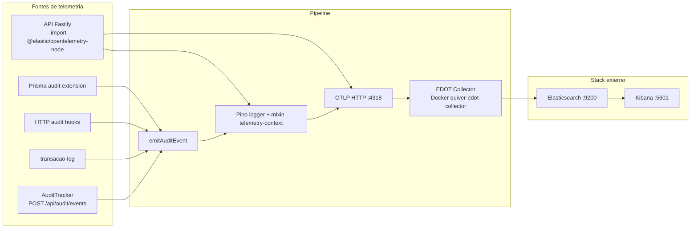

# Prompt de handoff — Observabilidade Quiver Tap

> Copie **todo o conteúdo abaixo da linha `---`** e cole como primeira mensagem em um novo chat com a IA.

---

## Contexto do projeto

Você está no repositório **Quiver Tap** (Cervejaria), monorepo Node/React + Fastify + Prisma + PostgreSQL, deploy Windows local com Cloudflare Tunnel.

**Regra de ambientes:**
- DEV: API `:3002`, frontend Vite `:5202`, banco `cervejaria_dev`, `.env.development`
- PROD: API `:3001`, frontend estático via API, banco `cervejaria`, `.env.production`
- Deploy prod só com autorização explícita (`npm run prod:deploy -- -Confirmed`)

**Commit recente relevante:** `2acee07` — exclusão de clientes + observabilidade audit + scripts prod.

---

## Arquitetura de observabilidade (visão geral)



**Princípio central:** audit **não** usa cliente Elasticsearch direto. Tudo passa por **Pino** → **OTLP** → **EDOT Collector** → **Elasticsearch** (mapping OTel, índices dinâmicos).

**Bootstrap OTel:** Node inicia com `--import @elastic/opentelemetry-node` (ver `backend/package.json` scripts `dev`/`start`). Não há init OTel manual no código — só env vars + import.

---

## Quatro fontes de audit (backend)

| Fonte | Arquivo | Actions | Notas |
|-------|---------|---------|-------|
| HTTP API | `backend/src/lib/audit-hooks.ts` | `http.get`, `http.post`, ... | Ignora `/api/health`, `/api/ready`, `/api/audit/events`, estáticos |
| SQL Prisma | `backend/src/lib/prisma-audit.ts` | `db.create`, `db.findMany`, ... | Controlado por `AUDIT_SQL` e `AUDIT_SQL_SAMPLE_RATE` |
| Transações de negócio | `backend/src/lib/transacao-log.ts` | `transacao.comanda_criada`, etc. | Persiste em `transacaoLog` + emite audit |
| UI frontend | `backend/src/routes/audit.ts` | `ui.page_view`, `ui.click`, `ui.submit` | Batch POST; exige sessão staff ou cliente |

Todas convergem em `backend/src/lib/audit/emit-audit-event.ts`.

**Integração em `backend/src/app.ts`:**
- `createLogger()` como logger Fastify
- `registerAuditHooks(app)` antes das rotas
- `auditRoutes` em `/api/audit`

---

## Contexto por request (tenant + actor)

`backend/src/lib/telemetry-context.ts` usa **AsyncLocalStorage** para:

- `cervejariaId`, `cervejaria.slug`, `env` (`dev`|`prd`)
- `actor`: `usuario` | `cliente` | `system` | `anonymous`

Resolução:
- JWT staff → slug via DB (cache 5 min); ADMIN sem cervejaria → `system`
- Cookie cliente → slug da cervejaria do cliente
- Rotas públicas `/api/public/cervejarias/{slug}` → slug da URL
- Fallback → `system` / `anonymous`

Pino `mixin()` injeta esses campos em **todos** os logs quando há contexto.

---

## Nomenclatura de índices e namespaces

**Namespace:** `dev` ou `prd` (de `getObservabilityEnv()` = `NODE_ENV === 'production' ? 'prd' : 'dev'`)

**Audit (explícito em emit-audit-event):**
- `data_stream.dataset`: `audit-{slug}`
- `data_stream.namespace`: `dev` | `prd`
- `elasticsearch.index`: `audit-{slug-sanitizado}.otel-{dev|prd}`
- Exemplo prod: `audit-cia-maritima.otel-prd`

**Logs/traces/metrics (auto OTel):**
- `logs-{dataset}.otel-{namespace}`, `traces-*.otel-prd`, `metrics-generic.otel-default*`

**Kibana data views** em `deploy/observability/`:
- Audit DEV: `audit-*.otel-dev`
- Audit PRD: `audit-*.otel-prd`
- Logs PRD: `logs-*.otel-prd`
- Traces PRD: `traces-*.otel-prd`
- Metrics: `metrics-generic.otel-default*`
- Infra: `metrics-infra.otel-*`

---

## Variáveis de ambiente (observabilidade)

Copiar de `backend/.env.development.example` e `backend/.env.production.example`:

| Variável | Dev típico | Prod típico |
|----------|------------|-------------|
| `OTEL_EXPORTER_OTLP_ENDPOINT` | `http://127.0.0.1:4318` | igual |
| `OTEL_SERVICE_NAME` | `quiver-tap-api-dev` | `quiver-tap-api` |
| `OTEL_RESOURCE_ATTRIBUTES` | `deployment.environment.name=development,...` | `...=production,...` |
| `OTEL_TRACES/METRICS/LOGS_EXPORTER` | `otlp` | `otlp` |
| `ELASTIC_OTEL_NODE_ENABLE_LOG_SENDING` | `true` | `true` |
| `AUDIT_SQL` | `true` | `true` |
| `AUDIT_SQL_SAMPLE_RATE` | `1` | `1` (ajustar em prod se verboso) |
| `LOG_LEVEL` | `debug` | `info` |

Opcional ES com auth: `OTEL_EXPORTER_OTLP_HEADERS=Authorization=ApiKey ...`

---

## Infraestrutura (o que o repo controla vs externo)

**No repo:**
- `docker-compose.observability.yml` — só o **EDOT Collector** (`otel/opentelemetry-collector-contrib:0.120.0`)
- `deploy/observability/otel-collector-config.yml` — OTLP :4317/:4318 → Elasticsearch exporter (mapping otel)
- Scripts PowerShell em `scripts/observability/`
- Dashboard/alerts NDJSON + data views Kibana

**Externo (pré-requisito):**
- Elasticsearch `:9200` + Kibana `:5601` em Docker network **`elasticsearch-kibana_elastic`**
- Collector entra nessa network e aponta para `http://elasticsearch:9200`

**Comandos npm:**
```powershell
npm run obs:up          # sobe collector
npm run obs:kibana      # health + hints Fleet
npm run obs:configure   # data views, dashboard, alerts
```

---

## Frontend observability

**Única telemetria frontend:** audit de UI (sem Sentry/OTel no browser).

- `frontend/src/lib/audit-tracker.ts` — fila, batch (20 eventos / flush 5s / max 50), `sendBeacon` no unload
- `frontend/src/components/AuditTracker.tsx` — montado em `RootLayout` (`frontend/src/App.tsx`)
- Rastreia: `page_view` (SPA), `click` (button/a/`[data-audit]`), `submit` (forms)
- Envia: `POST /api/audit/events` com `credentials: include`
- **401** se não autenticado (eventos descartados no servidor)
- Label de click: `data-audit` > `aria-label` > textContent (120 chars) > tag
- **`data-audit` ainda não usado** nos componentes — labels vêm do texto visível

Distinção: click UI (`ui.click`) ≠ request HTTP resultante (`http.post`) — camadas separadas, mesmo índice audit.

---

## Redação e segurança

- `backend/src/lib/audit/redact.ts` — senhas, tokens, telefone mascarado
- Pino redact em `backend/src/lib/logger.ts` — headers auth/cookies
- HTTP audit: body só em mutações ou status >= 400; GET 2xx sem body

---

## Mensagens humanas (PT-BR)

`backend/src/lib/audit/describe.ts` — gera `message` legível para HTTP, SQL, UI e transações (ex.: "Consultou /api/clientes → 200").

---

## Scripts úteis de diagnóstico

- `backend/scripts/audit-prod-alignment.mjs` — verifica bundle servido, alinhamento dist vs src
- Scripts `diag-*` e `browser-test-clientes-prod.mjs` — diagnóstico pontual prod (locais, opcionais)

---

## Armadilhas conhecidas (produção Windows)

1. **API stale:** restart pode criar PID novo sem matar o listener antigo na `:3001`. Scripts corrigidos em `scripts/prod/restart-api.ps1` e `scripts/prod/start-api.ps1` — validam PID na porta.
2. **Watchdog:** `npm run prod:ensure` só faz health check pontual; **daemon** = `scripts/prod/start-watchdog-daemon.ps1` (PID em `deploy/runtime/watchdog.pid`).
3. **SQL audit sample rate 1** em dev gera muito volume — considerar reduzir em prod.
4. **Collector fallback:** se namespace ausente, collector força `dev` (`deploy/observability/otel-collector-config.yml`).

---

## O que NÃO fazer sem autorização

- `prod:deploy`, `prod:restart`, editar `.env.production`, migrar prod
- Hook `.cursor/hooks/block-prod-without-approval.mjs` bloqueia prod sem aprovação

---

## Tarefas típicas que a IA pode ajudar

- Adicionar novo `action` de audit em fluxo de negócio → `emitAuditEvent` ou `registrarTransacao`
- Criar data view Kibana para novo padrão de índice → JSON em `deploy/observability/` + `configure-kibana.ps1`
- Reduzir ruído SQL audit → `AUDIT_SQL_SAMPLE_RATE` ou filtros em `prisma-audit.ts`
- Melhorar labels UI → adicionar `data-audit` em botões críticos
- Debug "eventos não aparecem no Kibana" → checar collector up, OTEL env, namespace dev/prd, Discover no índice certo
- Correlacionar trace + audit → campos `trace_id` / `span_id` nos eventos audit

---

## Links Kibana úteis (local)

- Dashboard: `http://localhost:5601/app/dashboards#/view/quiver-tap-observability`
- Discover audit prod: índice `audit-*.otel-prd`
- Discover audit dev: índice `audit-*.otel-dev`

---

Fim do prompt de handoff.
