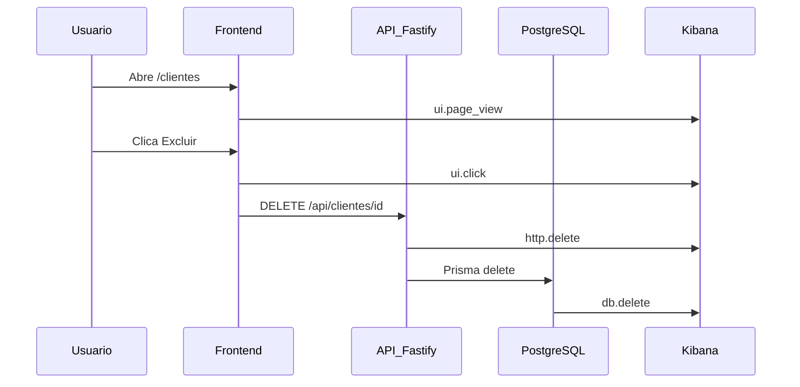
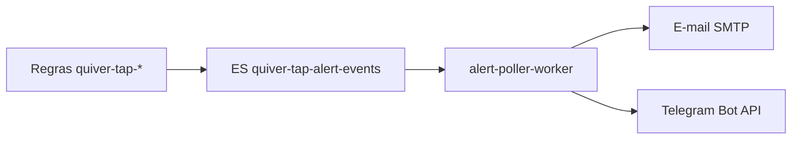

# Manual — Auditoria no Kibana (Quiver Tap)

Guia prático para investigar **quem fez o quê**, em **qual tela**, via **qual API** e com **qual consulta SQL**, usando os eventos de audit do Quiver Tap.

---

## 1. Pré-requisitos

| Item | Valor |
|------|-------|
| Kibana | http://localhost:5601 (login: `elastic` + senha em `deploy/observability/.env.observability`) |
| Elasticsearch | http://localhost:9200 (xpack.security habilitado) |
| Credenciais | Copie `deploy/observability/.env.observability.example` → `.env.observability` |
| Collector OTel | `npm run obs:up` |
| Configurar data views | `npm run obs:configure` |

### Data views corretos

Use **Discover** e selecione o data view conforme o ambiente:

| Data view | Ambiente | Padrão de índice |
|-----------|----------|------------------|
| **Quiver Tap Audit PRD** | Produção (`:3001`) | `logs-audit*.otel-prd` |
| **Quiver Tap Audit DEV** | Desenvolvimento (`:3002`) | `logs-audit*.otel-dev` |
| **Quiver Tap Metrics PRD** | Produção (`:3001`) | `metrics-generic.otel-prd*` |
| **Quiver Tap Metrics DEV** | Desenvolvimento (`:3002`) | `metrics-generic.otel-dev*` |

> **Dica:** no seletor de data views, digite `audit` no campo *Find a data view*.

**Alternativa:** *Quiver Tap Logs PRD* / *Logs DEV* também contém audit, mas mistura logs técnicos da API. Prefira os data views **Audit**.

> Métricas auto do Node.js (CPU, event loop, heap) usam o namespace derivado de `deployment.environment.name` no collector OTel. Logs, traces e audit já vinham segregados por `otel-prd` / `otel-dev`.

### Links rápidos

- [Discover Audit PRD](http://localhost:5601/app/discover#/?_a=(index:'logs-audit*.otel-prd')&_g=(time:(from:now-7d,to:now)))
- [Discover Audit DEV](http://localhost:5601/app/discover#/?_a=(index:'logs-audit*.otel-dev')&_g=(time:(from:now-7d,to:now)))
- [Regras de alerta](http://localhost:5601/app/management/insightsAndAlerting/triggersActions/rules)
- [Dashboard métricas PRD](http://localhost:5601/app/dashboards#/view/quiver-tap-observability-prd)
- [Dashboard métricas DEV](http://localhost:5601/app/dashboards#/view/quiver-tap-observability-dev)
- [Dashboard infra](http://localhost:5601/app/dashboards#/view/quiver-tap-observability-infra)

---

## 2. Visão geral — três camadas de evento

Um fluxo típico do usuário gera eventos **separados**, todos no mesmo índice de audit:



| Camada | `event.action` | Responde |
|--------|----------------|----------|
| Interface | `ui.page_view`, `ui.click`, `ui.submit` | Qual **tela** e qual **botão** |
| HTTP | `http.get`, `http.post`, `http.put`, `http.delete`, … | Qual **rota da API** e status |
| SQL | `db.findMany`, `db.create`, `db.update`, `db.delete`, … | Qual **model/tabela** e resumo da query |
| Negócio | `transacao.*` | Ação funcional (comanda, pagamento, etc.) |

Todos os eventos incluem `event.category: audit` e campos de **tenant** (`cervejaria.*`) e **ator** (`actor.*`).

---

## 3. Referência de campos

### 3.1 Identificação do evento

| Campo | Tipo | Descrição | Exemplo |
|-------|------|-----------|---------|
| `@timestamp` | date | Momento do evento | `2026-07-16T20:15:00Z` |
| `message` | text | Descrição legível em PT-BR | `Consultou /api/clientes → 200` |
| `event.category` | keyword | Sempre `audit` para estes eventos | `audit` |
| `event.action` | keyword | Tipo da ação | `http.get`, `ui.click`, `db.update` |
| `event.outcome` | keyword | Resultado | `success`, `failure` |

### 3.2 Cervejaria (tenant)

| Campo | Descrição | Exemplo |
|-------|-----------|---------|
| `cervejaria.slug` | Slug da cervejaria | `cia-maritima` |
| `cervejaria.id` | UUID no banco | `a1b2c3d4-...` |
| `data_stream.dataset` | Dataset OTel | `audit-cia-maritima` |
| `data_stream.namespace` | Ambiente observabilidade | `prd` ou `dev` |

**Índice físico (Elasticsearch):** `logs-audit_cia_maritima.otel-prd` (underscore no slug, prefixo `logs-`).

### 3.3 Quem fez (ator)

| Campo | Descrição | Valores |
|-------|-----------|---------|
| `actor.type` | Tipo de ator | `usuario`, `cliente`, `system`, `anonymous` |
| `actor.id` | ID do usuário staff ou sessão | UUID |
| `actor.name` | Nome exibido | `João Silva` |
| `actor.email` | E-mail (staff) | `joao@cervejaria.com` |
| `actor.cliente_id` | ID do cliente (app público) | UUID |

### 3.4 Interface (telas e cliques)

O frontend usa estratégia **híbrida** (`frontend/src/lib/audit-tracker.ts`):

1. **Fallback genérico** — captura cliques em `button`, `a`, `[role="button"]` e `[data-audit]`
2. **Labels semânticos** — botões críticos usam `data-audit="..."` (ex.: `quiosque-caixa-fechar`, `comanda-abrir`)
3. **Ordem de rótulo** — `data-audit` → `aria-label` → texto do botão → tag HTML
4. **Erros de UI** — `ui.error` via `AuditErrorBoundary` (dedup 60s, máx. 20/sessão)

| Campo | Descrição | Exemplo |
|-------|-----------|---------|
| `ui.page` | Rota SPA (path + query) | `/clientes`, `/comandas/abc123` |
| `ui.label` | Rótulo do clique | `quiosque-caixa-fechar`, `Abrir Comanda` |
| `ui.element` | Tag HTML ou seletor | `button`, `a`, `data-audit` |

**Actions:** `ui.page_view`, `ui.click`, `ui.submit`, `ui.error`

### 3.5 HTTP (API)

| Campo | Descrição | Exemplo |
|-------|-----------|---------|
| `http.request.method` | Verbo HTTP | `GET`, `POST`, `DELETE` |
| `http.route` | Rota Fastify (template) | `/api/clientes`, `/api/clientes/:id` |
| `http.response.status_code` | Status da resposta | `200`, `404`, `500` |
| `metadata.requestBody` | Body da requisição (mutações ou erro) | JSON redigido |

> GET com sucesso **não** grava body. POST/PUT/PATCH/DELETE e respostas `>= 400` podem incluir `metadata.requestBody`.

### 3.6 SQL (Prisma)

| Campo | Descrição | Exemplo |
|-------|-----------|---------|
| `db.model` | Model Prisma | `Cliente`, `Comanda`, `Produto` |
| `db.operation` | Operação | `findMany`, `update`, `delete` |
| `db.query` | Resumo redigido dos args | `delete Cliente WHERE {"id":"..."}` |
| `db.duration_ms` | Duração em ms | `4` |

**Actions:** `db.create`, `db.findMany`, `db.findUnique`, `db.update`, `db.delete`, etc.

Controlado por `AUDIT_SQL=true` e `AUDIT_SQL_SAMPLE_RATE` (padrão `1` = todas as operações).

### 3.7 Transações de negócio

| Campo | Descrição | Exemplo |
|-------|-----------|---------|
| `event.action` | `transacao.{tipo}` | `transacao.comanda_criada` |
| `entity.type` | Tipo da entidade | `Comanda` |
| `entity.id` | ID da entidade | UUID |
| `metadata` | Dados extras da transação | `{ "valor": 50 }` |

Persistido também na tabela `transacaoLog` do PostgreSQL.

### 3.8 Correlação (trace)

| Campo | Descrição | Uso |
|-------|-----------|-----|
| `trace_id` | ID do trace OpenTelemetry | Correlacionar **HTTP + SQL** da mesma requisição |
| `span_id` | ID do span | Detalhe dentro do trace |

> **Importante:** `ui.click` e `http.post` da ação do usuário **não compartilham** o mesmo `trace_id` (o clique é enviado depois, em batch, via `POST /api/audit/events`). Use **timestamp + actor** para juntar tela e API.

---

## 4. Configurar o Discover

### Colunas recomendadas

Adicione estas colunas (ícone de colunas no Discover):

```
@timestamp
message
event.action
cervejaria.slug
actor.type
actor.name
actor.email
ui.page
ui.label
http.route
http.response.status_code
db.model
db.query
trace_id
```

### Ordenação

Ordene por **`@timestamp`** decrescente para ver a timeline do mais recente ao mais antigo.

### Janela de tempo

Canto superior direito: escolha *Last 7 days*, *Last 24 hours* ou intervalo customizado.

---

## 5. Exemplos KQL (Kibana Query Language)

No Discover, defina o idioma da query como **KQL** e use os exemplos abaixo.

### 5.1 Por cervejaria

```kql
cervejaria.slug: "cia-maritima"
```

```kql
data_stream.dataset: "audit-cia-maritima" and data_stream.namespace: "prd"
```

### 5.2 Por usuário

```kql
cervejaria.slug: "cia-maritima" and actor.email: "dono@ciamaritima.com.br"
```

```kql
actor.type: "usuario" and actor.name: *Silva*
```

```kql
actor.type: "cliente" and actor.cliente_id: "uuid-do-cliente"
```

### 5.3 Só eventos de interface (telas)

```kql
event.action: "ui.page_view" and cervejaria.slug: "cia-maritima"
```

```kql
event.action: "ui.click" and ui.page: "/clientes*"
```

```kql
ui.label: *Excluir* and event.action: "ui.click"
```

### 5.4 Só chamadas HTTP

```kql
event.action: http.* and cervejaria.slug: "cia-maritima"
```

```kql
http.route: "/api/clientes*" and http.request.method: "DELETE"
```

```kql
http.response.status_code >= 400 and cervejaria.slug: "cia-maritima"
```

### 5.5 Só SQL

```kql
event.action: db.* and cervejaria.slug: "cia-maritima"
```

```kql
db.model: "Cliente" and db.operation: "delete"
```

```kql
db.query: *Comanda* and db.operation: "update"
```

### 5.6 Transações de negócio

```kql
event.action: transacao.* and cervejaria.slug: "cia-maritima"
```

```kql
event.action: "transacao.comanda_criada"
```

### 5.7 Jornada completa de um usuário

```kql
cervejaria.slug: "cia-maritima"
  and actor.email: "dono@ciamaritima.com.br"
  and event.action: (ui.* or http.* or db.* or transacao.*)
```

Leia a timeline de cima para baixo (ordem decrescente de tempo):

1. `ui.page_view` — abriu a tela  
2. `ui.click` — clicou em algo  
3. `http.post` / `http.delete` — API executada  
4. `db.*` — queries no banco  
5. `transacao.*` — registro funcional (se houver)

### 5.8 Correlacionar SQL com uma requisição HTTP

1. Localize um evento `http.delete` ou `http.post`
2. Copie o valor de `trace_id`
3. Filtre:

```kql
trace_id: "COLE_O_TRACE_ID_AQUI" and event.action: db.*
```

Todos os `db.*` com o mesmo `trace_id` pertencem à **mesma requisição** à API.

### 5.9 Falhas

```kql
event.outcome: "failure" and cervejaria.slug: "cia-maritima"
```

```kql
http.response.status_code >= 500
```

```kql
message: *falhou*
```

---

## 6. Cenários práticos passo a passo

### Cenário A — “Quem excluiu o cliente X?”

1. Data view: **Quiver Tap Audit PRD**
2. Query:

```kql
cervejaria.slug: "cia-maritima"
  and (event.action: "http.delete" or event.action: db.delete)
  and http.route: *clientes*
```

3. Verifique `actor.name`, `actor.email`, `@timestamp`
4. Abra o documento e veja `metadata.requestBody` (se houver)
5. Use `trace_id` para listar todas as queries SQL da exclusão

### Cenário B — “O que o usuário fez na tela de comandas?”

```kql
cervejaria.slug: "cia-maritima"
  and actor.email: "atendente@ciamaritima.com.br"
  and ui.page: "/comandas*"
```

Inclua também cliques e APIs:

```kql
cervejaria.slug: "cia-maritima"
  and actor.email: "atendente@ciamaritima.com.br"
  and (ui.page: "/comandas*" or http.route: "/api/comandas*")
```

### Cenário C — “Quais queries rodaram ao salvar um produto?”

1. Encontre o `http.put` ou `http.post` em `/api/produtos*`
2. Copie `trace_id`
3. Query:

```kql
trace_id: "..." and event.action: db.*
```

4. Leia `db.model`, `db.operation`, `db.query`, `db.duration_ms`

### Cenário D — “Auditoria de um cliente do app público”

```kql
actor.type: "cliente" and cervejaria.slug: "cia-maritima"
```

```kql
actor.cliente_id: "uuid-do-cliente-logado"
```

---

## 7. Exemplo de documento no Elasticsearch

Trecho simplificado de um evento HTTP:

```json
{
  "@timestamp": "2026-07-16T23:10:05.123Z",
  "message": "Excluiu /api/clientes/abc-123 → 200",
  "event.category": "audit",
  "event.action": "http.delete",
  "event.outcome": "success",
  "cervejaria.slug": "cia-maritima",
  "cervejaria.id": "uuid-cervejaria",
  "actor.type": "usuario",
  "actor.email": "dono@ciamaritima.com.br",
  "actor.name": "Maria Dono",
  "http.request.method": "DELETE",
  "http.route": "/api/clientes/:id",
  "http.response.status_code": 200,
  "trace_id": "4bf92f3577b34da6a3ce929d0e0e4736",
  "span_id": "00f067aa0ba902b7",
  "data_stream.dataset": "audit-cia-maritima",
  "data_stream.namespace": "prd"
}
```

Trecho de um evento SQL na mesma requisição (mesmo `trace_id`):

```json
{
  "@timestamp": "2026-07-16T23:10:05.127Z",
  "message": "SQL delete em Cliente (3 ms)",
  "event.action": "db.delete",
  "db.model": "Cliente",
  "db.operation": "delete",
  "db.query": "delete Cliente WHERE {\"id\":\"abc-123\"}",
  "db.duration_ms": 3,
  "trace_id": "4bf92f3577b34da6a3ce929d0e0e4736",
  "cervejaria.slug": "cia-maritima"
}
```

Trecho de clique na interface (trace **diferente**):

```json
{
  "@timestamp": "2026-07-16T23:10:03.500Z",
  "message": "Clicou em \"Excluir\" na página /clientes",
  "event.action": "ui.click",
  "ui.page": "/clientes",
  "ui.label": "Excluir",
  "actor.email": "dono@ciamaritima.com.br",
  "cervejaria.slug": "cia-maritima"
}
```

---

## 8. Limitações e boas práticas

### O que funciona bem

- Filtrar por **cervejaria**, **usuário**, **tela**, **rota API**, **model SQL**
- Correlacionar **HTTP ↔ SQL** via `trace_id`
- Ler **`message`** em português para triagem rápida

### Limitações atuais

| Limitação | Detalhe |
|-----------|---------|
| UI ↔ HTTP | Clique e API têm `trace_id` diferentes; correlacione por **horário + actor** (segundos de diferença) |
| Labels de clique | Fluxos críticos têm `data-audit`; demais usam texto/`aria-label` do botão |
| Volume SQL | `AUDIT_SQL_SAMPLE_RATE=1` gera muitos eventos `db.*`; filtre quando não precisar |
| GETs | Body não é registrado em GETs com sucesso |
| Dados sensíveis | Senhas, tokens e telefones são redigidos — não espere ver valores completos |

### Dicas

1. Comece sempre pelo **Audit PRD/DEV** correto (não Metrics/Traces)
2. Filtre primeiro **cervejaria + usuário**, depois afunile por `event.action`
3. Use **`message`** para leitura humana e campos estruturados para filtros precisos
4. Para investigações longas, salve a busca: *Save* → *Save search*
5. Eventos de **system** / **anonymous** indicam contexto não resolvido (health, rotas públicas sem login)

---

## 9. Data views — quando usar cada um

| Data view | Use para |
|-----------|----------|
| **Audit PRD / DEV** | Logs transacionais e auditoria por cervejaria |
| **Logs PRD / DEV** | Logs técnicos + audit (busca ampla) |
| **Traces PRD / DEV** | Latência APM, spans por rota |
| **OTel Metrics** | CPU, memória, event loop da API |
| **Metrics Infra** | Métricas de host (se configurado) |

---

## 10. Investigação de erros 4xx (UX)

### KQL — falhas HTTP em produção

```
data_stream.namespace: "prd" and attributes.event.outcome: "failure" and attributes.http.response.status_code >= 400
```

Data view: **Quiver Tap Audit PRD** (`logs-audit*.otel-prd`).

Campos úteis: `attributes.http.route`, `attributes.http.response.status_code`, `attributes.actor.name`, `attributes.ui.page`, `metadata.responseError.error`, `trace_id`.

### Correlacionar jornada do usuário (trace_id)

1. No Discover, filtre um evento HTTP com `attributes.event.outcome: failure`.
2. Copie o `trace_id` do documento.
3. Nova busca: `trace_id: "<id>"` no mesmo data view (±30 min).
4. Ordene por `@timestamp` — reconstrua: `ui.page_view` → `ui.click` → `http.post`/`http.get` falho.

Eventos UI e HTTP compartilham `trace_id` quando gerados na mesma requisição/trace OTel.

### Relatório CLI (sem PII)

```powershell
npm run obs:report-4xx
```

Agrega contagem por status, rota e dia (últimos 14 dias).

---

## 11. Alertas por e-mail e Telegram

### Fluxo (licença Kibana Basic)



1. Regras Kibana disparam e gravam no índice `quiver-tap-alert-events` (connector `.index`).
2. O worker `alert-poller` consulta o ES a cada ~30s.
3. Notifica por **e-mail** e/ou **Telegram**, conforme variáveis de ambiente.

Setup inicial:

```powershell
npm run obs:alert-email   # índice + connector + vincular regras
npm run alert-poller:start
```

### Variáveis de ambiente

| Variável | Canal | Descrição |
|----------|-------|-----------|
| `OBS_ALERT_EMAIL_TO` | E-mail | Destinatários (vírgula ou ponto-e-vírgula) |
| `OBS_ALERT_TELEGRAM_BOT_TOKEN` | Telegram | Token do bot criado no @BotFather |
| `OBS_ALERT_TELEGRAM_CHAT_ID` | Telegram | ID do chat (usuário ou grupo) |

Pelo menos **um** canal deve estar configurado. E-mail e Telegram podem coexistir.

### Ativar bot Telegram (uma vez)

1. No Telegram, abra **@BotFather** → `/newbot` → copie o **token**.
2. Abra conversa com seu bot e envie `/start`.
3. Descubra o **chat_id**: acesse `https://api.telegram.org/bot<TOKEN>/getUpdates` e procure `"chat":{"id":...}`.
4. Preencha `OBS_ALERT_TELEGRAM_BOT_TOKEN` e `OBS_ALERT_TELEGRAM_CHAT_ID` em `backend/.env.production` (ou `.env.development` para testes).
5. Teste: `npm run obs:test-telegram`

**Grupo (opcional):** adicione o bot ao grupo, envie uma mensagem, repita `getUpdates` e use o `chat_id` do grupo (geralmente negativo).

### Regras que disparam alertas

Todas as regras `quiver-tap-*` habilitadas via `npm run obs:configure` / `obs:alert-email`, incluindo:

- `quiver-tap-ui-error-prd` — erros de tela (`ui.error`)
- `quiver-tap-5xx-rate-prd` — HTTP 5xx (>2 em 15 min)
- `quiver-tap-api-ready-down-prd` — API fora do ar
- `quiver-tap-transacao-failure-prd` — falhas transacionais
- SLOs, event loop, postgres, telemetry gap, etc.

Variantes `-dev` também notificam se habilitadas.

### Limitações

- Dedup de 5 min no poller evita spam da mesma regra.
- Cada regra Kibana tem janela própria (ex.: 5xx só dispara se >2 em 15 min).
- O usuário precisa ter enviado `/start` ao bot antes de receber mensagens.

### Testes

```powershell
npm run obs:test-webhook    # POST /api/observability/kibana-alert → e-mail
npm run obs:test-telegram   # Bot API direto → Telegram
```

---

## 12. Comandos úteis

```powershell
# Subir collector
npm run obs:up

# Criar/atualizar data views, dashboard e alertas
npm run obs:configure

# Corrigir cluster ES yellow (single-node)
npm run obs:fix-es-replicas

# Politicas ILM (traces 30d, audit 90d)
npm run obs:ilm

# Relatorio agregado 4xx prod
npm run obs:report-4xx

# Testar alertas
npm run obs:test-webhook
npm run obs:test-telegram

# Verificar saúde Kibana/Fleet
npm run obs:kibana
```

---

## 13. Referência cruzada no código

| Fonte | Arquivo |
|-------|---------|
| Emissão de eventos | `backend/src/lib/audit/emit-audit-event.ts` |
| Hooks HTTP | `backend/src/lib/audit-hooks.ts` |
| SQL Prisma | `backend/src/lib/prisma-audit.ts` |
| UI (batch) | `backend/src/routes/audit.ts`, `frontend/src/lib/audit-tracker.ts` |
| Transações | `backend/src/lib/transacao-log.ts` |
| Mensagens PT-BR | `backend/src/lib/audit/describe.ts` |
| Redação | `backend/src/lib/audit/redact.ts` |
| Alertas e-mail/Telegram | `backend/src/lib/kibana-alert-email.ts`, `backend/src/lib/telegram-alert.ts` |
| Data views Kibana | `deploy/observability/kibana-audit-data-view-*.json` |

---

*Última atualização: jul/2026 — padrão de índice audit: `logs-audit*.otel-{dev|prd}`*
