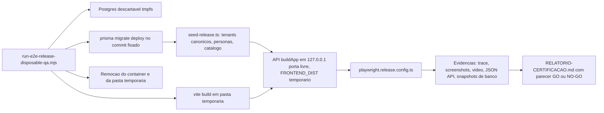

# Plano de Regressão E2E — Certificação de Release do PDV Único

- **Work item:** TAP-98 — "[QA] Refazer suíte de regressão E2E para o modelo PDV único (certificação de release)" (Plane, projeto Tap Quiver, In Progress, `Quality`, `high`).
- **Branch:** `chore/tap-98-e2e-release-regression` (criada a partir de `origin/main` em `dfe94abe`).
- **Objetivo:** reconstruir a regressão E2E para o modelo único (PDV canônico, sem modos Caixa/Evento), em Postgres descartável com paridade de configuração de produção, cobrindo todos os módulos com casos de sucesso, de exceção e RBAC, e gerando evidências rastreáveis e um parecer GO/NO-GO para liberação aos clientes.
- **Quem executa:** pode ser qualquer agente (Cursor, Codex) ou pessoa. A seção 10 é o guia de implementação; a seção 11 traz prompts prontos por etapa.

## 1. Contexto e decisões

- **Modelo alvo:** apenas o PDV canônico (`configurationSource = CANONICAL_PDV`), que opera por caixa. "Evento" passa a ser só uma ocorrência de agenda associada ao abrir o caixa. LEGACY não é testado como caminho suportado.
- **Bloqueador já identificado:** a ativação canônica depende de uma allowlist com 2 IDs fixos em [backend/src/lib/pdv-tenant-activation.ts](../../../backend/src/lib/pdv-tenant-activation.ts) (`allowed = new Set([...])`). Uma empresa nova provisionada em `/api/admin/cervejarias/provision` nasce LEGACY, com Caixa/Evento e sem RBAC individual. O caso `ADM-S02` prova isso. Se falhar, o parecer é **NO-GO para clientes novos** e o achado vira Suggested Plane Item.
- **Situação atual (verificada em 18/10/2026):**
  - CIA Marítima (`cmr9yis3c0000hvu00q9fe7y1`) e Churrasquinho do Thiago (`cmsry9xrn0000hvlgopjxy0oo`) estão canônicos em DEV e PROD: `PDV_CANONICAL_TENANTS` nos dois `.env`; no DEV, cada uma tem 1 PDV ativo com configuração.
  - "Demo Chopp Móvel" (`demo-chopp`) e "Lanchonete" (`lanchonete`) estão ativas no DEV fora da allowlist, portanto em LEGACY.
- **Ambiente:** Postgres descartável (`cervejaria_qa_pdv_unico`, portas 55439–55449, tmpfs), migrations do commit fixado, API servindo o frontend compilado e `PDV_CANONICAL_TENANTS` igual ao de produção, com as duas empresas semeadas usando os IDs da allowlist. Nada toca `:3001`, `:3002` ou `cervejaria_dev`.

## 2. Arquitetura de execução



- O novo runner usa como base [backend/scripts/run-pdv-individual-permissions-disposable-qa.mjs](../../../backend/scripts/run-pdv-individual-permissions-disposable-qa.mjs) (porta, container com labels de dono, manifest de migrations fixado, limpeza segura) e a forma como [backend/scripts/pdv-individual-permissions.isolated.test.mjs](../../../backend/scripts/pdv-individual-permissions.isolated.test.mjs) sobe a API (`buildApp` + `setupSocketIO` + `app.listen({ host: '127.0.0.1', port: 0 })`) e chama o Playwright.
- O ambiente usa `NODE_ENV=test`, `PDV_ISOLATED_QA=1`, `PDV_CANONICAL_TENANTS=<2 IDs>` (paridade com produção, sem o atalho global `PDV_CANONICAL_CONFIG_QA`), `QA_RATE_LIMIT_LOGIN_MAX` alto, um `JWT_SECRET` aleatório e `UPLOADS_DIR` temporário.
- O Playwright usa 4 projetos: `desktop` (dono e caixa, 1440x900), `mobile` (atendente e portal, Pixel 7), `tablet` (cozinha, 1180x820) e `tv` (cozinha TV e ranking, 1920x1080).
- Novo script `npm run qa:release-e2e` (backend) e um atalho na raiz.

## 3. Massa de teste (seed determinístico)

- **Empresa A (canônica, ID `cmr9yis3c0000hvu00q9fe7y1`):** 1 PDV ativo com `ConfiguracaoPontoVenda` (taps, estoque e cozinha ligados), 2 taps mapeados, chave PIX e branding.
- **Empresa B (canônica, ID `cmsry9xrn0000hvlgopjxy0oo`):** massa mínima, usada para testar isolamento entre empresas.
- **Empresa C:** criada durante o teste pelo Admin (caso `ADM-S02`).
- **Catálogo da Empresa A:**
  - chope Pilsen e IPA (300/500/700 ml, por litro, ligados aos taps);
  - porção com opcional e `exigePreparo`, com estoque por unidade;
  - lata com estoque mínimo crítico;
  - item sem controle de estoque;
  - produto inativo;
  - 1 cardápio salvo;
  - categorias ordenadas.
- **Personas** (senhas aleatórias por execução, nenhuma credencial no código):
  - `ADMIN`, `DONO-A`, `DONO-B`;
  - ATENDENTE "Salão": `command.read`, `command.operate`;
  - ATENDENTE "Caixa": `cash.*`, `payment.receive`, `debt.receive`, `command.close`, `discount.apply`;
  - ATENDENTE "Cozinha": `kitchen.read`, `kitchen.operate`;
  - ATENDENTE "Cozinha-Líder": "Cozinha" + `kitchen.cancel`, `sale.refund`;
  - ATENDENTE "Estoque": `inventory.read`, `inventory.adjust`;
  - ATENDENTE "Gerente": todas as permissões, exceto `command.item.cancel.delivered`;
  - ATENDENTE "Sem permissão": lista vazia.
- **Cliente do portal:** telefone único gerado por execução, mais um cliente com conta pendente (fiado).

## 4. Catálogo de casos

Prioridade: **P0** bloqueia a release, **P1** é grave, **P2** é desejável. Módulos sem prioridade explícita são P1. Sufixo `S` = sucesso, `X` = exceção. Todo caso `X` confere a mensagem de erro exibida na UI, o status HTTP e que **o banco ficou inalterado** (contagem e hash antes e depois).

### SMK — Pré-condições (P0)
- S01: `/api/health` devolve o `releaseSha` esperado; S02: `/api/ready` devolve 200; S03: o guard de escrita em produção recusa alvo `:3001`.
- S04: o login de cada persona cai na tela inicial correta (DONO e Caixa em `/operacao/comandas`, Cozinha em `/operacao/cozinha`).

### AUT — Autenticação e sessão
- S01: login e logout; S02: esqueci a senha e redefinição com token; S03: `/me` reflete papel e permissões; S04: troca de usuário no mesmo dispositivo.
- X01: credencial errada dá 401 com mensagem genérica; X02: empresa inativa dá 403; X03: rate limit de login; X04: token expirado ou adulterado leva ao login; X05: ADMIN numa rota de empresa dá 403 e redireciona para `/admin`; X06: rota inexistente cai no `CatchAll`.

### ADM — Admin da plataforma
- S01: listar, editar, ativar e desativar empresa.
- **S02 (P0, BLOQUEADOR): uma empresa provisionada pelo Admin nasce canônica**, sem seletor "Por caixa / Por operações", com `configurationSource=CANONICAL_PDV` e RBAC individual aplicado.
- S03: SMTP de teste; S04: backup (executar e baixar); S05: reextrair branding.
- X01: atendente ou dono chamando `/api/admin/*` dá 403; X02: slug duplicado; X03: textos sem acentuação corrompida (hoje `AdminCervejariasPage.tsx:133`).

### ONB — Onboarding
- S01: checklist e `readiness` refletem o progresso real (caixa, produto, estoque, primeira venda); S02: o wizard não mostra escolha de modo.
- X01: todos os links e destaques do onboarding existem (hoje `/venda-avulsa` e `brewery-start-sale` estão quebrados).

### CFG — Configurações (só dono)
- S01: grupos do PDV (recursos, atendimento, tela de comandas, cozinha, pagamentos/PIX, WhatsApp, portal/QR) persistem e afetam a operação.
- S02: aparência (logo, cor, fundo do portal, prévia por dispositivo); S03: mesas; S04: torneiras do PDV; S05: perfil visual da cozinha salvo por dispositivo.
- X01: atendente acessando `/operacao/configuracoes/*` é redirecionado e recebe 403 na API.
- X02: tentar EVENTO dá 409 `CANONICAL_PDV_MODE_CHANGE_UNSUPPORTED`; X03: mutação de trailer dá 409 `CANONICAL_PDV_TRAILER_MUTATION_BLOCKED`.
- X04: "fechar com pedido pendente" sem "cobrar no lançamento" dá 400; X05: upload acima de 5 MB ou com tipo inválido; X06: desligar a cozinha com pedidos ativos dá 409; X07: as abas `trailers` e `operacao` legadas não aparecem.

### RBAC — Matriz de permissões (P0)
- S01: matriz das 28 chaves × (menu, rota, botão, API): para cada chave, conceder dá acesso, revogar bloqueia, sem precisar novo login.
- S02: DONO acessa tudo; S03: cadastro de funcionário pelo dono (sempre ATENDENTE).
- X01: persona "Sem permissão" não vê nenhum item de menu e recebe 403 em todas as escritas.
- X02: `command.item.cancel.delivered` concedida a atendente não habilita a ação (só dono); X03: e-mail duplicado dá 409.
- X04: atendente editando permissões dá 403; X05: editar permissões de usuário de outra empresa dá 404; X06: alvo não-atendente dá 409.
- X07: chaves de evento (`event.dashboard.read`, `event.menu.manage`) não aparecem ou não têm efeito no canônico (registrar a decisão de produto).

### CAT — Catálogo e cardápio
- S01: CRUD de produto, opcional e categoria, com ordenação; S02: cardápio salvo (criar, ativar); S03: ativar e desativar produto reflete no PDV e no portal.
- S04: preço no escopo TURNO com `catalog.shift.manage`; S05: preço TEMPLATE com `catalog.manage`.
- X01: sem permissão, a tela e a API ficam bloqueadas; X02: TURNO sem permissão dá 403; X03: produto inativo não pode ser vendido.

### CXA — Caixa e turno (P0)
- S01: abrir com troco e cardápio; S02: sangria e suprimento; S03: corrigir movimento com credencial do dono (gera ESTORNO + SUBSTITUICAO).
- S04: fechar com contagem que confere; S05: fechar com divergência registrada; S06: turno que passa da meia-noite.
- S07: encerramento administrativo (idempotente); S08: resumo do turno confere item a item com a massa; S09: abrir associando uma ocorrência de agenda.
- X01: abrir sem cardápio; X02: troco negativo; X03: segundo caixa aberto dá 409; X04: tap sem mapeamento; X05: fechar com comanda aberta é bloqueado com a quantidade de comandas.
- X06: vender sem caixa aberto; X07: credencial do dono inválida na correção; X08: corrigir duas vezes; X09: motivo do encerramento com menos de 8 caracteres.
- X10: sem `cash.values.read`, os valores aparecem mascarados na UI e na API.

### CMD — Comanda, venda e pagamento (P0)
- **Comanda:**
  - S01: abrir comanda (mesa, cliente) e lançar chope 300, 500 e 700 ml pelo tap, mais porção com opcional e observação;
  - S02: alterar quantidade;
  - S03: cancelar item não entregue (motivo, devolução ao estoque);
  - S04: cancelar item entregue (dono).
- **Desconto e pagamento:**
  - S05: desconto;
  - S06: pagamento dividido entre dinheiro (com troco), PIX, débito e crédito;
  - S07: fechamento em grupo;
  - S08: deixar pendente (fiado) e receber depois em Contas pendentes, parcial e total.
- **Venda avulsa, WhatsApp e tempo real:**
  - S09: venda avulsa e estorno;
  - S10: links WhatsApp (resumo, número da comanda) interceptados como `wa.me`;
  - S11: dois navegadores veem a comanda atualizar em tempo real;
  - S12: layout compacto (TAP-78).
- **Exceções de lançamento e cancelamento:**
  - X01: cobrar sem itens dá 409;
  - X02: soma dos pagamentos diferente do total;
  - X03: valor recebido menor que o devido;
  - X04: troco em forma diferente de dinheiro;
  - X05: desconto maior que o subtotal;
  - X06: desconto em venda avulsa;
  - X07: desconto sem permissão dá 403;
  - X08: fechar com cozinha pendente dá 409 (e passa quando as duas flags estão ligadas);
  - X09: cancelar item entregue numa comanda com pagamento dá 409;
  - X10: chave de idempotência reutilizada dá 409.
- **Exceções de fechamento e concorrência:**
  - X11: cancelar comanda com pagamento dá 409;
  - X12: fiado sem telefone do cliente;
  - X13: grupo com IDs duplicados;
  - X14: concorrência, com dois atendentes cancelando o mesmo item ("quantidade disponível mudou");
  - X15: lançar produto fora do cardápio do turno.

### KDS — Cozinha (P0)
- S01: fluxo RECEBIDO, EM_PREPARO, PRONTO, ENTREGUE (e voltar uma etapa); S02: cancelamento pendente confirmado pela Cozinha-Líder; S03: paginação.
- S04: TV da cozinha e modo demo; S05: pedido novo aparece sem recarregar; S06: aviso de pedido pronto por WhatsApp a partir da cozinha.
- X01: transição inválida dá 409 `KITCHEN_ORDER_TRANSITION_INVALID`; X02: dois tablets mudando o mesmo pedido dá 409 `KITCHEN_ORDER_STATUS_CONFLICT`.
- X03: cancelar sem `kitchen.cancel` ou sem `sale.refund`; X04: com a cozinha desligada, a rota e o menu somem e a API devolve 404.

### EST — Estoque
- S01: entrada, saída e ajuste; S02: venda baixa unidade e litros (chope por volume); S03: cancelamento devolve ao estoque; S04: alerta de estoque crítico e esgotado no PDV; S05: mínimo definido pelo dono.
- X01: saldo insuficiente bloqueia a venda; X02: litros com mais de 3 casas decimais; X03: unidade fracionada; X04: quantidade zero ou negativa.
- X05: mínimo definido por atendente dá 403; X06: com o estoque desligado, a rota e o menu somem.

### POR — Portal do cliente (QR do PDV)
- S01: entrar em `/c/:slug/p/:pv` com telefone e nome; S02: ver cardápio, fazer pedido e cancelar; S03: o status muda por polling (até 5 s) quando a equipe confirma ou recusa.
- S04: resumo da conta bate com a comanda da equipe; S05: o pedido do portal entra no caixa e no fechamento.
- X01: slug ou PDV inválido ou inativo; X02: cliente bloqueado; X03: sessão expirada; X04: rota de trailer `/c/:slug/t/:id` em empresa canônica é bloqueada ou redirecionada; X05: `/c/:slug/cadastro` mostra a página de link descontinuado.

### AGD — Agenda
- S01: criar, editar, arquivar, interromper e gerar ocorrências; S02: cancelar e restaurar ocorrência; S03: ocorrência associada aparece no caixa.
- X01: conflito de horário (`AGENDA_HORARIO_CONFLITO`); X02: intervalo atravessando a meia-noite; X03: agenda arquivada; X04: sem `agenda.manage`.

### CLI — Clientes
- S01: CRUD de cliente e histórico; S02: dono une clientes.
- X01: atendente unindo ou excluindo clientes dá 403; X02: telefone duplicado.

### DSH / REL — Dashboards e relatórios (P0 para a conciliação)
- S01: `/operacao/dashboard` mostra KPIs **exatos** a partir da massa conhecida (vendas, recebido, pendente, ticket, itens, turnos, formas de pagamento, top produtos, receita por funcionário); S02: filtros de mês e de ponto; S03: link para o resumo do turno.
- S04: `/dashboard` no canônico (decidir se continua acessível e conferir os mesmos números).
- S05: ranking e TV de ranking no canônico (série e período), conferindo se são alcançáveis sem evento; se não forem, registrar lacuna de produto.
- X01: sem `dashboard.read`; X02: mês futuro bloqueado; X03: resumo executivo e exportação CSV (ligados a evento) não são alcançáveis no canônico, ou funcionam (registrar).

### PWA — App instalável e offline
- S01: manifest e instalação; S02: barra "Sem conexão" e reconexão; S03: logout e troca de usuário offline; S04: inscrição de push; S05: aviso de nova versão.

### SEC / ISO — Segurança e isolamento (P0)
- X01: o dono B não lê nem escreve dados da A (comanda, cliente, produto, caixa, socket), e tudo dá 404.
- X02: rotas legadas `/api/eventos/*` (fechar, excluir, reabrir) chamadas por atendente; hoje **não têm guarda**, e o esperado é 403 ou 404 no canônico.
- X03: as rotas de front legadas (`/eventos`, `/comandas`, `/trailer`) redirecionam no canônico; X04: write freeze dá 503 em toda escrita, exceto no encerramento administrativo.
- X05: cookie `token` com HttpOnly; X06: nenhuma credencial fixa no código dos testes.

### NFR — Qualidade transversal
- Zero erros de console e zero respostas 5xx em toda a execução (monitorados por fixture global).
- Telas principais em mobile, tablet e TV sem sobreposição (screenshot de referência por persona).
- Casos P0 executados 3 vezes seguidas sem nenhuma intermitência.

## 5. Evidências exigidas por caso

- **Do Playwright:** `trace.zip` sempre, screenshot nomeado em cada checkpoint (`<ID>_<passo>.png`), vídeo nos casos P0 e em toda falha, além do log de console e de rede.
- **Por chamada à API:** request, status e body redigidos em `api/<ID>.json`.
- **Do banco:** consulta antes e depois (contagens e somatórios relevantes) em `db/<ID>.json`. Nos casos `X`, prova que nada mudou.
- **Consolidação** em `docs/testing/release-certification/<releaseSha>/`:
  - `RELATORIO-CERTIFICACAO.md`: cada caso com resultado e caminho da evidência, os defeitos e o parecer;
  - `results.json`;
  - `matriz-rbac.md`.
- Artefatos pesados (trace, vídeo, screenshots) ficam em `artifacts/release-e2e/<releaseSha>/` (fora do Git); no relatório entram apenas caminhos, resumos e os screenshots dos defeitos.
- Defeitos encontrados viram **Suggested Plane Items**, com título, problema, impacto, evidência e prioridade. Nenhum item é criado automaticamente.

## 6. Critérios de saída (GO / NO-GO)

- **GO:** 100% dos P0 aprovados (incluindo `ADM-S02`), pelo menos 95% dos P1, nenhum defeito grave aberto, zero 5xx, zero erros de console e P0 estáveis em 3 execuções.
- **GO condicional:** só P2 em aberto, com aceite explícito do responsável pelo produto.
- **NO-GO:** qualquer P0 reprovado ou defeito de isolamento ou segurança.

## 7. Limpeza da suíte atual

- **Aposentar** (mover com `git mv` para `e2e/legacy/`, fora de qualquer gate):
  - `event-capability-matrix`, `operational-capability-matrix`, `current-model/capability-mode-matrix`;
  - `portal-comanda`, `portal-pedido`, `portal-staff-confirma`, `portal-staff-recusa` (todos da arena);
  - `ranking-tv-live`, `onboarding-frontend`.
- **Reescrever no novo modelo**, aproveitando a lógica que serve: `quiosque-capacidades`, `attendant-transaction-parity` (sem o ramo EVENTO), `rbac-live/*`, `pdv-settings*`, `onboarding-readiness`, `login-dono`, `auth-troca-offline`, `quiosque-estoque-critico`.
- **Remover** a senha real do ADMIN de [e2e/helpers/auth.ts](../../../e2e/helpers/auth.ts) (passar a ler de variável de ambiente) e incluir `testIgnore` para `rbac-live/` e `legacy/` em [playwright.config.ts](../../../playwright.config.ts).
- **Atualizar** [docs/testing/e2e-current-model.md](../e2e-current-model.md) e [docs/testing/E2E-REGRESSION-MATRIX.md](../E2E-REGRESSION-MATRIX.md) para o modelo único.
- `data-testid` (hoje só existem 7): acrescentar apenas onde não houver seletor estável por papel ou rótulo. Isso muda o frontend, então exige publicar no DEV e é `PROD_DEPLOY_REQUIRED`.

## 8. Estrutura da nova suíte

- `e2e/release/<modulo>/*.spec.ts`, com um arquivo por módulo e IDs dos casos no título (`test('CMD-X05 desconto maior que subtotal', ...)`).
- `e2e/release/support/`: fixtures de persona (storageState por persona), cliente de API, coletor de evidências (screenshot, JSON da API, snapshot do banco), monitor de console e de 5xx, e page objects enxutos por tela.
- [playwright.release.config.ts](../../../playwright.release.config.ts) (novo): recusa rodar sem `RELEASE_QA_BASE_URL` apontando para a API descartável e reusa o `assertTestProdWriteGuard`.

## 9. Fluxo Git, Plane e DEV

- Branch `chore/tap-98-e2e-release-regression`, commits em Conventional Commits com rodapé `Refs: TAP-98`, push por etapa, PR para `main` com CI verde. Nunca push direto em `main`.
- Comentários no TAP-98 nos marcos: infraestrutura pronta, P0 implementados, primeira execução completa com defeitos, parecer final.
- Se houver mudança de frontend (`data-testid`), publicar no DEV com `scripts/dev/prepare-dev-release.ps1` e `scripts/dev/swap-dev-release.ps1`. Produção só com autorização explícita do usuário.

---

## 10. Guia de implementação (para o Codex ou outro agente)

### 10.1 Regras inegociáveis

1. **Interação em português.**
2. **Produção é intocável:** não acessar a porta `:3001`, `tap.quivercloud.com.br`, `deploy/prod-artifacts/`, o banco `cervejaria` (porta 5432) nem `backend/.env.production`. Não rodar `prod:*`, `db:migrate:prod`, `db:sync-prod-to-dev` nem `taskkill` em processos da API.
3. **O DEV oficial também não é alvo da suíte:** não escrever em `:3002`, `:5202` nem no banco `cervejaria_dev` (porta 5434). A suíte roda só no Postgres descartável.
4. **Git:** trabalhar só na branch `chore/tap-98-e2e-release-regression`; commits com `Refs: TAP-98`; antes do PR, `npm run ci` precisa passar; nada direto em `main`.
5. **Plane:** não criar, excluir nem reatribuir tickets. Defeitos encontrados viram **Suggested Plane Item** no relatório (título, problema, impacto, evidência, prioridade, labels). Se não houver acesso ao Plane MCP, escrever os comentários de marco num arquivo `docs/testing/release-regression/COMENTARIOS-TAP-98.md` para o usuário colar.
6. **O teste descreve o comportamento esperado, não o atual.** Nunca enfraquecer uma asserção para o teste passar. Nunca alterar código de produto (`backend/src`, `frontend/src`) para fazer teste passar sem autorização do usuário; a única exceção prevista é acrescentar `data-testid`.
7. **Comportamento ambíguo vira decisão de produto, não suposição.** Casos marcados "registrar" (RBAC-X07, DSH-S04, DSH-S05, REL-X03, POR-X04) devem afirmar o comportamento observado e anotar `test.info().annotations.push({ type: 'product-decision', description: '...' })`; eles entram numa seção própria do relatório.
8. **Defeitos conhecidos devem falhar de verdade.** Não usar `test.fail()`, `test.skip()` nem `fixme` para esconder defeito. A falha é a evidência.
9. **Nenhuma credencial no código.** Senhas e cookies são gerados por execução e passados por variável de ambiente ou por arquivo temporário fora do Git.

### 10.2 Receita do ambiente descartável

- **Validação obrigatória do banco:** [backend/scripts/isolated-qa-env.mjs](../../../backend/scripts/isolated-qa-env.mjs) só aceita `postgresql://...@127.0.0.1:55439-55449/cervejaria_qa_pdv_unico` com `PDV_ISOLATED_QA=1`.
- **Para a ativação canônica funcionar com `PDV_CANONICAL_TENANTS` definido** (ver `tenantPdvActivation` em [backend/src/lib/pdv-tenant-activation.ts](../../../backend/src/lib/pdv-tenant-activation.ts)), o processo da API precisa de:
  - `NODE_ENV` igual a `test` ou `development`;
  - `PDV_ISOLATED_QA=1`;
  - `QA_DATABASE_URL` **idêntica** a `DATABASE_URL`;
  - host exatamente `127.0.0.1` (não `localhost`), porta entre 55439 e 55449, banco `/cervejaria_qa_pdv_unico`;
  - **nenhuma** variável de ambiente cujo nome comece com `PROD` (o runner de referência já remove essas chaves);
  - `PDV_CANONICAL_TENANTS` contendo só IDs da allowlist, sem repetição (qualquer outro ID lança erro).
- **Não definir** `PDV_CANONICAL_CONFIG_QA` nem `PDV_INDIVIDUAL_PERMISSIONS_ENABLED`: eles ativam o canônico para todas as empresas e mascaram o caso `ADM-S02`.
- **Frontend:** `frontend/src/lib/api.ts` usa `VITE_API_URL ?? ''` (mesma origem). Fazer `vite build` com `--outDir` numa pasta temporária (não usar `frontend/dist`) e passar o caminho absoluto em `FRONTEND_DIST`; a API serve o estático (`resolveFrontendDist` em `backend/src/app.ts`). Assim a `baseURL` do Playwright é a própria porta da API e o Socket.IO funciona sem proxy.
- **Container:** copiar do runner de referência a escolha de porta livre, os labels `codex.purpose`/`codex.run`, o tmpfs, a checagem `pg_isready`, o `createPinnedManifest`/`materializePinnedMigrationBundle` e a limpeza que confere os labels antes de parar o container.
- **Docker** precisa estar rodando no Windows; o runner deve falhar cedo com mensagem clara se não estiver.

### 10.3 Receita da massa (seed-release)

- Criar `backend/qa/release/seed-release.ts` (executado pelo runner com `node --import tsx`), usando `PrismaClient` apontado para o banco descartável.
- Criar as empresas A e B com `prisma.cervejaria.create({ data: { id: 'cmr9yis3c0000hvu00q9fe7y1', ... } })` e `id: 'cmsry9xrn0000hvlgopjxy0oo'`.
- Para cada empresa canônica, o backend exige **exatamente um** `PontoVenda` ativo com `ConfiguracaoPontoVenda` (schema `quiosque`); senão a API devolve 409 `CANONICAL_PDV_MISSING`, `..._AMBIGUOUS`, `..._INACTIVE` ou `..._CONFIGURATION_MISSING` (ver `backend/src/lib/canonical-pdv-operational-config.ts`). Campos obrigatórios de `ConfiguracaoPontoVenda`: `tapsEnabled`, `inventoryEnabled`, `kitchenEnabled`, `kitchenItemsChargeAtLaunch`, `allowCloseComandaWithPendingKitchenOrders`, `whatsappPedidoProntoEnabled`, `whatsappPedidoProntoNaCozinha`.
- Criar também `ConfiguracaoOperacional` com `setupCompletedAt` preenchido, para o onboarding não bloquear a operação.
- Preferir os endpoints atuais para produtos, cardápio, taps e permissões (`POST /api/operacao/produtos`, `PATCH /api/usuarios/:id/permissoes-operacao` etc.); usar Prisma direto só para o que não tem endpoint (empresa com ID fixo, usuários iniciais, admin). Exemplos prontos de ambos os jeitos estão em `backend/scripts/pdv-individual-permissions.isolated.test.mjs`.
- Senhas: `hashPassword` de `backend/src/lib/utils.ts`, com senha aleatória por execução.
- O seed grava um `release-context.json` numa pasta temporária (IDs, e-mails, senhas da execução, slug, `pontoVendaId`, `releaseSha`) e o runner passa o caminho em `RELEASE_QA_CONTEXT`. Os specs leem só desse arquivo.

### 10.4 Seletores e âncoras disponíveis

- Preferência: `getByRole`, `getByLabel`, `getByText` (padrão já usado em `e2e/`).
- `data-testid` existentes: `employee-list`, `onboarding-next-action`, `canonical-pdv-settings`, `caixa-contexto-ocorrencia`, `caixa-turno-anterior`, `comandas-abertas-tab`, `comandas-fechadas-tab`.
- `data-audit` (telemetria, estáveis): `operacao-caixa-abrir`, `operacao-caixa-fechar`, `operacao-caixa-fechar-confirmar`, `operacao-caixa-sangria`, `operacao-caixa-suprimento`, `operacao-caixa-corrigir`, `operacao-caixa-encerrar-administrativamente`, `operacao-estoque-repor`, `operacao-estoque-saida`, `operacao-estoque-ajustar`, `operacao-estoque-minimo`, `operacao-estoque-minimo-confirmar`, `operacao-cozinha-avancar`, `operacao-cozinha-cancelar`, `operacao-cozinha-confirmar-cancelamento`, `operacao-comanda-fechar`, `operacao-comanda-cancelar`, `operacao-confirmar-pagamento`, `venda-avulsa-pagar`.
- `data-onboarding-target`: `operacao-open-cash`, `operacao-add-product`, `operacao-adjust-stock`, `operacao-start-sale`.

### 10.5 Armadilhas conhecidas

- **Rate limit de login:** usar `QA_RATE_LIMIT_LOGIN_MAX` alto e reaproveitar `storageState` por persona; fazer login uma vez por persona no setup.
- **Sessão:** cookie HttpOnly `token` (equipe) e `cliente_token` (portal). Para chamadas de API nos testes, usar o `request` do próprio contexto do Playwright, que já carrega o cookie.
- **Service worker:** usar `serviceWorkers: 'block'` em todos os projetos, exceto nos testes de PWA, que precisam dele.
- **Módulo desligado devolve 404, não 403** nas rotas `/api/operacao/*`.
- **Permissões em LEGACY não são aplicadas:** se um teste de RBAC "passa" liberando tudo, provavelmente a empresa caiu em LEGACY; o setup deve conferir `configurationSource === 'CANONICAL_PDV'` em `GET /api/cervejaria/configuracao-operacional` antes de qualquer caso.
- **Portal do PDV atualiza por polling de 5 s** (sem socket): esperar com `expect.poll` ou `toHaveText` com timeout de 10 s, nunca `waitForTimeout` fixo.
- **Cozinha:** atualiza por socket e também por polling de 20 s.
- **`hasPermission` e `canPermission`** no `frontend/src/contexts/AuthContext.tsx` se comportam diferente quando `permissoesOperacao` é `undefined`; cobrir isso no RBAC.
- **Turno que vira a noite:** o runner de referência é `qa:cash-overnight-disposable`; reaproveitar a técnica de data do spec `e2e/current-model/cash-overnight-ui.spec.ts`.
- **Windows/PowerShell:** os scripts são `.mjs` executados com `node`; evitar dependências de shell Unix.

### 10.6 Arquivos a criar ou alterar (resumo)

- Novos:
  - `backend/scripts/run-e2e-release-disposable-qa.mjs`
  - `backend/qa/release/seed-release.ts`
  - `playwright.release.config.ts`
  - `e2e/release/support/*` (fixtures, evidências, monitor, page objects)
  - `e2e/release/<modulo>/*.spec.ts`
  - `scripts/qa/build-release-report.mjs` (gera o relatório a partir do JSON do Playwright e das evidências)
- Alterados:
  - `backend/package.json` (`qa:release-e2e`) e `package.json` da raiz (atalho);
  - `playwright.config.ts` (`testIgnore`), `e2e/helpers/auth.ts` (sem senha fixa);
  - `docs/testing/e2e-current-model.md`, `docs/testing/E2E-REGRESSION-MATRIX.md`.
- `artifacts/` já está no `.gitignore`; não é preciso alterá-lo.

### 10.7 Etapas e critérios de pronto

1. **Infraestrutura** — runner, seed, config e um único spec `SMK`.
   - Pronto quando: `npm run qa:release-e2e -- --grep SMK` sobe o container, migra, semeia, builda, roda, gera evidências e remove o container; o setup confirma `CANONICAL_PDV` nas empresas A e B.
2. **Suporte** — fixtures de persona, coletor de evidências, monitor de console/5xx, gerador de relatório.
   - Pronto quando: cada teste produz `api/<ID>.json`, `db/<ID>.json` e screenshots nomeados, e o relatório lista o caso.
3. **P0** — SMK, ADM-S02, RBAC, CXA, CMD, KDS, SEC/ISO, DSH/REL (conciliação).
   - Pronto quando: todos os casos P0 do catálogo existem com o ID no título; os que falham por defeito estão documentados como Suggested Plane Item.
4. **P1/P2** — AUT, ONB, CFG, CAT, EST, POR, AGD, CLI, PWA, NFR.
5. **Limpeza** — seção 7.
   - Pronto quando: `npm run test:e2e:current` não roda nenhum spec do modelo antigo e não há senha fixa no código.
6. **Execução e certificação** — suíte completa, P0 três vezes, relatório.
   - Pronto quando: `docs/testing/release-certification/<releaseSha>/RELATORIO-CERTIFICACAO.md` existe com resultado por caso, caminhos de evidência, defeitos, decisões de produto pendentes e parecer GO, GO condicional ou NO-GO.
7. **PR** — `npm run ci` verde, PR para `main` com `TAP-98` no título, comentário final no TAP-98 (modelo abaixo).

Modelo do comentário final no TAP-98 (HTML):

```html
<p><strong>Objetivo:</strong> ...</p>
<p><strong>Solução:</strong> ...</p>
<p><strong>Testes:</strong> comandos executados e resultado (P0 x/y, P1 x/y, P2 x/y)</p>
<p><strong>Parecer:</strong> GO | GO condicional | NO-GO, com motivo</p>
<p><strong>Commit:</strong> <code>...</code> — <strong>Push:</strong> ok — <strong>PR:</strong> #NN</p>
<p><strong>PROD_DEPLOY_REQUIRED:</strong> sim | não</p>
<p><strong>Pendências e Suggested Plane Items:</strong> ...</p>
```

### 10.8 Defeitos e riscos já conhecidos (devem aparecer no relatório se confirmados)

- Empresa nova nasce LEGACY (allowlist fixa) — caso `ADM-S02`, bloqueador.
- Demo Chopp Móvel e Lanchonete ativas fora da allowlist (LEGACY) — confirmar com o usuário se são clientes reais.
- Rotas `/api/eventos/*` de ciclo de vida sem guarda de permissão — caso `SEC-X02`.
- Onboarding aponta para `/venda-avulsa` (rota inexistente) e para o destaque `brewery-start-sale`, que não existe — caso `ONB-X01`.
- Acentuação corrompida em `AdminCervejariasPage.tsx:133` — caso `ADM-X03`.
- Senha real do ADMIN fixa em `e2e/helpers/auth.ts` — caso `SEC-X06`.

## 11. Prompts prontos por etapa (para colar no Codex)

Use um prompt por etapa e revise o resultado antes de seguir. Todos assumem que o Codex está na raiz do repositório.

**Etapa 1 — Infraestrutura**

```text
Leia docs/testing/release-regression/PLANO.md inteiro, com atenção às seções 10.1 a 10.3.
Trabalhe na branch chore/tap-98-e2e-release-regression e responda em português.
Implemente a etapa 1 da seção 10.7: backend/scripts/run-e2e-release-disposable-qa.mjs,
backend/qa/release/seed-release.ts, playwright.release.config.ts e e2e/release/smoke/smk.spec.ts
com os casos SMK-S01 a SMK-S04. Use como referência
backend/scripts/run-pdv-individual-permissions-disposable-qa.mjs e
backend/scripts/pdv-individual-permissions.isolated.test.mjs.
Não toque em produção nem no DEV oficial. Rode o runner, mostre a saída e faça commit
com "Refs: TAP-98" e push.
```

**Etapa 2 — Suporte e relatório**

```text
Siga docs/testing/release-regression/PLANO.md (seções 5, 8 e 10.7, etapa 2).
Implemente e2e/release/support (fixtures de persona com storageState, coletor de evidências
api/<ID>.json e db/<ID>.json, screenshots nomeados, monitor de console e de respostas 5xx)
e scripts/qa/build-release-report.mjs. Adapte o smoke para usar o suporte.
Rode, mostre o relatório gerado, commit com "Refs: TAP-98" e push.
```

**Etapa 3 — Casos P0** (pode ser dividida em 3a RBAC e SEC, 3b CXA e CMD, 3c KDS, ADM-S02 e DSH/REL)

```text
Siga docs/testing/release-regression/PLANO.md (seção 4 e regras 10.1).
Implemente os casos P0 dos módulos <MÓDULOS>, um arquivo por módulo em e2e/release/<modulo>/,
com o ID do caso no título de cada teste. Cada caso X deve provar que o banco não mudou.
Não enfraqueça asserções, não use test.fail/skip para esconder defeito e não altere
backend/src nem frontend/src (exceto data-testid, avisando). Rode os specs, liste os que
falharam com a causa provável e um Suggested Plane Item para cada defeito real.
Commit com "Refs: TAP-98" e push.
```

**Etapa 4 — Casos P1 e P2**

```text
Mesmas regras da etapa 3, para os módulos AUT, ONB, CFG, CAT, EST, POR, AGD, CLI, PWA e NFR.
```

**Etapa 5 — Limpeza**

```text
Execute a seção 7 de docs/testing/release-regression/PLANO.md: git mv dos specs obsoletos para
e2e/legacy/, testIgnore em playwright.config.ts, senha do ADMIN fora do código, documentação
de testes atualizada para o modelo único. Rode npm run ci. Commit com "Refs: TAP-98" e push.
```

**Etapa 6 — Execução e certificação**

```text
Rode a suíte completa com npm run qa:release-e2e; depois rode os P0 mais duas vezes
(--grep "P0" ou pelos IDs). Gere docs/testing/release-certification/<releaseSha>/ conforme a
seção 5 e aplique os critérios da seção 6. Liste defeitos como Suggested Plane Items e as
decisões de produto pendentes. Não crie tickets. Commit com "Refs: TAP-98" e push.
```

**Etapa 7 — PR**

```text
Rode npm run ci. Abra um PR para main com "TAP-98" no título, resumo das etapas, parecer
GO/NO-GO e link do relatório. Prepare o comentário final do TAP-98 no modelo da seção 10.7.
```
